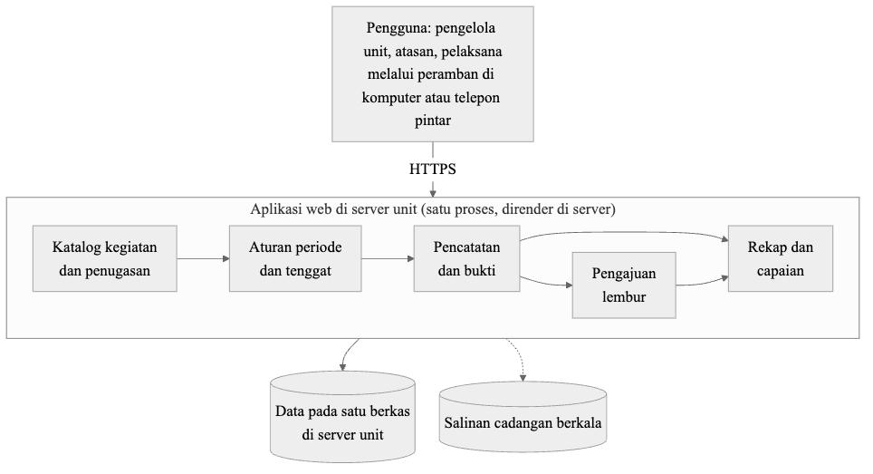
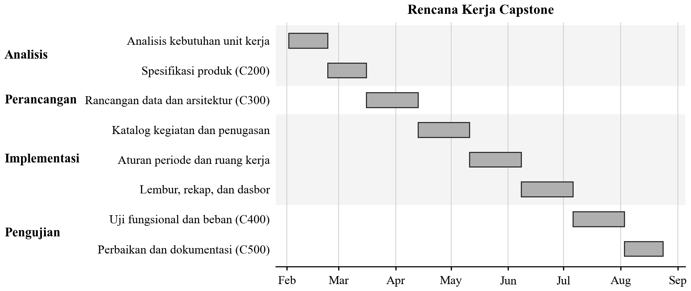

# RANCANG BANGUN SISTEM PENUGASAN, PELAPORAN KINERJA, DAN PENGAJUAN LEMBUR BERBASIS PERIODE UNTUK UNIT KERJA DI LINGKUNGAN KAMPUS

**PROPOSAL PROYEK DESAIN CAPSTONE**

[Nama Program Studi] — [Nama Fakultas]
[Nama Universitas]

Disusun oleh:

- [Nama Anggota 1] — [NIM]
- [Nama Anggota 2] — [NIM]
- [Nama Anggota 3] — [NIM]

Dosen Pembimbing:

- [Nama Pembimbing 1] (Utama)
- [Nama Pembimbing 2]

[Kota], [Tahun]

---

# Halaman Identitas

| Field | Isi |
|:---|:---|
| Topik Capstone | Sistem Informasi Penugasan dan Pelaporan Kinerja Unit Kerja |
| Mitra | Unit kerja di lingkungan Fakultas Teknik, Universitas Muhammadiyah Surabaya |
| Siklus / Tahun | [Gasal/Genap] / [tahun] |
| Judul | Rancang Bangun Sistem Penugasan, Pelaporan Kinerja, dan Pengajuan Lembur Berbasis Periode untuk Unit Kerja di Lingkungan Kampus |
| Jenis Dokumen | PROPOSAL |
| Nomor Dokumen | C100.[NoRev]TA[tahun].[1/2].[KodeKelompok] |
| Nomor Revisi | [NoRev] |
| Tanggal Penerbitan | [tanggal] |
| Unit Penerbit | [Nama Program Studi], [Nama Universitas] |
| Jumlah Halaman | [jumlah] halaman (tidak termasuk sampul) |
| Nama File | [KodeKelompok].pdf |

## Data Pengusul

| No | Nama | NIM | Peminatan | Peran dalam tim | Tanda Tangan |
|:---|:---|:---|:---|:---|:---|
| 1 | [Nama] | [NIM] | Rekayasa Perangkat Lunak | Pengembang antarmuka dan aturan periode | |
| 2 | [Nama] | [NIM] | Sistem Informasi / Basis Data | Perancang data dan perhitungan rekap | |
| 3 | [Nama] | [NIM] | Keamanan Sistem | Otorisasi, sesi, dan pemasangan di server | |

## Pembimbing

| Peran | Nama | NIP | Tanda Tangan |
|:---|:---|:---|:---|
| Pembimbing 1 (Utama) | [Nama] | [NIP] | |
| Pembimbing 2 | [Nama] | [NIP] | |

## Riwayat Revisi

| No | Tanggal | Revisi | Penyusun |
|:---|:---|:---|:---|
| 1 | [tanggal] | Draf awal seluruh bab | Tim |
| 2 | | | |

---

# Daftar Isi

- [Halaman Identitas](#halaman-identitas)
  - [Data Pengusul](#data-pengusul)
  - [Pembimbing](#pembimbing)
  - [Riwayat Revisi](#riwayat-revisi)
- [Daftar Gambar](#daftar-gambar)
- [Daftar Tabel](#daftar-tabel)
- [1. Pendahuluan](#1-pendahuluan)
  - [1.1 Ringkasan isi dokumen](#11-ringkasan-isi-dokumen)
  - [1.2 Aplikasi Dokumen](#12-aplikasi-dokumen)
  - [1.3 Fenomena](#13-fenomena)
  - [1.4 Referensi](#14-referensi)
  - [1.5 Daftar Singkatan](#15-daftar-singkatan)
- [2. Proposal Pengembangan Produk](#2-proposal-pengembangan-produk)
  - [2.1 Latar belakang masalah](#21-latar-belakang-masalah)
  - [2.2 Rumusan masalah](#22-rumusan-masalah)
  - [2.3 Tujuan](#23-tujuan)
  - [2.4 Pemilihan Solusi dan Analisis](#24-pemilihan-solusi-dan-analisis)
    - [2.4.1 Alternatif Solusi](#241-alternatif-solusi)
    - [2.4.2 Analisis Kelayakan Tiap Alternatif](#242-analisis-kelayakan-tiap-alternatif)
    - [2.4.3 Analisis Aspek Terkait](#243-analisis-aspek-terkait)
    - [2.4.4 Pemilihan Solusi](#244-pemilihan-solusi)
  - [2.5 Skenario pemanfaatan produk oleh stakeholder](#25-skenario-pemanfaatan-produk-oleh-stakeholder)
- [3. Usaha Pengembangan](#3-usaha-pengembangan)
  - [3.1 Man-month](#31-man-month)
  - [3.2 Machine-month](#32-machine-month)
  - [3.3 Development tools](#33-development-tools)
  - [3.4 Test equipment](#34-test-equipment)
  - [3.5 Kebutuhan pakar](#35-kebutuhan-pakar)
- [4. Kesimpulan](#4-kesimpulan)

# Daftar Gambar

| Nomor | Isi |
|:---|:---|
| Gambar 2.1 | Arsitektur high-level produk |
| Gambar 3.1 | Gantt chart man-month |

# Daftar Tabel

| Nomor | Isi |
|:---|:---|
| Tabel 1 | Alternatif solusi pengelolaan penugasan dan capaian kerja |
| Tabel 2 | Alternatif solusi platform aplikasi |
| Tabel 3 | Alternatif solusi teknik perenderan |
| Tabel 4 | Alternatif solusi penyimpanan data |
| Tabel 5 | Alternatif solusi autentikasi dan sesi |
| Tabel 6 | Rincian biaya pengembangan dan operasional per tahun |
| Tabel 7 | Manfaat berwujud dan cara perhitungannya per tahun |
| Tabel 8 | Komponen siap pakai dan komponen yang dibuat sendiri |
| Tabel 9 | Keterkaitan fitur dengan pemangku kepentingan |
| Tabel 10 | Alokasi jam kerja per anggota |
| Tabel 11 | Lama penggunaan mesin |
| Tabel 12 | Perhitungan machine-month |
| Tabel 13 | Instrumen pengujian |

---

# 1. Pendahuluan

## 1.1 Ringkasan isi dokumen

Dokumen ini memaparkan alasan pembuatan, analisis kebutuhan, dan usulan proses pengembangan sistem penugasan dan pelaporan kinerja bagi satu unit kerja di lingkungan kampus. Isinya menjadi dasar evaluasi selama proyek berlangsung sekaligus acuan teknis bagi tim pelaksana.

Mitra proyek ini adalah unit kerja di lingkungan Fakultas Teknik, Universitas Muhammadiyah Surabaya. Mitra memasok kebutuhan, aturan kerja, dan data nyata (Matriks Rencana Kerja beserta daftar pegawai), serta menjadi tempat sistem dipasang dan divalidasi; mitra tidak memakai sistem secara langsung dalam pembangunan, melainkan melalui perwakilan unit kerja yang berperan sebagai pengelola, atasan, dan pelaksana.

Tujuan dokumen ini ada tiga. Pertama, menjelaskan masalah nyata yang dihadapi unit kerja beserta alasan masalah tersebut tidak dapat diselesaikan dengan cara yang berjalan sekarang. Kedua, membuktikan bahwa solusi yang dipilih layak dilihat dari sisi teknis, waktu, biaya, dan keberlanjutan. Ketiga, menjadi catatan proses pengerjaan dan revisi selama tahap pengembangan.

## 1.2 Aplikasi Dokumen

Dokumen proposal ini diajukan kepada dosen pembimbing dan tim capstone program studi sebagai bahan penilaian. Ada tiga hal yang diharapkan dari dokumen ini. Pertama, memberikan gambaran umum teknis dan non-teknis atas pekerjaan yang akan dikerjakan. Kedua, memastikan kelayakan pekerjaan dari segi teknik, waktu, biaya, dan strategi pelaksanaan. Ketiga, menjadi catatan proses pengerjaan dan revisi sepanjang proyek berjalan.

## 1.3 Fenomena

Digitalisasi layanan kepegawaian sudah menjadi arah yang ditempuh banyak instansi, bukan pilihan yang luar biasa. Sistem informasi kepegawaian dipakai untuk memusatkan data pegawai dan mengotomasi proses yang sebelumnya dikerjakan manual, seperti penggajian, kenaikan pangkat, dan pemutakhiran data [3]. Alasan yang disebutkan berulang kali sederhana: beban kerja manual berkurang, data lebih cepat diakses, dan keputusan dapat diambil lebih tepat waktu [3].

Penerapannya, bagaimanapun, tidak berhenti pada penyediaan aplikasi. Kajian atas transformasi digital layanan kepegawaian di lingkungan pemerintah daerah menemukan bahwa kesulitan terbesar justru berada pada layanan yang masih dikerjakan manual, termasuk pelaporan kinerja harian, dan bahwa perpindahan ke bentuk digital menuntut penyesuaian proses kerja, bukan sekadar pengadaan perangkat lunak [1]. Masalahnya bukan "belum ada aplikasi", melainkan "aplikasi yang ada belum memuat cara kerja yang sebenarnya".

Di unit kerja kecil, hambatannya kemudian berpindah ke orang dan fasilitas. Pengalaman penerapan aplikasi e-kinerja di tingkat kecamatan menunjukkan dua kendala yang berulang: pemahaman teknologi pengguna yang belum merata dan fasilitas pendukung yang minim di unit kerja [2]. Ini menjelaskan mengapa sistem yang secara teknis berjalan baik tetap tidak terpakai — penggunanya bukan pengguna teknis, dan unit kerjanya tidak memiliki tenaga khusus untuk mengoperasikannya.

Ketiga temuan di atas berasal dari instansi pemerintah dengan struktur kepegawaian yang mapan dan unit teknologi informasi tersendiri. Unit kerja di lingkungan kampus memiliki bentuk yang berbeda: jumlah pegawai kecil, tidak ada unit teknologi informasi yang menaungi, rencana kerja disusun per periode berulang, dan penugasan diberikan langsung oleh atasan kepada pelaksana. Pada bentuk seperti ini, persoalan yang muncul bukan penggajian atau kenaikan pangkat, melainkan pencatatan siapa mengerjakan apa pada periode mana, bukti pekerjaannya, dan bagaimana capaiannya direkap — dan bagian itulah yang menjadi lingkup pekerjaan ini.

## 1.4 Referensi

[1] K. T. Hermawan, I. G. Pusparani, and D. Solihudin, "Digital transformation of personnel services in Cirebon City local government," *Jurnal Studi Kebijakan Publik*, vol. 2, no. 1, pp. 13–26, 2023, doi: 10.21787/jskp.2.2023.13-26.

[2] A. C. F. Gae and A. Ardieansyah, "Implementasi aplikasi E-Kinerja untuk meningkatkan kinerja ASN di Kecamatan Ende Timur," *Jurnal Abdi Masyarakat Indonesia*, vol. 5, no. 3, pp. 1081–1090, 2025, doi: 10.54082/jamsi.1895.

[3] S. Waldi, P. Andini, R. Ilahi, and Y. Hanoselina, "Pengaruh penggunaan sistem informasi kepegawaian terhadap kualitas pelayanan administrasi di sektor publik," *Perspektif Administrasi Publik dan Hukum*, vol. 1, no. 4, pp. 61–72, 2025, doi: 10.62383/perspektif.v2i1.86.

[4] Republik Indonesia, *Undang-Undang Nomor 27 Tahun 2022 tentang Pelindungan Data Pribadi*. Jakarta: Sekretariat Negara, 2022.

[5] Republik Indonesia, *Undang-Undang Nomor 19 Tahun 2016 tentang Perubahan atas Undang-Undang Nomor 11 Tahun 2008 tentang Informasi dan Transaksi Elektronik*. Jakarta: Sekretariat Negara, 2016.

[6] International Engineering Alliance, *Graduate Attributes and Professional Competences*, Version 4. Wellington: IEA, 2021.

[7] Republik Indonesia, *Peraturan Pemerintah Nomor 30 Tahun 2019 tentang Penilaian Kinerja Pegawai Negeri Sipil*. Jakarta: Sekretariat Negara, 2019.

## 1.5 Daftar Singkatan

| Akronim | Pengertian |
|:---|:---|
| ASN | Aparatur Sipil Negara |
| COTS | *Commercial Off-The-Shelf* |
| CRUD | *Create, Read, Update, Delete* |
| HTTPS | *Hypertext Transfer Protocol Secure* |
| RBAC | *Role-Based Access Control* |
| RPO | *Recovery Point Objective* |
| RTO | *Recovery Time Objective* |
| SIMPEG | Sistem Informasi Manajemen Kepegawaian |
| SKP | Sasaran Kinerja Pegawai |
| SSR | *Server-Side Rendering* |
| TLS | *Transport Layer Security* |

---

# 2. Proposal Pengembangan Produk

## 2.1 Latar belakang masalah

Mitra proyek ini adalah unit kerja di lingkungan Fakultas Teknik, Universitas Muhammadiyah Surabaya. Pihak yang terdampak masalahnya tiga lapis: pengelola unit yang menyusun rencana kerja dan rekap, atasan langsung yang memberi dan memantau penugasan, dan pelaksana yang mengerjakan serta membuktikan pekerjaannya. Kondisi saat ini pada mitra adalah sebagai berikut.

Unit kerja di lingkungan kampus memiliki rencana kerja yang disusun tiap periode: daftar kegiatan, penanggung jawab, tenggat, dan perkiraan waktu penyelesaian. Rencana itu menjadi dasar pembagian tugas sehari-hari, dan biasanya sudah tersedia dalam bentuk lembar kerja yang tersimpan pada komputer pengelola unit.

Masalahnya muncul satu lapis di bawah rencana tersebut. Rencana kerja mendefinisikan apa yang harus dikerjakan, tetapi tidak mencatat siapa yang mengerjakan dan kapan diselesaikan. Penugasan disampaikan secara lisan atau melalui pesan singkat, sehingga ketika ditanyakan, jawabannya bergantung pada ingatan orang yang menugaskan maupun yang mengerjakan.

Bukti pekerjaan juga tidak menetap di satu tempat. Sebagian tersimpan di surel, sebagian di grup pesan, sebagian pada berkas di komputer masing-masing pelaksana. Karena tidak ada satu tempat yang mengikat bukti pada periode kerja tertentu, bukti yang ditemukan belakangan sulit dipastikan milik periode mana, dan capaian yang dilaporkan tidak dapat diperiksa ulang.

Rekap capaian dikerjakan manual pada akhir bulan atau akhir tahun. Prosesnya memakan waktu, rawan keliru, dan tidak dapat dibandingkan antarbagian karena tiap orang menyusun rekapnya dengan cara sendiri. Akibatnya capaian yang dilaporkan lebih mencerminkan kerapian penyusunnya daripada banyaknya pekerjaan yang benar-benar selesai.

Di sisi lain, pengajuan lembur tidak terikat pada pekerjaan yang tercatat, sehingga tidak ada dasar untuk menilai kewajarannya. Sementara itu pemulihan kata sandi dan pengelolaan data pegawai bergantung pada satu orang, sehingga pekerjaan lain terhambat ketika yang bersangkutan tidak tersedia.

Penyelesaiannya tidak cukup dengan membuat formulir digital. Ia menuntut pemodelan periode kerja berulang, dari harian sampai tahunan, yang menentukan kapan sebuah tugas muncul, kapan dianggap terlambat, dan kapan berhenti berulang; penetapan hak akses atas data kinerja orang lain; serta penanganan data pribadi pegawai. Dengan demikian masalah ini melibatkan isu teknis sekaligus non-teknis, dan menyentuh lebih dari satu pemangku kepentingan dengan kebutuhan yang berbeda.

## 2.2 Rumusan masalah

Masalah dirumuskan dari kondisi nyata di unit kerja mitra (Fakultas Teknik, Universitas Muhammadiyah Surabaya):

1. (P1) Unit kerja belum memiliki catatan yang menunjukkan siapa mengerjakan tugas apa pada periode apa, sehingga capaian kerja tidak dapat dibuktikan.
2. (P2) Bukti pekerjaan tersimpan di banyak tempat dan tidak melekat pada periode kerja, sehingga sulit ditelusuri ketika diperlukan.
3. (P3) Rekap capaian disusun manual dari ingatan pelaksana, sehingga memakan waktu dan tidak dapat dibandingkan antarbagian.
4. (P4) Pengajuan lembur tidak terikat pada pekerjaan yang tercatat, sehingga tidak memiliki dasar penilaian.
5. (P5) Pemulihan akses akun bergantung pada satu orang, sehingga menghambat pekerjaan lain ketika yang bersangkutan tidak tersedia.

## 2.3 Tujuan

### A. Tujuan umum

Mengembangkan sistem penugasan dan pelaporan kinerja berbasis periode untuk satu unit kerja di lingkungan kampus, yang mengikat setiap capaian pada periode, bukti, dan pemberi tugas, serta menyediakan rekap yang dihitung dari data tercatat.

### B. Tujuan khusus

| Anggota | Peminatan | Tujuan khusus | Luaran |
|:---|:---|:---|:---|
| 1 | Rekayasa Perangkat Lunak | Merancang dan membangun aturan periode, ruang kerja pelaksana, serta tampilan capaian | Modul periode, ruang kerja, dasbor |
| 2 | Sistem Informasi / Basis Data | Merancang struktur data, migrasi, dan perhitungan rekap capaian | Skema data, modul rekap |
| 3 | Keamanan Sistem | Menerapkan hak akses per peran, sesi, validasi masukan, dan pemasangan pada server unit | Modul otorisasi, panduan pemasangan |

## 2.4 Pemilihan Solusi dan Analisis

### 2.4.1 Alternatif Solusi

Lima keputusan ditetapkan lebih dahulu; tabel di bawah disajikan sebagai komparasi, bukan sebagai proses pemilihan yang masih terbuka. Kolom Status menyatakan hasilnya di muka.

#### A. Pengelolaan penugasan dan capaian kerja

**Tabel 1. Alternatif solusi pengelolaan penugasan dan capaian kerja**

| Solusi | Deskripsi | Status |
|:------------|:--------------------------------------------------|:----------------|
| Melanjutkan cara yang berjalan sekarang | Rencana kerja pada lembar kerja, penugasan lisan atau lewat pesan, rekap manual di akhir periode. Tanpa biaya dan tanpa perubahan kebiasaan, tetapi tidak ada catatan pelaksana, bukti tidak melekat pada periode, dan capaian tidak dapat ditelusuri. | Tidak dipilih — justru menjadi kondisi awal yang harus diperbaiki |
| Aplikasi manajemen tugas yang sudah jadi | Aplikasi pengelola tugas berbasis langganan atau versi gratis. Segera dipakai, tetapi strukturnya mengikuti model kartu dan tenggat sekali selesai, bukan periode kerja berulang; capaian per periode tidak terbentuk sendiri, dan data tersimpan di luar kendali unit. | Tidak dipilih |
| **Aplikasi yang dibangun untuk unit ini** | Memodelkan langsung kosakata kerja unit: aktivitas berperiode, kemunculan per periode, pemberi tugas, bukti per periode, dan pengajuan lembur. Struktur data, hak akses, dan alur kerja mengikuti kebutuhan unit; seluruh data berada di lingkungan kampus. | **Dipilih** |

#### B. Platform aplikasi

**Tabel 2. Alternatif solusi platform aplikasi**

| Solusi | Deskripsi | Status |
|:------------|:--------------------------------------------------|:----------------|
| **Aplikasi web** | Diakses lewat peramban pada alamat yang disediakan server unit. Tidak ada pemasangan pada komputer pengguna, pembaruan cukup sekali di server, dan seluruh data berada pada satu tempat sehingga capaian antarpegawai dapat dilihat bersama. Tata letak menyesuaikan layar, dari telepon pintar hingga komputer meja. | **Dipilih** |
| Aplikasi desktop | Program yang dipasang pada tiap komputer. Cepat dan dapat bekerja tanpa jaringan, tetapi harus dipasang dan diperbarui satu per satu, data tersimpan per komputer atau pada berkas bersama yang rawan tertimpa, dan capaian hanya dapat dilihat dari komputer pemegang data. Untuk unit dengan pegawai di beberapa ruang, ini memindahkan masalah pencatatan dari kertas ke berkas, bukan menyelesaikannya. | Tidak dipilih |
| Aplikasi mobile | Program yang dipasang pada telepon pintar. Paling dekat dengan kebiasaan pengguna, tetapi menuntut pembangunan dan pemeliharaan terpisah per sistem operasi, distribusi melalui toko aplikasi atau pemasangan berkas manual, serta layar sempit yang menyulitkan tampilan tabel dan grafik capaian. Aplikasi mobile juga tetap memerlukan server untuk menyatukan data, sehingga tidak menghilangkan kebutuhan pada pilihan pertama. | Tidak dipilih pada tahap ini |

#### C. Teknik perenderan di dalam platform web

**Tabel 3. Alternatif solusi teknik perenderan**

| Solusi | Deskripsi | Status |
|:------------|:--------------------------------------------------|:----------------|
| Halaman statis dengan penyimpanan di peramban | Seluruhnya berjalan di peramban tanpa server. Paling murah dan tanpa pemasangan, tetapi data terkurung pada satu peramban, tidak ada kendali akses antarpengguna, dan capaian tidak dapat digabung. | Tidak dipilih |
| Aplikasi satu halaman dengan API terpisah | Antarmuka dan API berupa dua bagian terpisah. Interaksi terasa halus setelah pemuatan awal, tetapi beban awal lebih besar, konten tidak tersedia sebelum skrip berjalan, dan ada dua hal yang harus dijalankan serta dipantau. | Tidak dipilih |
| **Perenderan di server dalam satu proses** | Satu proses merender halaman dan melayani perubahan data. Beban peramban kecil, konten tersedia sebelum skrip berjalan, otorisasi dan akses data berada di satu tempat. Kapasitas ditambah dengan menaikkan sumber daya server. | **Dipilih** |

#### D. Penyimpanan data

**Tabel 4. Alternatif solusi penyimpanan data**

| Solusi | Deskripsi | Status |
|:------------|:--------------------------------------------------|:----------------|
| Berkas lembar kerja | Berkas spreadsheet yang dibuka bersama. Mudah diperiksa manusia, tetapi tanpa kendali akses per baris, rawan tertimpa saat dibuka bersamaan, dan tidak dapat dipakai aplikasi tanpa langkah impor manual. | Tidak dipilih |
| Basis data klien–server | Layanan basis data relasional tersendiri. Mampu menangani banyak penulis bersamaan dan sudah mapan, tetapi menambah satu layanan yang harus dipasang, dikonfigurasi, dicadangkan, dan dipantau di server unit. | Tidak dipilih |
| **Basis data tertanam** | Berjalan di dalam proses aplikasi, data tersimpan pada satu berkas. Tanpa layanan terpisah, pencadangan cukup menyalin berkas, data mudah dipindahkan. Penulisan bersifat satu penulis — memadai untuk satu instans dengan pengguna terbatas, tetapi tidak untuk dua instans terhadap berkas yang sama. | **Dipilih** |

#### E. Autentikasi dan sesi

**Tabel 5. Alternatif solusi autentikasi dan sesi**

| Solusi | Deskripsi | Status |
|:------------|:--------------------------------------------------|:----------------|
| Tanpa kata sandi, cukup pemilihan nama | Pengguna memilih namanya dari daftar tanpa verifikasi. Paling ringan, tetapi tidak ada jaminan identitas — siapa pun dapat membuka dan mengubah catatan orang lain. | Tidak dipilih — tidak layak untuk data kinerja dan pengajuan lembur |
| **Akun lokal dengan sesi cookie bertanda tangan** | Akun dibuatkan pengelola unit, kata sandi disimpan sebagai hash dan diverifikasi saat login, identitas serta peran disimpan pada cookie bertanda tangan yang tidak dapat dibaca peramban. Mandiri, tidak bergantung layanan luar, peran diperiksa ulang setiap permintaan. | **Dipilih** |
| Login tunggal (SSO) kampus | Memakai akun kampus yang sudah dimiliki pegawai. Menghilangkan pengelolaan kata sandi, tetapi bergantung pada ketersediaan dan kebijakan penyedia identitas kampus serta menuntut koordinasi dengan pengelola TI. | Tidak dipilih pada tahap ini — dicatat sebagai arah pengembangan |

### 2.4.2 Analisis Kelayakan Tiap Alternatif

Kelayakan dinilai pada empat aspek — teknis, operasional, ekonomis, dan waktu — untuk setiap kelompok alternatif pada 2.4.1. Kesimpulan per alternatif dirangkum pada akhir bagian ini.

#### A. Kelayakan alternatif pengelolaan penugasan dan capaian kerja (Tabel 1)

| Aspek | Melanjutkan cara sekarang | Aplikasi jadi | Aplikasi buatan sendiri |
|:---|:---|:---|:---|
| Teknis | Tidak ada komponen baru; masalah tetap karena catatan memang tidak dibuat | Berjalan pada infrastruktur penyedia; struktur data tidak dapat diubah | Dapat dibangun dengan teknologi yang sudah dikuasai tim dan berjalan di server yang sudah ada |
| Operasional | Beban kerja manual tetap; bergantung pada ingatan dan kedisiplinan | Perlu adaptasi kebiasaan ke model kartu–tenggat; capaian per periode tetap dihitung manual | Mengikuti kosakata kerja unit; pelatihan singkat karena alur meniru cara kerja sekarang |
| Ekonomis | Tanpa biaya, tetapi biaya tersembunyi berupa waktu rekap manual terus terjadi | Langganan per pengguna per tahun; biaya berulang selama dipakai | Biaya pembangunan ditanggung proyek capstone; tanpa biaya lisensi dan langganan |
| Waktu | Bukan penyelesaian | Terpakai cepat, tetapi masalah inti tidak tertutup | Jadwal mengikuti tahap capstone C100–C500; terpasang sebelum akhir proyek |
| **Kesimpulan** | Tidak layak — justru kondisi awal yang diperbaiki | Tidak layak untuk masalah inti — struktur data tidak memuat periode | **Layak dan dipilih** |

#### B. Kelayakan alternatif platform aplikasi (Tabel 2)

| Aspek | Aplikasi web | Aplikasi desktop | Aplikasi mobile |
|:---|:---|:---|:---|
| Teknis | Berjalan pada peramban apa pun di server unit; satu tempat pembaruan | Harus dibangun dan diperbarui per komputer; data terpisah per mesin | Dua basis kode per sistem operasi; tetap butuh server penyatu data |
| Operasional | Tanpa pemasangan; pengguna non-teknis cukup membuka alamat | Pemasangan dan pembaruan satu per satu oleh pengelola | Distribusi lewat toko aplikasi atau berkas manual; pemeliharaan berat |
| Ekonomis | Tanpa biaya distribusi | Biaya kemasan dan penyebaran per komputer | Biaya akun toko aplikasi dan pemeliharaan ganda |
| Waktu | Satu jalur pembangunan | Jalur pembangunan serupa dengan distribusi lebih lambat | Paling lama; pembangunan ganda per platform |
| **Kesimpulan** | **Layak dan dipilih** | Tidak layak — memecah data per komputer | Tidak layak pada tahap ini |

#### C. Kelayakan alternatif teknik perenderan (Tabel 3)

| Aspek | Statis di peramban | SPA dengan API terpisah | Perenderan di server |
|:---|:---|:---|:---|
| Teknis | Tanpa server; tidak ada kendali akses dan penyatuan data | Dua bagian yang harus konsisten; otorisasi terpisah dari tampilan | Satu proses; otorisasi dan akses data di satu tempat |
| Operasional | Data terkurung per peramban; tidak dapat dipakai bersama | Beban awal peramban besar; peramban lama di unit berisiko | Halaman ringan untuk peramban lama dan jaringan kampus yang tidak stabil |
| Ekonomis | Paling murah, tetapi tidak memenuhi kebutuhan | Dua hal yang dipantau untuk ukuran unit sekecil ini | Satu proses pada server yang sudah ada |
| Waktu | Bukan penyelesaian | Waktu pembangunan dan pemantauan lebih panjang | Jalur paling langsung dengan kapasitas naik secara vertikal |
| **Kesimpulan** | Tidak layak | Tidak layak — biaya tanpa manfaat sepadan | **Layak dan dipilih** |

#### D. Kelayakan alternatif penyimpanan data (Tabel 4)

| Aspek | Berkas lembar kerja | Basis data klien–server | Basis data tertanam |
|:---|:---|:---|:---|
| Teknis | Tanpa kendali akses per baris; rawan tertimpa saat dibuka bersamaan | Mampu banyak penulis bersamaan; mapan | Satu penulis; transaksi dan integritas dijamin mesin basis data |
| Operasional | Tidak dapat dipakai aplikasi tanpa impor manual | Layanan tambahan yang dipasang, dikonfigurasi, dicadangkan, dipantau | Terpasang bersama aplikasi; cadangan cukup menyalin satu berkas |
| Ekonomis | Tanpa biaya, tetapi risiko kehilangan data tinggi | Biaya operasional dan kebutuhan tenaga pemeliharaan bertambah | Tanpa layanan tambahan pada server unit |
| Waktu | Bukan penyelesaian | Penyiapan layanan memakan waktu yang tidak sepadan untuk pengguna terbatas | Selesai bersama aplikasi |
| **Kesimpulan** | Tidak layak | Tidak layak pada skala ini — kemampuan lebih dari kebutuhan | **Layak dan dipilih**; batas satu penulis diterima dengan jalur migrasi ke klien–server bila perlu |

#### E. Kelayakan alternatif autentikasi dan sesi (Tabel 5)

| Aspek | Pilih nama tanpa kata sandi | Akun lokal + cookie bertanda tangan | SSO kampus |
|:---|:---|:---|:---|
| Teknis | Tanpa verifikasi identitas; catatan siapa pun dapat diubah siapa pun | Hash kata sandi; identitas dan peran diperiksa ulang di server tiap permintaan | Bergantung pada penyedia identitas kampus dan protokol yang didukungnya |
| Operasional | Tidak ada perlindungan sama sekali | Akun dibuatkan pengelola; pemulihan terpusat | Menuntut koordinasi dengan pengelola TI kampus yang waktunya di luar kendali tim |
| Ekonomis | — | Tanpa biaya; mandiri | Biaya koordinasi dan ketergantungan layanan |
| Waktu | — | Dapat diterapkan segera | Menunda pekerjaan tanpa nilai tambah sekarang |
| **Kesimpulan** | Tidak layak — melanggar kebutuhan dasar data kinerja | **Layak dan dipilih** | Tidak layak pada tahap ini; dicatat sebagai arah pengembangan |

#### F. Ringkasan

Seluruh kelompok alternatif mengarah pada satu kombinasi yang sama: aplikasi web buatan sendiri yang dirender di server, memakai basis data tertanam, dengan akun lokal dan sesi cookie bertanda tangan. Kelayakan ekonomis, manufakturabilitas, sustainibilitas, serta legal dan etika atas kombinasi tersebut dibahas pada 2.4.3.

### 2.4.3 Analisis Aspek Terkait

#### A. Aspek ekonomis

Analisis ekonomis disusun dari dua sisi: biaya yang dikeluarkan dan manfaat yang diperoleh. Seluruh komponen biaya maupun manfaat dinyatakan dalam rupiah per tahun agar dapat dibandingkan.

**Tabel 6. Rincian biaya pengembangan dan operasional per tahun**

| Kategori | Item | Biaya (Rp) | Keterangan |
|:---|:---|:---|:---|
| Pengembangan | Tenaga kerja tim | 0 | Dikerjakan tim capstone, dibiayai sebagai waktu, bukan rupiah |
| Pengembangan | Lisensi perangkat lunak | 0 | Seluruhnya perangkat lunak terbuka |
| Pengembangan | Perangkat kerja | 0 | Laptop masing-masing anggota |
| Operasional | Server unit | 0 | Memakai server yang sudah tersedia di unit |
| Operasional | Sertifikat TLS | 0 | Disediakan lembaga sertifikat gratis |
| Operasional | Pemeliharaan | [UKUR] | Pencadangan berkas dan pembaruan berkala |
| **Total** | | **[UKUR]** | |

**Tabel 7. Manfaat berwujud dan cara perhitungannya per tahun**

| Item | Perhitungan | Nilai (Rp) |
|:---|:---|:---|
| Penghematan waktu rekap | [UKUR] jam/bulan × [UKUR] Rp/jam × 12 | [UKUR] |
| Penghematan waktu distribusi tugas | [UKUR] menit/tugas × [UKUR] tugas/bulan × [UKUR] Rp/jam | [UKUR] |
| Penghindaran kesalahan rekap | [UKUR] kejadian/tahun × [UKUR] Rp/kejadian | [UKUR] |
| **Total manfaat berwujud** | | **[UKUR]** |

Manfaat tak berwujud tidak dinilai dalam rupiah, tetapi tetap dicatat sebagai bagian dari kelayakan: ketertelusuran bukti per periode, kecepatan pencarian riwayat pekerjaan, kesetaraan cara rekap antarbagian sehingga capaian dapat dibandingkan, serta hilangnya ketergantungan pada satu orang untuk pemulihan akun.

Dari kedua sisi tersebut dihitung satu metrik keuangan, yaitu payback period:

*Payback period* = total biaya pengembangan ÷ penghematan per bulan

Karena biaya pengembangan dan lisensi bernilai nol, payback period tercapai pada bulan pertama penggunaan. Pernyataan ini disertai asumsi yang terbuka: biaya tenaga kerja tim tidak dihitung sebagai rupiah melainkan sebagai waktu pengerjaan, dan nilai penghematan diambil dari pengukuran waktu rekap sebelum dan sesudah penerapan, bukan perkiraan.

#### B. Aspek manufakturabilitas

Ketersediaan komponen. Seluruh perangkat lunak yang dipakai tersedia bebas, dirilis berkala, dan didokumentasikan. Tidak ada pustaka berbayar maupun komponen yang harus dipesan khusus, sehingga pekerjaan tidak bergantung pada pengadaan.

**Tabel 8. Komponen siap pakai dan komponen yang dibuat sendiri**

| Komponen siap pakai (COTS) | Komponen yang dibuat sendiri |
|:---|:---|
| Kerangka kerja aplikasi, kerangka gaya tampilan, pustaka ikon, pustaka animasi | Aturan periode kerja, penentuan keterlambatan, perhitungan capaian |
| Pustaka basis data tertanam, pustaka hashing kata sandi, pustaka validasi masukan | Alur penugasan langsung, alur pengajuan lembur, panel progres |
| Pustaka markdown untuk pengumuman unit | Tata letak halaman ruang kerja dan dasbor capaian |

Kebutuhan khusus lingkungan operasional. Lingkungannya tidak keras secara fisik, tetapi terbatas: satu server kecil, jaringan kampus yang tidak selalu stabil, peramban beragam termasuk versi lama, dan pengguna non-teknis. Konsekuensi rancangan yang diambil: halaman dirender di server agar peramban tidak berat, tidak ada unggahan berkas besar karena bukti berupa tautan, dependensi dijaga minimum, dan mode penulisan basis data yang tahan kegagalan diaktifkan.

Skalabilitas dan kemudahan pemeliharaan. Sistem berjalan sebagai satu server, satu berkas data, satu proses. Pemasangan ulang cukup menyalin berkas dan menjalankan satu perintah. Penambahan jenis kegiatan tidak memerlukan perubahan kode. Bila kapasitas terlampaui, jalur keluarnya adalah memindahkan data ke basis data klien–server, dan karena seluruh akses data sudah dipusatkan pada satu modul, lapisan tampilan tidak perlu disentuh.

#### C. Aspek sustainibilitas

Efisiensi energi. Sistem menempati satu proses kecil pada server yang sudah menyala untuk keperluan lain, tanpa unit pemrosesan grafis dan tanpa penambahan mesin.

Manajemen sumber daya. Bukti pekerjaan disimpan sebagai tautan, bukan berkas biner, sehingga tidak menambah kebutuhan penyimpanan. Kueri memakai indeks pada kolom yang sering disaring, dan jumlah periode per penugasan dibatasi agar perhitungan tidak tumbuh tanpa batas.

Efisiensi desain. Penambahan unit kerja, kegiatan, dan pengguna tidak menuntut perubahan kode. Jenis periode baru hanya menambah satu pemetaan pada aturan yang sudah ada.

Kelangsungan jangka panjang. Seluruhnya perangkat lunak terbuka tanpa biaya berulang. Data berada pada satu berkas yang dapat dicadangkan, dipindahkan, dan dibaca kembali tanpa ketergantungan pada vendor tertentu.

#### D. Aspek tambahan — legal dan etika

Aspek legal. Sistem menyimpan data pribadi pegawai: nama, surel, jabatan, catatan login berisi alamat IP dan peramban, catatan pekerjaan, serta riwayat pengajuan lembur. Karena itu diberlakukan ketentuan dari Undang-Undang Pelindungan Data Pribadi [4] dan Undang-Undang Informasi dan Transaksi Elektronik [5]: pembatasan tujuan pengumpulan, pembatasan siapa yang dapat melihat data siapa, serta kewajiban menjaga kerahasiaan data yang disimpan. Rujukan pada ketentuan penilaian kinerja pegawai [7] dipakai untuk memastikan istilah dan alur yang dipakai tidak bertentangan dengan praktik yang berlaku.

Aspek etika. Sistem ini mencatat dan menilai kinerja orang, sehingga ada dua isu yang wajib dibahas. Pertama, batas antara transparansi dan pengawasan: data yang tercatat seharusnya dipakai untuk memudahkan pekerjaan, bukan untuk mengawasi tanpa sepengetahuan yang diawasi. Kedua, keterbukaan atas apa yang dicatat: pegawai perlu mengetahui data apa tentang dirinya yang tersimpan dan siapa yang dapat melihatnya. Ketentuan yang diambil: atasan hanya melihat capaian atas tugas yang ia berikan sendiri, bukan seluruh riwayat pegawai, dan setiap pengguna dapat melihat rekap capaian dirinya sendiri.

### 2.4.4 Pemilihan Solusi

Susunan yang ditetapkan adalah aplikasi web yang dibangun khusus untuk unit ini, dirender di server dalam satu proses, menyimpan data pada basis data tertanam, dan mengautentikasi pengguna melalui akun lokal dengan sesi cookie bertanda tangan. Penetapan ini sudah diambil sebelum rincian alternatif disusun; Tabel 1 sampai Tabel 5 disajikan untuk menunjukkan bahwa pilihan tersebut memiliki dasar.

Pengelolaan penugasan. Cara yang berjalan sekarang tidak dipilih karena justru menjadi masalah yang hendak diselesaikan. Aplikasi jadi tidak dipilih karena kosakata kerjanya berbeda: unit ini bekerja dalam periode berulang, sedangkan aplikasi jadi bekerja dengan kartu dan tenggat sekali selesai — menyesuaikannya berarti setiap periode dibuat manual dan capaian tetap dihitung sendiri. Aplikasi yang dibangun untuk unit ini dipilih karena aturan periode, keterlambatan, pemberi tugas, dan bukti per periode menjadi bagian dari struktur data, bukan kebiasaan pengguna.

Platform. Aplikasi desktop tidak dipilih karena memecah data per komputer, padahal kebutuhan utamanya justru melihat capaian antarpegawai dalam satu unit; data yang terkunci pada satu mesin tidak dapat dipakai atasan untuk memantau maupun pengelola untuk merekap. Aplikasi mobile tidak dipilih karena menuntut pembangunan dan pemeliharaan terpisah per sistem operasi, distribusi lewat toko aplikasi atau pemasangan manual, serta layar sempit yang menyulitkan tampilan tabel dan grafik. Kebutuhan yang paling mendesak dari mobile — akses cepat saat berpindah ruang — sudah terpenuhi oleh aplikasi web yang menyesuaikan lebar layar tanpa pemasangan apa pun. Aplikasi web dipilih karena satu pembaruan di server berlaku untuk semua pengguna dan seluruh data berada pada satu tempat.

Teknik perenderan. Halaman statis tidak dipilih karena tidak memiliki kendali akses dan tidak dapat menyatukan data antarpengguna. Aplikasi satu halaman dengan API terpisah tidak dipilih karena menambah bagian yang harus dijalankan dan dipantau tanpa manfaat sepadan pada ukuran unit ini. Perenderan di server dipilih karena meringankan peramban pengguna, menyediakan konten sebelum skrip berjalan, dan menempatkan otorisasi pada satu tempat.

Penyimpanan data. Berkas lembar kerja tidak dipilih karena tidak memiliki kendali akses dan rawan tertimpa. Basis data klien–server tidak dipilih bukan karena kemampuannya kurang, melainkan karena menambah satu layanan yang harus dipasang, dikonfigurasi, dicadangkan, dan dipantau — pekerjaan yang tidak sepadan untuk satu instans dengan pengguna terbatas. Basis data tertanam dipilih karena pemasangan selesai bersama aplikasi, pencadangan cukup menyalin satu berkas, dan pemindahan data tidak memerlukan ekspor-impor. Batas satu penulis diterima secara sadar, dengan konsekuensi yang dinyatakan terbuka: kapasitas ditambah dengan menaikkan sumber daya server, bukan menambah instans.

Autentikasi. Pemilihan nama tanpa kata sandi ditolak karena data yang dikelola bersifat penilaian kinerja dan pengajuan lembur — tanpa verifikasi identitas, catatan siapa pun dapat diubah siapa pun. SSO kampus tidak dipilih pada tahap ini karena bergantung pada kebijakan dan ketersediaan layanan pengelola TI kampus; ketergantungan itu menunda pekerjaan tanpa menambah nilai sekarang, dan dicatat sebagai arah pengembangan. Akun lokal dengan cookie bertanda tangan dipilih karena mandiri, dapat diterapkan tanpa koordinasi lintas unit, dan tetap memungkinkan pemisahan hak akses per peran yang diperiksa ulang di server pada setiap permintaan.

## 2.5 Skenario pemanfaatan produk oleh stakeholder

Pengguna membuka satu alamat dari peramban apa pun di lingkungan kampus. Server unit merender halaman dan melayani perubahan data. Seluruh data berada pada server itu, dan salinan berkala disimpan terpisah. Tidak ada pemasangan pada komputer pengguna dan tidak ada layanan di luar kampus yang dilibatkan.

**Tabel 9. Keterkaitan fitur dengan pemangku kepentingan**

| Fitur | Pengelola unit | Atasan | Pelaksana | Nilai yang diperoleh |
|:---|:---:|:---:|:---:|:---|
| Katalog kegiatan dan periode | ✓ | — | — | Satu daftar kerja, tidak disusun ulang tiap orang |
| Penugasan dari katalog dan massal | ✓ | — | — | Distribusi cepat, beban kerja terlihat |
| Penugasan langsung | ✓ | ✓ | — | Tugas di luar rencana tetap tercatat |
| Ruang kerja per periode | — | ✓ | ✓ | Daftar kerja hari ini, urut prioritas |
| Catatan dan tautan bukti | — | ✓ | ✓ | Bukti melekat pada periode |
| Panel progres per periode | ✓ | ✓ | — | Pemantauan tanpa bertanya langsung |
| Rekap dan capaian pribadi | — | ✓ | ✓ | Umpan balik, bukan penilaian gelap |
| Pengajuan dan keputusan lembur | ✓ (putuskan) | ✓ (ajukan) | ✓ (ajukan) | Lembur berbasis pekerjaan tercatat |
| Pengelolaan akun dan pemulihan akses | ✓ | — | — | Tidak bergantung pada satu orang |
| Pengumuman unit | ✓ | — | — | Informasi terpusat |

Di lapangan, unit kerja memerlukan satu orang pengelola yang menyiapkan katalog kegiatan, mengelola akun, dan memutuskan pengajuan lembur; beberapa atasan yang memberikan penugasan langsung dan memantau progres; serta seluruh pelaksana yang mencatat penyelesaian dan bukti pekerjaannya.

---

# 3. Usaha Pengembangan

## 3.1 Man-month

Rencana kerja disusun dalam lima tahap yang mengikuti urutan dokumen capstone, dari analisis kebutuhan sampai dokumentasi akhir.

**Tabel 10. Alokasi jam kerja per anggota**

| No | Peran | Jam/bulan | Jumlah bulan | Total jam |
|:---|:---|:---|:---|:---|
| 1 | Pengembang antarmuka dan aturan periode | [UKUR] | [UKUR] | [UKUR] |
| 2 | Perancang data dan perhitungan rekap | [UKUR] | [UKUR] | [UKUR] |
| 3 | Keamanan dan pemasangan | [UKUR] | [UKUR] | [UKUR] |
| **Total** | | | | **[UKUR]** |

Angka pada tabel ini dipakai ulang pada 3.2 sehingga keduanya harus konsisten.

## 3.2 Machine-month

Perhitungan mengikuti rumus baku. Hari kerja jika bekerja 24 jam per hari adalah total jam pengerjaan dibagi 24. Machine-month adalah hari kerja tersebut dibagi 20, dengan asumsi satu bulan sama dengan 20 hari kerja.

**Tabel 11. Lama penggunaan mesin**

| Perangkat | Jam pakai/hari | Hari pakai | Total jam |
|:---|:---|:---|:---|
| Laptop anggota 1 | [UKUR] | [UKUR] | [UKUR] |
| Laptop anggota 2 | [UKUR] | [UKUR] | [UKUR] |
| Laptop anggota 3 | [UKUR] | [UKUR] | [UKUR] |

**Tabel 12. Perhitungan machine-month**

| Perangkat | Total jam | Hari jika 24 jam | Machine-month |
|:---|:---|:---|:---|
| Laptop anggota 1 | [UKUR] | total ÷ 24 | hari ÷ 20 |
| Laptop anggota 2 | [UKUR] | total ÷ 24 | hari ÷ 20 |
| Laptop anggota 3 | [UKUR] | total ÷ 24 | hari ÷ 20 |
| **Total** | **[UKUR]** | **[UKUR]** | **[UKUR]** |

## 3.3 Development tools

### 3.3.1 Perangkat keras

- **A. Laptop pengembang.** Satu unit per anggota, dengan spesifikasi [UKUR] (prosesor, memori, penyimpanan), digunakan untuk penulisan kode, pengujian lokal, dan penyusunan dokumen.
- **B. Server unit.** Satu unit di lingkungan kampus sebagai tempat pemasangan akhir, dengan spesifikasi minimum yang diajukan: 2 inti prosesor, memori 2 GB, penyimpanan 20 GB dengan ruang data yang persisten. Server ini juga menjadi lingkungan operasional, sehingga hasil pengujian di sini yang dilaporkan.
- **C. Perangkat pengujian tampilan.** Telepon pintar dan komputer meja untuk memeriksa tata letak pada lebar layar sempit dan lebar.

Tidak ada perangkat khusus, sensor, maupun aktuator yang digunakan. Pernyataan ini disampaikan eksplisit agar lingkup perangkat keras tidak disalahartikan.

### 3.3.2 Perangkat lunak

- **A. Runtime aplikasi.** Lingkungan eksekusi sisi server yang menjalankan seluruh aplikasi.
- **B. Kerangka kerja web.** Perenderan halaman di server, penanganan rute, dan mekanisme pemanggilan aksi dari peramban.
- **C. Kerangka gaya tampilan.** Penataan antarmuka dan penyesuaian tata letak pada berbagai lebar layar.
- **D. Basis data tertanam.** Penyimpanan data pada satu berkas dengan mode penulisan yang tahan kegagalan.
- **E. Pustaka autentikasi dan hashing kata sandi.** Verifikasi identitas dan penyimpanan kata sandi dalam bentuk hash.
- **F. Pustaka validasi masukan.** Pemeriksaan bentuk data di sisi server sebelum disimpan.
- **G. Pustaka animasi antarmuka.** Transisi dan umpan balik gerak yang halus.
- **H. Pustaka ikon.** Penanda visual yang konsisten pada seluruh halaman.
- **I. Pustaka markdown.** Perenderan teks pengumuman unit.
- **J. Pemeriksa tipe dan pengelola paket.** Menjaga konsistensi kode dan dependensi.
- **K. Pengendali versi.** Pencatatan riwayat perubahan kode.
- **L. Peramban dengan alat pengembang.** Pemeriksaan jaringan, waktu muat, dan perilaku halaman.
- **M. Alat uji otomatis peramban.** Menjalankan skenario uji berulang pada alur kritis.

## 3.4 Test equipment

**Data uji.** Akun uji untuk tiap peran, kegiatan dengan setiap jenis periode, penugasan dengan rentang tanggal berbeda, serta riwayat penyelesaian dan pengajuan lembur buatan. Data uji dibuat dan dihapus sendiri oleh skrip uji agar tidak mengganggu data unit.

**Skenario uji.** Pertama, fungsional alur utama dan alur negatif: tenggat lebih awal dari tanggal mulai, tugas di luar rentang, pengajuan lembur saat menit belum cukup, pengajuan ganda pada tanggal yang sama, serta permintaan pemulihan akun ganda. Kedua, hak akses lintas peran untuk memastikan peran rendah tidak dapat melakukan tindakan peran tinggi. Ketiga, beban dengan [UKUR] pengguna bersamaan. Keempat, aksesibilitas melalui pengoperasian dengan papan ketik dan pembaca layar. Kelima, tampilan pada lebar layar sempit hingga [UKUR] piksel tanpa luapan. Keenam, keandalan berupa pemulihan dari salinan cadangan.

**Tabel 13. Instrumen pengujian**

| Instrumen | Tujuan | Metrik yang dihasilkan |
|:---|:---|:---|
| Alat pengembang peramban | Mengukur waktu muat dan waktu tanggap aksi | Milidetik per halaman dan per aksi |
| Alat audit performa | Menilai efisiensi pemuatan halaman | Skor dan metrik inti pemuatan |
| Alat uji otomatis peramban | Menjalankan skenario fungsional berulang | Lulus atau gagal per skenario |
| Perintah pengukur waktu tanggap | Mengukur respons server tanpa peramban | Milidetik per permintaan |
| Pemeriksa tipe | Menemukan ketidaksesuaian tipe sebelum dijalankan | Jumlah dan jenis kesalahan |
| Perkakas basis data | Memeriksa jumlah baris, indeks, dan integritas | Jumlah baris, ukuran berkas |
| Pemeriksa aksesibilitas | Menemukan hambatan navigasi dan kontras | Daftar temuan |

Metrik dari tabel inilah yang mengisi angka target pada dokumen spesifikasi.

## 3.5 Kebutuhan pakar

Proyek ini tidak memerlukan pakar eksternal berbayar. Yang diperlukan adalah dosen pembimbing sebagai peninjau rancangan dan satu narasumber internal unit kerja — pengelola kepegawaian — untuk memastikan daftar kegiatan, jenis periode, dan jabatan sesuai kenyataan unit. Validasi dilakukan melalui wawancara dan peninjauan bersama, bukan konsultasi pakar.

---

# 4. Kesimpulan

a. Produk yang diusulkan adalah sistem penugasan dan pelaporan kinerja berbasis periode untuk satu unit kerja di lingkungan kampus, yang mengikat capaian pada periode, bukti, dan pemberi tugas.

b. Platform yang dipilih adalah aplikasi web yang dirender di server dalam satu proses, karena tidak menuntut pemasangan pada komputer pengguna dan menyatukan data sehingga capaian dapat dilihat bersama.

c. Penyimpanan data memakai basis data tertanam pada satu berkas, dengan batas satu penulis yang diterima secara sadar. Autentikasi memakai akun lokal dengan sesi cookie bertanda tangan, sementara login tunggal kampus dicatat sebagai arah pengembangan.

d. Cakupan fitur inti meliputi katalog kegiatan berperiode, penugasan dan penugasan langsung, ruang kerja per periode dengan bukti, panel progres, rekap capaian, pengajuan dan keputusan lembur, serta pengelolaan akun.

e. Batasan yang diakui sejak awal: tidak ada langkah persetujuan penyelesaian tugas oleh atasan, lembur hanya untuk hari berjalan dengan satu tingkat keputusan, tidak ada relasi atasan–bawahan yang tersimpan, notifikasi bersifat tarik, kapasitas ditambah secara vertikal, dan bukti berupa tautan bukan unggahan berkas.

f. Estimasi usaha pengembangan adalah [UKUR] man-month dan [UKUR] machine-month, dengan rincian pada Tabel 10 sampai Tabel 12.
