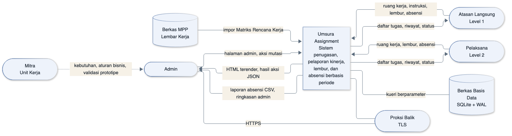
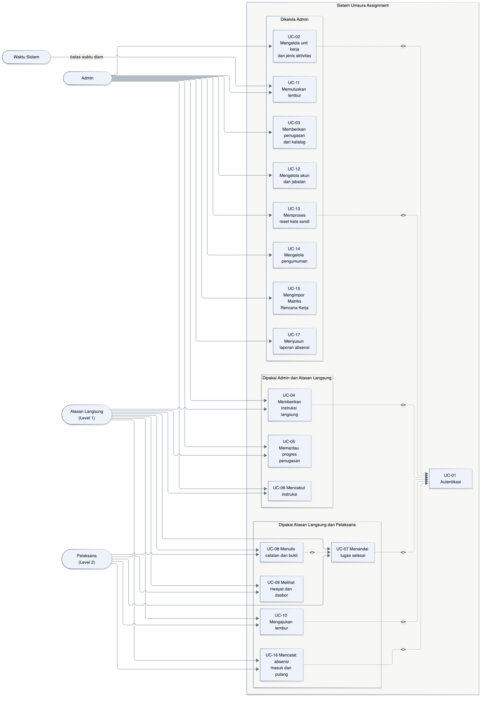
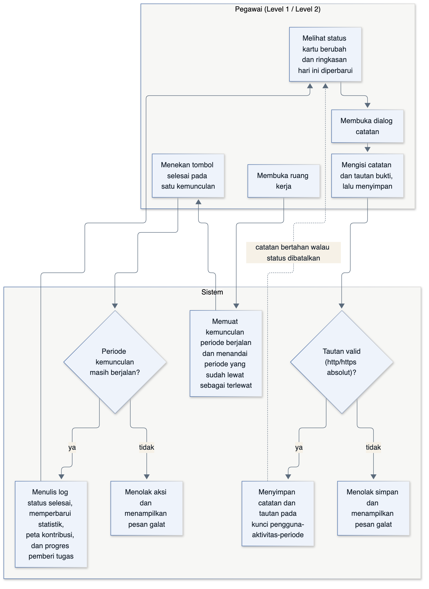
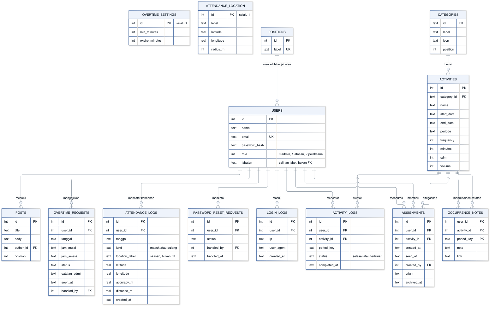
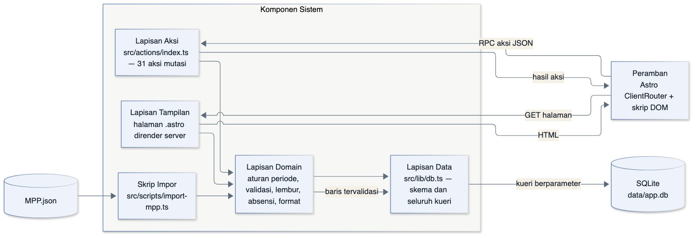
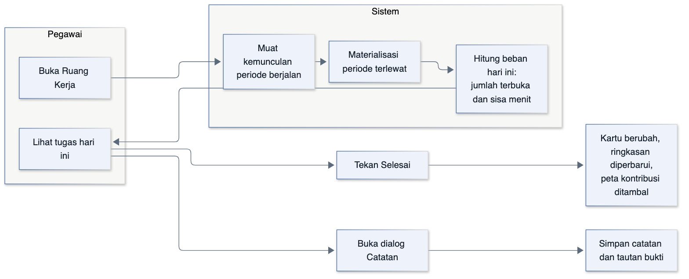

# C200 — Spesifikasi Produk "Umsura Assignment"

> Disusun mengikuti template **C200 Spesifikasi Produk, S1 Informatika**: Bab 1–5 dan Lampiran.
> Angka terukur ditandai `[UKUR]` dan berasal dari pengukuran 11 November 2026 (Lampiran G).
> Diagram dibuat dengan Mermaid; sumber `.mmd` dan render PNG/SVG ada di `c200/diagram/`.
> Lampiran A–F (notulen, dokumentasi observasi, kode diagram, learning log, logbook, daftar
> periksa) dimuat terpisah pada `C200-Lampiran.md` agar dokumen ini tetap ringkas.

---

# LEMBAR PENGESAHAN / APPROVAL SHEET

## Data Pengusul / Proposers

| No | Nama | Jabatan | NIM | Tanggal | Tanda Tangan |
|:------|:----------------|:------------|:------------|:------------|:----------------|
| 1 | `[Nama Anggota 1]` | Anggota | `[NIM]` | `[tanggal]` | |
| 2 | `[Nama Anggota 2]` | Anggota | `[NIM]` | `[tanggal]` | |
| 3 | `[Nama Anggota 3]` | Anggota | `[NIM]` | `[tanggal]` | |

## Pengesahan / Approval

| Peran | Nama | NIP | Tanggal | Tanda Tangan |
|:---------------|:------------|:------------|:------------|:----------------|
| Pembimbing 1 (Utama) | `[Nama]` | `[NIP]` | | |
| Pembimbing 2 | `[Nama]` | `[NIP]` | | |
| Perwakilan Mitra | `[Nama]` | `[NIP/NIK]` | | |

## Riwayat Revisi / Revision History

| Versi | Tanggal | Oleh | Perbaikan |
|:------|:------------|:------|:---------------------------------------------|
| 1.0 | 11 Nov 2026 | Tim | Draf lengkap Bab 1–5 dan Lampiran; penambahan modul absensi |

| Field | Isi |
|:-------------|:-------------------------------------------|
| Topik Capstone | Sistem Informasi Manajemen Penugasan dan Kinerja Unit Kerja |
| Siklus / Tahun | `[Gasal/Genap]` / `[tahun]` |
| Judul Dokumen | Spesifikasi Produk Umsura Assignment |
| Judul Capstone | Rancang Bangun Umsura Assignment: Sistem Penugasan, Pelaporan Kinerja, Pengajuan Lembur, dan Absensi Berbasis Periode untuk Unit Kerja |
| Jenis Dokumen | **SPESIFIKASI** |
| Nomor Dokumen | `C200.[NoRev]TA[tahun].[1/2].[KodeKelompok]` |
| Nomor Revisi | `[NoRev]` |
| Nama File | `[KodeKelompok].pdf` |
| Tanggal Penerbitan | `[tanggal]` |
| Unit Penerbit | Program Studi S1 Informatika |
| Jumlah Halaman | `[jumlah]` (tidak termasuk sampul) |

---

# DAFTAR ISI / TABLE OF CONTENTS

- [BAB 1 PENDAHULUAN](#bab-1-pendahuluan) — 1.1 Ringkasan Isi Dokumen · 1.2 Aplikasi Dokumen ·
  1.3 Referensi · 1.4 Daftar Singkatan
- [BAB 2 SPESIFIKASI SISTEM DAN PENGGUNA](#bab-2-spesifikasi-sistem-dan-pengguna) — 2.1 Gambaran
  Sistem · 2.2 Batasan Sistem · 2.3 Kebutuhan Fungsional (2.3.1 Deskripsi Fitur, 2.3.2 Alur Proses) ·
  2.4 Kebutuhan Data (2.4.1 Migrasi, 2.4.2 ERD, 2.4.3 Kamus Data) · 2.5 Kebutuhan Non-Fungsional
  (2.5.1 Kinerja, 2.5.2 Keamanan, 2.5.3 Keandalan, 2.5.4 Skalabilitas, 2.5.5 Teknologi) · 2.6
  Kebutuhan Arsitektur · 2.7 Karakteristik Pengguna (2.7.1 Profil, 2.7.2 Hak Akses, 2.7.3 Persona) ·
  2.8 Target Sistem
- [BAB 3 KEBUTUHAN ANTARMUKA SISTEM](#bab-3-kebutuhan-antarmuka-sistem) — 3.1 Antarmuka Pengguna
  (3.1.1 Kebutuhan UI, 3.1.2 User Flow, 3.1.3 Wireframe) · 3.2 Antarmuka Perangkat Keras · 3.3
  Antarmuka Perangkat Lunak · 3.4 Antarmuka Komunikasi · 3.5 Integrasi dengan Sistem Lain
- [BAB 4 RENCANA VERIFIKASI](#bab-4-rencana-verifikasi) — 4.1 Rencana Verifikasi Spesifikasi · 4.2
  Matriks Keterlacakan
- [BAB 5 RENCANA PROYEK](#bab-5-rencana-proyek) — 5.1 Matriks RACI · 5.2 Jadwal hingga C500 · 5.3
  Estimasi Biaya · 5.4 Risiko dan Mitigasi
- [LAMPIRAN / APPENDICES](#lampiran--appendices) — A–F (dokumen terpisah) · G. Log Pengukuran

**Daftar Gambar.** 2.1 Diagram konteks · 2.2 Use case diagram · 2.3 Activity diagram menandai tugas
selesai · 2.4 ERD konseptual · 2.5 Arsitektur logis berlapis · 3.1 User flow ruang kerja pegawai.

**Daftar Tabel.** 1.1 Daftar singkatan · 2.1 Batasan sistem · 2.2 Kebutuhan fungsional · 2.3 Kelompok
fitur, user story, dan AC · 2.4 Pemetaan use case · 2.5 Skenario use case · 2.6 Proses dan aturan
bisnis · 2.7 Kebutuhan data · 2.8 Kamus data ringkas · 2.9 Kebutuhan non-fungsional · 2.10
Karakteristik pengguna · 2.11 Matriks hak akses · 2.12 Persona · 2.13 Target sistem · 3.1 Kebutuhan
antarmuka pengguna · 3.2 Antarmuka komunikasi · 4.1 Rencana verifikasi · 4.2 Matriks keterlacakan ·
5.1 Matriks RACI · 5.2 Gantt chart · 5.3 Rincian tugas mingguan · 5.4 Estimasi biaya · 5.5 Risiko dan
mitigasi · G.1 Kondisi pengukuran · G.2 Hasil pengukuran.

-------------|:--------------------------------|:-------------|
| Gambar 2.1 | Diagram konteks | 2.1 |
| Gambar 2.2 | Use case diagram | 2.3.2.1 |
| Gambar 2.3 | Activity diagram menandai tugas selesai | 2.3.2.3 |
| Gambar 2.4 | ERD konseptual | 2.4.2 |
| Gambar 2.5 | Arsitektur logis berlapis | 2.6 |
| Gambar 3.1 | User flow ruang kerja pegawai | 3.1.2 |

**Daftar Tabel**

| Nomor | Isi | Nomor | Isi |
|:------|:---------------------------|:------|:---------------------------|
| 1.1 | Daftar singkatan | 3.1 | Kebutuhan antarmuka pengguna |
| 2.1 | Kebutuhan fungsional | 3.2 | Antarmuka perangkat lunak |
| 2.2 | Fitur di luar lingkup | 3.3 | Antarmuka komunikasi |
| 2.3 | Kelompok fitur dan AC kunci | 4.1 | Rencana verifikasi |
| 2.4 | Skenario use case | 4.2 | Matriks keterlacakan |
| 2.5 | Proses, percabangan, aturan bisnis | 5.1 | Matriks RACI |
| 2.6 | Kebutuhan data | 5.2 | Gantt chart sampai C500 |
| 2.7 | Kamus data ringkas | 5.3 | Rincian tugas mingguan |
| 2.8 | Kebutuhan non-fungsional | 5.4 | Estimasi biaya |
| 2.9 | Interaksi antar komponen | 5.5 | Risiko dan mitigasi |
| 2.10 | Karakteristik pengguna | G.1 | Kondisi dan hasil pengukuran |
| 2.11 | Matriks hak akses | | |
| 2.12 | Target sistem | | |

---

# BAB 1 PENDAHULUAN

## 1.1 Ringkasan Isi Dokumen

Dokumen ini menetapkan spesifikasi produk **"Umsura Assignment"**, sistem informasi yang
mendigitalkan penugasan, pelaporan penyelesaian pekerjaan, penelusuran bukti kinerja, pengajuan
lembur, dan pencatatan absensi pada satu unit kerja di lingkungan kampus. Sistem menggantikan
pengelolaan Matriks Rencana Kerja (MPP) berupa lembar kerja tersebar, penugasan lisan, rekap
kinerja manual, serta klaim lembur yang tidak terikat pada pekerjaan tercatat.

Tujuan dokumen: (1) menetapkan ruang lingkup dan batasan secara eksplisit; (2) merumuskan
kebutuhan fungsional, non-fungsional, dan antarmuka secara terukur agar dapat diverifikasi pada
C400 dan C500; (3) memodelkan alur proses bisnis utama beserta alur negatifnya sebagai dasar
perancangan C300; (4) menetapkan karakteristik pengguna, hak akses, dan target keberhasilan.

Dokumen ini tidak membahas rancangan basis data fisik, pemilihan teknologi secara rinci, maupun
naskah pengujian; ketiganya dibahas pada C300 dan C500.

## 1.2 Aplikasi Dokumen

Dokumen berlaku sebagai *technical specification design* yang (1) menjelaskan proses bisnis dan
ruang lingkup sistem, (2) menetapkan target efisiensi/efektivitas beserta metriknya, dan (3)
menjadi dasar perancangan pada C300 serta verifikasi pada C400–C500. Pembaca yang dituju: tim
pengembang, dosen pembimbing, penguji, dan perwakilan unit kerja (mitra). Notulen elisitasi,
dokumentasi observasi, kode diagram, learning log, logbook, dan daftar periksa pengumpulan
dimuat pada `C200-Lampiran.md`.

## 1.3 Referensi

[1] ISO/IEC 25010:2023 — *Systems and software Quality Requirements and Evaluation (SQuaRE) —
Product quality model*, 2023.

[2] ISO/IEC/IEEE 29148:2018 — *Systems and software engineering — Life cycle processes —
Requirements engineering*, 2018.

[3] Republik Indonesia, *Undang-Undang Nomor 27 Tahun 2022 tentang Pelindungan Data Pribadi*,
2022.

[4] Republik Indonesia, *Peraturan Pemerintah Nomor 30 Tahun 2019 tentang Penilaian Kinerja
Pegawai Negeri Sipil*, 2019.

[5] K. T. Hermawan, I. G. Pusparani, and D. Solihudin, "Digital transformation of personnel
services in Cirebon City local government," *Jurnal Studi Kebijakan Publik*, vol. 2, no. 1,
pp. 13–26, 2023, doi: 10.21787/jskp.2.2023.13-26.

[6] A. C. F. Gae and A. Ardieansyah, "Implementasi aplikasi E-Kinerja untuk meningkatkan kinerja
ASN di Kecamatan Ende Timur," *Jurnal Abdi Masyarakat Indonesia*, vol. 5, no. 3, pp. 1081–1090,
2025, doi: 10.54082/jamsi.1895.

[7] S. Waldi, P. Andini, R. Ilahi, and Y. Hanoselina, "Pengaruh penggunaan sistem informasi
kepegawaian terhadap kualitas pelayanan administrasi di sektor publik," *Perspektif
Administrasi Publik dan Hukum*, vol. 1, no. 4, pp. 61–72, 2025.

[8] W3C, *Web Content Accessibility Guidelines (WCAG) 2.1*, W3C Recommendation, 2018.

[9] J. Brooke, "SUS: A quick and dirty usability scale," in *Usability Evaluation in Industry*,
London: Taylor & Francis, 1996.

## 1.4 Daftar Singkatan

**Tabel 1.1 Daftar Singkatan**

| Akronim | Pengertian | Akronim | Pengertian |
|:------|:--------------------------|:------|:--------------------------|
| AC | *Acceptance Criteria* | PDP | Pelindungan Data Pribadi |
| ASN | Aparatur Sipil Negara | RACI | *Responsible, Accountable, Consulted, Informed* |
| BPMN | *Business Process Model and Notation* | RBAC | *Role-Based Access Control* |
| CRUD | *Create, Read, Update, Delete* | RPO | *Recovery Point Objective* |
| CSV | *Character Separated Values* | RTO | *Recovery Time Objective* |
| ERD | *Entity Relationship Diagram* | SKP | Sasaran Kinerja Pegawai |
| HTTP | *Hypertext Transfer Protocol* | SSR | *Server-Side Rendering* |
| ISO | *International Organization for Standardization* | SUS | *System Usability Scale* |
| MPP | Matriks Rencana Kerja | TLS | *Transport Layer Security* |
| NFR | *Non-Functional Requirement* | UAT | *User Acceptance Test* |
| — | — | WAL | *Write-Ahead Logging* |
| — | — | WCAG | *Web Content Accessibility Guidelines* |

---

# BAB 2 SPESIFIKASI SISTEM DAN PENGGUNA

## 2.1 Gambaran Sistem

Unit kerja di lingkungan kampus memiliki rencana kerja per periode: daftar kegiatan, penanggung
jawab, tenggat, dan perkiraan waktu. Rencana itu tersedia sebagai lembar kerja, tetapi
**pelaksanaannya tidak tercatat**. Siapa mengerjakan apa, kapan selesai, dan dengan bukti apa hanya
tersimpan dalam ingatan dan percakapan. Rekap capaian disusun manual, bukti sulit
dipertanggungjawabkan, dan klaim lembur tidak memiliki dasar.

Umsura Assignment menutup jarak itu dengan empat gagasan pokok: **(1) periode adalah satuan kerja,
bukan tanggal** — setiap jenis aktivitas membawa satu periode baku (Harian, Mingguan, Bulanan,
Triwulan, Semesteran, Tahunan, Kegiatan) dan sistem menurunkan sendiri kemunculan (*occurrence*)
yang jatuh tempo, sehingga satu definisi berlaku berulang tanpa disalin; **(2) setiap kemunculan
punya jejak** — satu baris status (`selesai` atau `terlewat`) dan satu catatan berisi tautan bukti,
terpisah dari status agar catatan tetap ada ketika penyelesaian dibatalkan; **(3) penugasan punya
pemberi** — tugas dari katalog maupun instruksi langsung mencatat pemberinya, dan pemberi melihat
progres per periode tanpa bertanya; **(4) klaim lembur dan kehadiran punya dasar** — lembur hanya
dapat diajukan bila menit pekerjaan tercatat hari itu mencapai ambang, dan absensi mencatat
masuk/pulang beserta jarak ke titik kantor.

Sistem berjalan sebagai satu aplikasi web yang dirender di server. Pengguna masuk dengan surel dan
kata sandi, lalu diarahkan sesuai peran: admin mengelola katalog dan keputusan, level 1 (atasan
langsung) memberi instruksi dan memantau, level 2 (pelaksana) menyelesaikan tugas. Seluruh data
berada pada satu berkas basis data di server unit kerja, tanpa layanan awan berbayar.

**Gambar 2.1 Diagram Konteks Umsura Assignment**

{width=12cm}

Narasi: tiga aktor manusia memakai sistem melalui peramban — admin, atasan langsung (level 1), dan
pelaksana (level 2). Mitra unit kerja tidak memakai sistem; ia memasok kebutuhan, aturan bisnis, dan
validasi prototipe kepada admin. Satu berkas MPP diimpor sekali pada tahap penyiapan. Data disimpan
pada satu berkas SQLite dan dilayani melalui proksi balik ber-TLS.

## 2.2 Batasan Sistem

Batasan berikut mengikat dan disengaja, bukan kekurangan yang belum disadari.

**Tabel 2.1 Batasan Sistem**

| # | Batasan | Alasan / konsekuensi yang diterima |
|:----|:----------------------------------|:------------------------------------------|
| 1 | Penyelesaian tanpa persetujuan atasan | Verifikasi berlapis menambah beban harian; "selesai" adalah klaim pelaksana |
| 2 | Lembur hanya hari berjalan | Tanpa rentang lintas tengah malam; pengajuan setelah 00.00 ditolak |
| 3 | Persetujuan lembur satu tingkat | Tidak memodelkan hierarki; hanya admin memutuskan |
| 4 | Tanpa hierarki atasan–bawahan | Tiga peran tanpa relasi; level 1 dapat memberi instruksi ke level 1 lain |
| 5 | Pemulihan sandi tanpa token dan surel | "Lupa kata sandi" hanya mencatat permintaan; admin mengeksekusi reset |
| 6 | Notifikasi bersifat tarik | Tanpa surel, SMS, atau *push*; notifikasi tampil sebagai lonceng |
| 7 | Satu berkas basis data, satu penulis | Skalabilitas vertikal; dua instans atas berkas sama tidak didukung |
| 8 | Absensi hanya satu titik kantor | Lokasi singleton; tanpa multi-lokasi, shift, selfie, atau QR |
| 9 | Tanpa persentase kehadiran | Tidak ada kalender hari kerja dan data cuti; laporan memuat jumlah hari |
| 10 | Belum ada rekap atau ekspor lembur | Belum diminta mitra; volume pengajuan kecil |
| 11 | Tidak menangani unggahan berkas | Bukti berupa tautan ke berkas di luar sistem |
| 12 | Antarmuka hanya Bahasa Indonesia | Satu unit kerja; area administratif menuntut JavaScript aktif |
| 13 | Belum ada replikasi atau *failover* | Konsekuensi satu berkas; keandalan pada WAL dan salinan harian |
| 14 | Tanpa SSO, SKP, dan pesan instan | Bergantung kebijakan TI kampus dan menambah biaya (lihat 3.5) |

## 2.3 Kebutuhan Fungsional

Prioritas memakai MoSCoW. Kolom terakhir memuat aktor, prioritas, dan masalah C100 yang ditutup:
**P1** penugasan tidak tercatat, **P2** bukti tersebar dan tidak melekat pada periode, **P3** rekap
manual dan tidak dapat dibandingkan, **P4** lembur tanpa dasar pekerjaan tercatat, **P5** pemulihan
akun bergantung pada satu orang, **P6** kehadiran tidak tercatat.

**Tabel 2.2 Daftar Kebutuhan Fungsional**

| Kode | Kebutuhan Fungsional | Aktor · Prioritas · Masalah |
|:--------|:---------------------------------------------------------------|:-------------------|
| F-01 | Autentikasi surel dan kata sandi; mencatat waktu, IP, dan peramban setiap login | Semua · Must · P1, P5 |
| F-02 | Mengarahkan pengguna ke ruang kerja sesuai peran setelah login | Semua · Must · P1 |
| F-03 | CRUD unit kerja beserta ikon dan urutannya | Admin · Must · P1 |
| F-04 | CRUD jenis aktivitas per unit: nama, tanggal, tenggat, durasi, periode, klasifikasi, frekuensi, SDM, volume | Admin · Must · P1, P3 |
| F-05 | Menerima permintaan reset kata sandi tanpa mengungkap keberadaan akun | Semua · Must · P5 |
| F-06 | Memproses antrean reset: mengeksekusi atau menolak permintaan | Admin · Must · P5 |
| F-07 | Menampilkan jumlah permintaan reset menunggu di seluruh halaman admin | Admin · Must · P5 |
| F-08 | Memberikan aktivitas dari katalog kepada satu pengguna | Admin · Must · P1 |
| F-09 | Memberikan banyak aktivitas kepada banyak pengguna; pasangan yang ada dilewati | Admin · Should · P1 |
| F-10 | Menampilkan jumlah penugasan yang belum dibaca penerimanya | Level 1, 2 · Must · P1 |
| F-11 | Memberi instruksi langsung kepada pengguna non-admin beserta tenggat, durasi, periode, penerima | Admin, Level 1 · Must · P1 |
| F-12 | Mencatat pemberi tugas dan menampilkannya pada sisi penerima | Semua · Must · P1 |
| F-13 | Menampilkan progres tiap penugasan per periode: selesai, terlewat, berjalan, belum mulai | Admin, Level 1 · Must · P1, P3 |
| F-14 | Mencabut instruksi yang ia berikan sendiri | Admin, Level 1 · Must · P1 |
| F-15 | Mengarsipkan penugasan tanpa menghapus riwayat, memulihkan, atau menghapus permanen | Admin · Should · P1 |
| F-16 | Menampilkan daftar tugas periode berjalan, diurutkan menurut keterlambatan | Level 1, 2 · Must · P1 |
| F-17 | Menandai kemunculan tugas selesai dan membatalkannya | Level 1, 2 · Must · P1 |
| F-18 | Menyimpan catatan dan tautan bukti per kemunculan, terpisah dari status | Level 1, 2 · Must · P2 |
| F-19 | Mencatat periode terlewat otomatis saat tenggat terlampaui tanpa penyelesaian | Sistem · Must · P1, P3 |
| F-20 | Melihat riwayat penyelesaian dan periode terlewat lintas periode | Level 1, 2 · Must · P2, P3 |
| F-21 | Menampilkan peta kontribusi tahunan dan tren penyelesaian 14 hari terakhir | Level 1, 2 · Should · P3 |
| F-22 | Menampilkan beban hari ini: jumlah tugas terbuka dan estimasi sisa menit | Level 1, 2 · Must · P1 |
| F-23 | Menolak pengajuan lembur bila menit tugas selesai hari itu belum mencapai ambang | Level 1, 2 · Must · P4 |
| F-24 | Menerima pengajuan lembur hari berjalan (jam mulai, selesai, keterangan); maksimal satu menunggu per tanggal | Level 1, 2 · Must · P4 |
| F-25 | Membatalkan pengajuan lembur miliknya yang masih menunggu | Level 1, 2 · Should · P4 |
| F-26 | Menyetujui atau menolak pengajuan lembur disertai catatan | Admin · Must · P4 |
| F-27 | Menolak otomatis pengajuan yang tidak diputuskan dalam batas waktu diam | Sistem · Must · P4 |
| F-28 | Mengubah ambang menit dan batas waktu diam lembur | Admin · Must · P4 |
| F-29 | Memberi tahu pemohon atas keputusan lembur melalui lonceng notifikasi | Level 1, 2 · Must · P4 |
| F-30 | CRUD akun pengguna beserta penetapan jabatan | Admin · Must · P1, P5 |
| F-31 | CRUD daftar Posisi/Jabatan yang menjadi pilihan formulir pengguna | Admin · Should · P1 |
| F-32 | CRUD pengumuman | Admin · Should · P1 |
| F-33 | Menampilkan ringkasan admin: pekerjaan perlu perhatian, cakupan per unit, tren login tujuh hari, log terbaru | Admin · Must · P3 |
| F-34 | Menyediakan impor Matriks Rencana Kerja secara idempoten | Admin · Could · P1 |
| F-35 | Menampilkan ringkasan aktivitas pengguna pada tabel pengguna | Admin · Could · P3 |
| F-36 | Mencatat absensi masuk/pulang dari dalam radius titik kantor; koordinat, akurasi, jarak dihitung server | Level 1, 2 · Must · P6 |
| F-37 | Menolak absensi di luar radius, berakurasi rendah, atau pulang tanpa masuk | Level 1, 2 · Must · P6 |
| F-38 | Menetapkan satu titik kantor beserta radius 10–300 m pada peta | Admin · Must · P6 |
| F-39 | Menampilkan laporan absensi harian/bulanan/tahunan dengan filter nama, surel, jabatan, dan daftar belum absen | Admin · Must · P6 |
| F-40 | Mengekspor laporan absensi yang ditampilkan ke CSV | Admin · Should · P6 |

**Fitur di luar lingkup (Won't).** Sepuluh butir berikut disepakati tidak dikerjakan pada rilis ini
dan menjadi pagar agar cakupan tidak meluas: persetujuan penyelesaian oleh atasan (menambah beban
harian; status "selesai" adalah klaim pelaksana), persetujuan lembur berjenjang (belum ada data
struktur organisasi), rekap dan ekspor lembur (belum diminta; rekap manual dari antrean), notifikasi
dorong surel/WA (menambah layanan dan biaya), unggah berkas bukti (butuh penyimpanan objek dan
pemindaian), multi-kantor (satu unit, satu kantor), absensi selfie/QR dan jam kerja (tidak diminta),
persentase kehadiran (tidak ada kalender hari kerja dan data cuti), SSO kampus (bergantung kebijakan
TI), dan integrasi SKP/kepegawaian (di luar lingkup C200).

### 2.3.1 Deskripsi Fitur Utama / Main Feature Description

Sistem memiliki **enam belas kelompok fitur utama**, diturunkan dari Tabel 2.2. Manfaat dan
penutupan masalah dinyatakan pada kolom terakhir tabel tersebut; bagian ini menambahkan user story
dan acceptance criteria yang menjadi skenario uji C500.

**Tabel 2.3 Kelompok Fitur, User Story, dan Acceptance Criteria**

| Kelompok (kode F) | User story | AC positif (Diberikan–Ketika–Maka) | AC negatif |
|:---------------------|:----------------------------|:------------------------------------------|:-----------------------------------|
| Autentikasi dan peran (F-01, F-02) | Pegawai ingin masuk dengan akun sendiri agar catatan yang diubah benar miliknya | Akun level 2 aktif; surel dan sandi benar → ruang kerja tampil, satu baris `login_logs` ber-IP dan peramban | Sandi salah → tolak "Surel atau kata sandi salah", tanpa sesi |
| Master unit dan aktivitas (F-03, F-04) | Admin ingin mendefinisikan aktivitas dan periodenya sekali agar tidak menyalin | Aktivitas Bulanan 60 menit mulai 5 Jan 2026 → bertenggat tanggal 5 setiap bulan | Tenggat 1 Jan lebih awal dari mulai 5 Jan → tolak, sebut kolom salah |
| Pemulihan akun (F-05–F-07) | Pegawai ingin mengajukan reset tanpa menghubungi satu orang | Satu permintaan menunggu; admin tekan "Reset" → status `reset`, `handled_by`/`handled_at` terisi | Permintaan kedua akun sama tidak menambah baris; layar hasil tetap |
| Penugasan katalog (F-08–F-10) | Admin ingin memberi banyak aktivitas ke banyak pegawai sekali langkah | 3 aktivitas × 4 pegawai → maksimal 12 pasangan; pasangan lama tidak bertambah | Kirim ulang tanpa pilihan baru → 0 penugasan baru |
| Instruksi langsung (F-11, F-12, F-14) | Atasan ingin memberi tugas bertenggat agar tidak hilang dalam percakapan | Instruksi untuk dua staf → dua penugasan ber-`created_by` pemberi, penerima melihat "Dari" | Penerima hanya admin → tolak setelah penyaringan server |
| Progres dan arsip (F-13, F-15) | Atasan ingin melihat periode yang sudah dikerjakan agar menegur berdasar catatan | Penugasan harian 10 hari lalu, dua periode tanpa log → kartu "Terlambat", dua simpul merah, urutan teratas | Mencabut instruksi milik level 1 lain → tolak, baris tidak terhapus |
| Ruang kerja periodik (F-16, F-17, F-19, F-22) | Pelaksana ingin menandai selesai di tempat agar tidak menyusun laporan terpisah | Kemunculan bulanan berjalan; tekan selesai → kartu berubah tanpa muat ulang, satu baris `selesai` | Periode Oktober ditekan pada November → tolak, tanpa log |
| Catatan dan bukti (F-18) | Pelaksana ingin menempelkan tautan bukti pada periode tertentu | Catatan "Berita acara rapat" dengan tautan `https://contoh.go.id/ba-11.pdf` → tersimpan per pengguna–aktivitas–periode | Tautan `javascript:alert(1)` → tolak, minta awalan http atau https |
| Riwayat dan dasbor (F-20, F-21) | Pelaksana ingin melihat capaian setahun agar bahan penilaian siap | Dua tugas selesai pada hari sama → sel tanggal berwarna sesuai kepadatan, keterangan menyebut selesai dan terlewat | Pegawai baru tanpa log → keadaan kosong yang menjelaskan, bukan galat |
| Pengajuan lembur (F-23–F-25) | Pelaksana ingin mengajukan lembur setelah pekerjaan tercatat | Total 75 menit selesai; ajukan 16.30–18.00 → satu baris `pending`, formulir terkunci | Total 30 menit dengan ambang 60 → aksi server menolak, tanpa baris |
| Keputusan dan setelan lembur (F-26–F-29) | Admin ingin memutuskan dengan alasan tertulis agar dapat dipertanggungjawabkan | Pengajuan menunggu; tolak dengan catatan → status `ditolak`, catatan tersimpan, pemohon menerima notifikasi | Formulir lama dikirim ulang atas baris yang sudah disetujui → tolak |
| Akun dan jabatan (F-30, F-31) | Admin ingin menambah akun beserta jabatan agar personel baru langsung bekerja | Nama, surel baru, peran 2, jabatan "Staf" → akun terbentuk dengan sandi awal dan dapat masuk | Surel `dosen1@assignment.id` sudah terdaftar → tolak, sebut surel terpakai |
| Pengumuman dan dasbor (F-32, F-33) | Admin ingin melihat unit dengan cakupan rendah agar penyiapan diperbaiki | Tiga unit berbeda; buka dasbor → tiap unit menampilkan pegawai, penugasan aktif, meter cakupan; "Instruksi" tidak dihitung | Judul pengumuman kosong → tolak, judul wajib diisi |
| Impor MPP (F-34, F-35) | Admin ingin memuat rencana kerja dari lembar kerja agar tidak mengetik 206 baris | Berkas sama diimpor dua kali → jumlah aktivitas tidak bertambah, baris berubah diperbarui | Satu baris berperiode "Bulananan" → seluruh transaksi batal |
| Absensi pegawai (F-36, F-37) | Pegawai ingin mencatat kehadiran dari ponsel tanpa buku kertas | Radius 100 m, pegawai 42 m dengan akurasi 15 m; tekan "Masuk" → satu baris `masuk` berkoordinat, jarak 42 m | "Pulang" pada jarak 2.400 m → tolak, tanpa baris |
| Laporan absensi (F-38–F-40) | Admin ingin mengunduh rekap bulanan agar tidak menyusun tabel ulang | Laporan November 2026 filter jabatan "Staf"; ekspor → CSV berisi baris sama, pemisah titik koma | Sesi level 2 meminta URL ekspor langsung → dialihkan, tanpa berkas |

### 2.3.2 Alur Proses Utama / Main Process Flow

#### 2.3.2.1 Use Case Diagram

Aktor adalah pihak di luar batas sistem; basis data bukan aktor. Sistem membedakan tiga aktor manusia
dan satu aktor waktu (batas waktu diam lembur). Aktor "Mitra Unit Kerja" tidak memakai sistem,
sehingga tidak digambarkan.

**Gambar 2.2 Use Case Diagram Umsura Assignment**

{width=7cm}

Diagram memuat tujuh belas use case, dengan `<<include>>` untuk langkah yang selalu dipanggil
(autentikasi) dan `<<extend>>` untuk perilaku opsional (menulis catatan setelah penandaan selesai,
meminta reset kata sandi dari halaman masuk).

**Tabel 2.4 Pemetaan Use Case ke Kebutuhan Fungsional**

| Kode | Nama Use Case | Aktor | Kebutuhan |
|:--------|:--------------------------------------------|:-------------------|:----------------------|
| UC-01 | Autentikasi | Semua | F-01, F-02 |
| UC-02 | Mengelola unit kerja dan jenis aktivitas | Admin | F-03, F-04 |
| UC-03 | Memberikan penugasan dari katalog | Admin | F-08, F-09, F-10 |
| UC-04 | Memberikan instruksi langsung | Admin, Level 1 | F-11, F-12 |
| UC-05 | Memantau progres penugasan | Admin, Level 1 | F-13, F-07 |
| UC-06 | Mencabut instruksi | Admin, Level 1 | F-14 |
| UC-07 | Menandai tugas selesai | Level 1, 2 | F-16, F-17, F-19, F-22 |
| UC-08 | Menulis catatan dan bukti | Level 1, 2 | F-18 |
| UC-09 | Melihat riwayat dan dasbor | Level 1, 2 | F-20, F-21 |
| UC-10 | Mengajukan lembur | Level 1, 2 | F-23, F-24, F-25 |
| UC-11 | Memutuskan lembur | Admin, Waktu Sistem | F-26–F-29 |
| UC-12 | Mengelola akun dan jabatan | Admin | F-30, F-31, F-10 |
| UC-13 | Memproses reset kata sandi | Admin, Semua | F-05, F-06, F-07 |
| UC-14 | Mengelola pengumuman | Admin | F-32, F-33 |
| UC-15 | Mengimpor Matriks Rencana Kerja | Admin | F-34, F-35 |
| UC-16 | Mencatat absensi masuk dan pulang | Level 1, 2 | F-36, F-37 |
| UC-17 | Menyusun laporan absensi | Admin | F-38, F-39, F-40 |
| — | Mengarsipkan dan menghapus penugasan | Admin | F-15 |

#### 2.3.2.2 Use Case Scenario

Setiap use case Must memiliki minimal dua alur alternatif atau negatif. Alur utama diringkas menjadi
langkah bernomor; percabangan yang menuntut penjelasan panjang ada pada activity diagram 2.3.2.3.

**Tabel 2.5 Skenario Use Case**

| UC (pra-kondisi) | Alur utama | Alur negatif | Pasca-kondisi |
|:---------------------------|:------------------------------------------|:------------------------------------------|:--------------------------|
| UC-01 Autentikasi (akun aktif) | Isi surel dan sandi; verifikasi hash, catat IP dan peramban; arahkan sesuai peran | **a.** Sandi salah → tolak, tanpa sesi. **b.** Asal tidak aman → formulir tampil dengan catatan | Sesi aktif; satu baris `login_logs` |
| UC-02 Kelola unit dan aktivitas (admin masuk) | Buka master; tambah atau ubah; validasi tanggal, periode, durasi; simpan | **a.** Tenggat mendahului mulai → tolak. **b.** Periode di luar tujuh baku → tolak | Katalog diperbarui; kemunculan diturunkan ulang |
| UC-03 Penugasan katalog (katalog terisi) | Pilih aktivitas dan pegawai; saring pasangan yang ada; simpan sisanya | **a.** Seluruh pasangan sudah ada → laporkan 0 baru. **b.** Tidak ada aktivitas dipilih → tolak | Penugasan baru; lencana penerima bertambah |
| UC-04 Instruksi langsung (peran 0 atau 1) | Isi nama, tenggat, durasi, periode, penerima; saring penerima non-admin; simpan satu transaksi | **a.** Penerima tersisa hanya admin → tolak. **b.** Durasi nol atau tenggat lampau → tolak | Aktivitas dan penugasan baru ber-`created_by` |
| UC-05 Pantau progres (ada penugasan) | Buka panel; hitung status per periode; tampilkan strip dua belas periode | **a.** Belum ada penugasan → keadaan kosong. **b.** Periode tanpa log → terlewat, bukan galat | Tidak mengubah data |
| UC-06 Cabut instruksi (milik pemanggil) | Buka instruksi; tekan cabut; periksa `created_by`; hapus penugasan | **a.** Bukan miliknya → tolak. **b.** Pemanggil peran 2 → tolak 403 | Penugasan hilang; log penyelesaian tetap |
| UC-07 Tandai selesai | Buka ruang kerja; materialisasi periode terlewat; tekan centang; tulis log; tambal statistik dan peta | **a.** Periode lewat → tolak. **b.** Klik ganda → satu baris (indeks unik). **c.** Sesi habis → halaman masuk | Satu baris `selesai`; ringkasan diperbarui |
| UC-08 Catatan dan bukti (kemunculan ada) | Buka dialog; isi keterangan dan tautan; validasi di peramban dan server; simpan | **a.** Tautan bukan http/https absolut → tolak. **b.** Teks > 1000 karakter → tolak | Baris `occurrence_notes`, lepas dari status |
| UC-09 Riwayat dan dasbor | Buka riwayat; pilih tahun; tampilkan penyelesaian, terlewat, peta kontribusi, tren 14 hari | **a.** Tahun tanpa data → keadaan kosong. **b.** Kueri gagal → pesan Indonesia tanpa jejak tumpukan | Tidak mengubah data |
| UC-10 Ajukan lembur (menit ≥ ambang) | Buka lembur; hitung menit selesai hari ini; isi jam dan keterangan; kirim; baris `pending` | **a.** Menit < ambang → formulir terkunci. **b.** Jam selesai ≤ mulai → tolak. **c.** Sudah ada menunggu → tolak. **d.** Bukan hari ini → tolak | Satu baris `pending`; formulir terkunci |
| UC-11 Putuskan lembur (ada antrean) | Buka antrean; tolak otomatis yang lewat batas; setuju/tolak ber-catatan; notifikasi terbit | **a.** Catatan kosong saat menolak → tolak. **b.** Baris sudah diputuskan → tolak. **c.** Lewat 180 menit → `ditolak` deterministik | Status final; `handled_by`/`handled_at` terisi |
| UC-12 Akun dan jabatan (admin masuk) | Isi nama, surel, peran, jabatan; simpan dengan sandi awal; daftar Posisi dikelola terpisah | **a.** Surel ganda → tolak. **b.** Hapus lalu batalkan dalam 5 detik → akun pulih | Akun aktif; teks jabatan pada baris pengguna |
| UC-13 Reset kata sandi (ada antrean) | Pengguna mengirim permintaan; layar hasil seragam; admin reset atau tolak | **a.** Permintaan kedua akun sama → tanpa baris baru. **b.** Baris sudah diproses → tidak diproses ulang | Permintaan `reset` atau `ditolak` |
| UC-14 Pengumuman dan ringkasan | Tulis markdown, simpan; dasbor menampilkan cakupan per unit dan tren login tujuh hari | **a.** Judul kosong → tolak. **b.** Unit "Instruksi" → tidak dihitung pada cakupan | Postingan tampil; ringkasan diperbarui |
| UC-15 Impor MPP (berkas tersedia) | Jalankan skrip; tiap baris melewati parser formulir; upsert satu transaksi | **a.** Periode di luar daftar → transaksi batal. **b.** Impor ulang → baris diperbarui, bukan digandakan | Katalog terisi; jumlah baris dapat dibandingkan |
| UC-16 Absensi (titik kantor ada) | Buka absensi; tekan Masuk; peramban kirim koordinat dan akurasi; server hitung jarak dan simpan | **a.** Di luar radius → tolak. **b.** Akurasi > `min(radius,150)` m → tolak. **c.** Pulang tanpa masuk → tolak. **d.** Masuk ganda → konflik. **e.** Asal tidak aman → diberitahu | Satu baris per jenis per hari |
| UC-17 Laporan absensi (ada data) | Pilih mode harian/bulanan/tahunan dan filter; hitung rekap dan daftar belum absen; ekspor CSV | **a.** Filter tanpa hasil → keadaan kosong. **b.** Sesi level 2 meminta ekspor → dialihkan | Tidak mengubah data; CSV berpemisah `;` |

#### 2.3.2.3 Activity Diagram / BPMN

Lima proses digambarkan pada sumber Mermaid karena melibatkan lebih dari satu peran dan memiliki
percabangan penting. Satu ditampilkan di sini; empat lainnya tersedia sebagai `activity-instruksi`,
`activity-lembur`, `activity-absensi`, dan `activity-reset` pada `c200/diagram/`. Aturan bisnis tiap
proses dinyatakan pada tabel berikut agar dapat ditelusuri ke notulen mitra (Lampiran A).

**Gambar 2.3 Activity Diagram — Menandai Tugas Selesai**

{width=6.5cm}

Narasi: pegawai membuka ruang kerja; sistem memuat kemunculan periode berjalan sekaligus mencatat
periode yang sudah lewat sebagai terlewat. Bila periode masih berjalan, penandaan menulis log,
memperbarui statistik, peta kontribusi, dan progres pemberi; bila tidak, aksi ditolak. Catatan dan
bukti ditulis melalui jalur terpisah yang memvalidasi skema tautan.

**Tabel 2.6 Proses, Percabangan, dan Aturan Bisnis**

| Proses | Percabangan utama | Aturan bisnis (sumber) |
|:-----------------------------|:-----------------------------------|:----------------------------------------------|
| Menandai tugas selesai | Periode berjalan vs lewat; klik ganda; sesi habis | Satu kemunculan hanya ditandai pada periodenya (sesi 2); catatan bertahan walau status dibatalkan (sesi 3); tautan hanya http/https absolut (keputusan tim, UU ITE) |
| Memberikan instruksi | Peran pemberi; penerima tersisa; duplikasi | Hanya peran 0 dan 1 boleh memberi (sesi 4); penerima selalu non-admin (sesi 4); instruksi identik dipakai ulang (keputusan tim) |
| Pengajuan dan keputusan lembur | Ambang menit; urutan jam; pengajuan menunggu; batas waktu diam | Ambang awal 60 menit (sesi 5); batas waktu diam 180 menit (sesi 5); satu menunggu per tanggal (sesi 5); hanya hari ini (keputusan mitra) |
| Absensi masuk dan pulang | Asal tidak aman; masukan ganda; akurasi; radius; pulang tanpa masuk | Satu titik kantor radius 10–300 m (sesi 6); jarak dihitung server; akurasi tidak memperlebar radius; satu kejadian per jenis per hari (keputusan tim) |
| Pemulihan kata sandi | Permintaan ganda; surel terdaftar vs tidak; baris sudah diproses | Satu permintaan menunggu per akun; layar hasil tidak membedakan surel terdaftar; hanya baris menunggu yang diproses (keputusan tim) |

## 2.4 Kebutuhan Data / Data Requirements

**Tabel 2.7 Kebutuhan Data**

| Butir | Isi |
|:----------|:---------------------------------------------|
| D-01 Jenis data | Empat ranah dan **empat belas tabel**. **(a) Kepegawaian dan akses:** `users`, `positions`, `login_logs`, `password_reset_requests`. **(b) Kerja dan penugasan:** `categories`, `activities`, `assignments`, `activity_logs`, `occurrence_notes`. **(c) Lembur dan kehadiran:** `overtime_requests`, `overtime_settings`, `attendance_location`, `attendance_logs`. **(d) Informasi:** `posts`. |
| D-02 Sumber | Formulir master admin; tindakan pegawai di ruang kerja; perhitungan sistem (periode terlewat, penolakan lembur otomatis, agregasi); berkas MPP yang diimpor sekali; metadata HTTP (IP dari header *forwarded*, peramban dari *user-agent*). |
| D-03 Format | Tanggal sebagai teks ISO `YYYY-MM-DD` zona Jakarta, terpisah dari waktu agar bebas pergeseran zona. Kunci periode: `YYYY-MM-DD` (Harian), `YYYY-Wnn` (Mingguan, pekan ISO), `YYYY-MM` (Bulanan dan Kegiatan), `YYYY-Qn` (Triwulan), `YYYY-Sn` (Semesteran), `YYYY` (Tahunan). Ekspor CSV berpemisah `;` dan BOM UTF-8 agar benar di Excel berlokal Indonesia; impor MPP melalui JSON hasil ekstraksi. |
| D-04 Volume | Baris `activity_logs` dan `occurrence_notes` sebanding jumlah kemunculan: Harian 365/tahun, Mingguan 52, Bulanan dan Kegiatan 12, Triwulan 4, Semesteran 2, Tahunan 1 per aktivitas. Dengan 30 aktivitas per pegawai dan komposisi dominan bulanan, satu pegawai menghasilkan ±400–500 baris per tahun. Data uji 11 November 2026: 223 jenis aktivitas, 541 baris `activity_logs`, 6 baris `attendance_logs`, berkas 316 KB. Target awal 200 pegawai, orde puluhan megabita per tahun; batas akumulasi periode per penugasan 400. |
| D-05 Frekuensi | Tanpa aliran berkelanjutan. Penulisan per kejadian: login, penandaan selesai, catatan, pengajuan lembur, kejadian absensi. Pembacaan agregat saat halaman dibuka; penulisan puncak puluhan per menit pada pagi hari. |
| D-06 Penyimpanan dan retensi | Satu berkas SQLite mode WAL. Penghapusan penugasan oleh pengguna berupa pengarsipan; hapus permanen hanya di tab arsip untuk data yang salah masuk. Tidak ada penghapusan baris absensi — riwayat yang dapat dihapus bukan riwayat. Pencadangan berkala dengan menyalin berkas. |
| D-07 Keamanan | Sandi hash bcrypt (biaya 10), tidak pernah teks biasa; sesi cookie bertanda tangan yang diverifikasi ulang ke baris pengguna tiap pembacaan; kueri berparameter; tautan bukti divalidasi di peramban dan server. **Data pribadi (UU PDP [3]):** nama, surel, jabatan, IP dan peramban pada log masuk, catatan pekerjaan, riwayat lembur, koordinat kehadiran. **Dasar pemrosesan:** pelaksanaan tugas kepegawaian. **Akses:** admin seluruh data, atasan hanya penugasan yang ia berikan, pelaksana hanya datanya. **Persetujuan:** pegawai diberi tahu saat akun dibuat dan dapat meminta pembetulan melalui admin; koordinat tidak dibagikan ke pegawai lain. |
| D-08 Pemrosesan | Tiga proses turunan: **(a) materialisasi keterlambatan** — saat ruang kerja dibuka, periode lewat tanpa penyelesaian dicatat `terlewat` pada tanggal jatuh temponya; **(b) penolakan lembur otomatis** — setiap pembacaan data lembur menandai pengajuan yang melewati batas waktu diam, dengan waktu keputusan dihitung deterministik dari waktu pengajuan; **(c) agregasi dasbor** — menit selesai hari ini, tren 14 hari, peta kontribusi, cakupan per unit, dan rekap absensi dihitung dari tabel transaksi, bukan tabel ringkasan. |
| D-09 Data kehadiran | `attendance_location` menyimpan satu titik (label, lintang, bujur, radius). `attendance_logs` menyimpan satu baris per kejadian berisi koordinat, akurasi, jarak hasil hitung server, salinan nama kantor, IP, dan peramban. Tanggal adalah hari sipil Jakarta; jam dari waktu pembuatan baris. |

### 2.4.1 Migrasi Data Awal / Initial Data Migration

Data lama yang dipindahkan adalah **Matriks Rencana Kerja**: lembar kerja dengan 11 unit kerja dan 206
baris aktivitas, dijalankan sekali sebelum sistem dipakai. **Ekstraksi:** skrip Python memetakan kolom
berdasarkan nama header (beberapa lembar tanpa kolom tanggal sehingga posisi bergeser), mengubah
tanggal bebas menjadi nomor hari, dan memetakan kosakata periode lembar kerja ke label baku; keluaran
JSON. **Pemuatan:** skrip TypeScript menjalankan setiap baris melalui parser yang sama dengan formulir
admin, lalu melakukan upsert dalam satu transaksi dengan kunci unit kerja dan nama aktivitas, sehingga
impor dapat diulang setelah berkas diperbaiki tanpa menggandakan baris. **Verifikasi:** admin dan
perwakilan unit kerja membandingkan jumlah baris per unit dengan lembar kerja asal dan memeriksa
sepuluh baris contoh tiap periode (Lampiran A). Penugasan, catatan, dan log penyelesaian tidak
dimigrasikan karena belum pernah tercatat; penugasan awal dilakukan setelah katalog terverifikasi.

### 2.4.2 ERD Konseptual / Conceptual ERD

**Gambar 2.4 ERD Konseptual Umsura Assignment**

{width=12cm}

Catatan kardinalitas dan kunci: `users` ke `positions` bukan relasi kunci asing (`users.jabatan`
menyimpan label teks, sehingga menghapus jabatan tidak mengubah akun); `assignments` unik atas
`(user_id, activity_id)` dan `activity_logs` unik atas `(user_id, activity_id, period_key)`;
`occurrence_notes` memakai kunci primer gabungan yang sama dan sengaja tidak bergantung pada
`activity_logs` agar catatan bertahan saat status dibatalkan; `attendance_location` dan
`overtime_settings` singleton (`CHECK id = 1`); `attendance_logs` unik atas `(user_id, tanggal,
kind)` dengan `location_label` berupa salinan nama kantor, bukan kunci asing.

### 2.4.3 Kamus Data / Data Dictionary

Empat tabel transaksi yang memuat aturan validasi tidak trivial diuraikan di bawah; tabel master
mengikuti pola yang sama.

**Tabel 2.8 Kamus Data Ringkas**

| Tabel.atribut | Aturan / validasi | Contoh |
|:---------------------------|:---------------------------------------------|:--------------------------|
| `*`.user_id | Wajib; pengguna terdaftar; baris ikut terhapus bila akun dihapus | 9 |
| `activity_logs`.activity_id | Wajib; harus aktivitas yang ditugaskan kepada pengguna itu | 282 |
| `activity_logs`.period_key | Wajib; format mengikuti jenis periode aktivitas | `2026-11` |
| `activity_logs`.status | Hanya `selesai` atau `terlewat` | `selesai` |
| `activity_logs`.completed_at | Boleh kosong untuk `terlewat`; diisi waktu server | `2026-11-11 04:52:04` |
| `occurrence_notes`.note | Maksimal 1000 karakter; boleh kosong bila tautan diisi | `Berita acara rapat` |
| `occurrence_notes`.link | Boleh kosong; bila diisi harus URL absolut http atau https | `https://contoh.go.id/ba-11.pdf` |
| `occurrence_notes`.kunci | Kunci primer `(user_id, activity_id, period_key)`, lepas dari `activity_logs` | `9 / 282 / 2026-11` |
| `overtime_requests`.tanggal | Wajib; harus hari ini pada zona Jakarta | `2026-11-11` |
| `overtime_requests`.jam_mulai | Wajib; format `HH:MM` | `16:30` |
| `overtime_requests`.jam_selesai | Wajib; lebih lambat dari `jam_mulai`; tanpa lintas tengah malam | `18:00` |
| `overtime_requests`.status | Hanya `pending`, `disetujui`, atau `ditolak` | `pending` |
| `overtime_requests`.catatan_admin | Maksimal 500 karakter; diisi saat menolak | `Pekerjaan belum diverifikasi` |
| `overtime_requests`.seen_at | Kosong berarti notifikasi belum dibaca | `2026-11-11 06:00:00` |
| `overtime_requests`.handled_by, `handled_at` | Diisi saat keputusan, termasuk penolakan otomatis | `1`, `2026-11-11 07:30` |
| `attendance_logs`.tanggal | Wajib; hari sipil Jakarta, dihitung server | `2026-11-11` |
| `attendance_logs`.kind | Hanya `masuk` atau `pulang` | `masuk` |
| `attendance_logs`.location_label | Salinan nama kantor saat kejadian, bukan kunci asing | `Kantor Unit Kerja` |
| `attendance_logs`.latitude, `longitude` | Wajib; dikirim peramban, disimpan apa adanya | `-7.0512`, `110.4381` |
| `attendance_logs`.accuracy_m | Wajib; lebih baik dari `min(radius, 150)` m | 15 |
| `attendance_logs`.distance_m | Dihitung server; klien tidak pernah mengirim jarak | 42.3 |
| `attendance_logs`.ip, `user_agent` | Diisi server | `10.0.0.5`, `Mozilla/5.0` |
| `attendance_logs`.kunci | `(user_id, tanggal, kind)`; penyisipan abaikan-konflik melaporkan konflik | `9 / 2026-11-11 / masuk` |

Durasi lembur tidak disimpan; ia dihitung dari `jam_mulai` dan `jam_selesai` saat ditampilkan,
sehingga satu sumber kebenaran tidak dapat menyimpang. Kunci unik pada ketiga tabel menjadi pagar
terhadap pengiriman ganda: aksi menyisipkan dengan mode abaikan-konflik dan melaporkan konflik,
bukan memeriksa lebih dulu di aplikasi.

## 2.5 Kebutuhan Non-Fungsional / Non-Functional Requirements

Setiap butir mengikuti pola **karakteristik ISO/IEC 25010 [1] — kondisi — besaran — ambang — asal**.
Angka `[UKUR]` diukur pada build produksi 11 November 2026: satu proses Node.js 22 pada CPU Intel
i7-1068NG7, akses lokal tanpa jaringan luar; rincian pada Lampiran G.

**Tabel 2.9 Kebutuhan Non-Fungsional**

| Kode | Karakteristik | Kebutuhan terukur (hasil ukur · asal) |
|:--------|:------------------------------------|:---------------------------------------------|
| NF-01 | *Performance* — waktu respons | Ruang kerja 50 kemunculan ≤ 500 ms p95 pada 7 permintaan; terukur 207 ms · P1, pengukuran |
| NF-02 | *Performance* — waktu respons | Aksi penandaan selesai ≤ 300 ms p95 tanpa muat ulang; terukur 17 ms · P1 |
| NF-03 | *Performance* — kapasitas | 50 permintaan serentak, rata-rata ≤ 100 ms tanpa galat; terukur 50 ms, 50/50 · pengukuran |
| NF-04 | *Performance* — ukuran transfer | Pemuatan pertama halaman pegawai ≤ 250 KB terkompresi; terukur 192 KB · pengukuran |
| NF-05 | *Security* — autentikasi | Sandi hash bcrypt biaya 10; tanpa sandi teks biasa pada basis data maupun log · UU PDP [3] |
| NF-06 | *Security* — otorisasi | 100% dari 31 aksi mutasi memeriksa sesi dan peran di server · keputusan tim |
| NF-07 | *Security* — kerahasiaan | Respons pemulihan identik untuk surel terdaftar dan tidak; satu permintaan menunggu per akun · keputusan tim |
| NF-08 | *Security* — integritas masukan | Masukan divalidasi skema server; kueri berparameter; tautan hanya http/https absolut · UU ITE |
| NF-09 | *Security* — integritas transmisi | HTTPS dengan TLS diakhiri proksi balik; cookie `HttpOnly` dan `SameSite` · keputusan tim |
| NF-10 | *Security* — akuntabilitas | Login mencatat waktu, IP, peramban; keputusan lembur dan reset mencatat pelaksana dan waktu · UU PDP [3] |
| NF-11 | *Security* — privasi lokasi | Koordinat kehadiran hanya dibaca admin; jarak dihitung server; tanpa penghapusan baris kehadiran · UU PDP [3] |
| NF-12 | *Reliability* — ketersediaan | Ketersediaan ≥ 99% pada jam layanan per bulan; satu proses, tanpa replikasi · keputusan tim |
| NF-13 | *Reliability* — toleransi kesalahan | WAL aktif; operasi lintas tabel satu transaksi; klik ganda tidak menggandakan baris · pengukuran, tinjauan kode |
| NF-14 | *Reliability* — pemulihan | RPO ≤ 24 jam; RTO ≤ 30 menit; boot terukur 0,43 detik · pengukuran |
| NF-15 | *Flexibility* — skalabilitas | Vertikal; penambahan unit dan aktivitas tanpa perubahan kode; batas praktis 50 pengguna serentak · pengukuran |
| NF-16 | *Interaction* — kepuasan | Skor SUS ≥ 70 dari ≥ 10 responden mitra · CPMK, praktik umum [9] |
| NF-17 | *Interaction* — kemudahan belajar | Pengguna baru menandai satu tugas pada percobaan pertama tanpa pendampingan, ≥ 8 dari 10 · Persona 2 |
| NF-18 | *Interaction* — aksesibilitas | Kontras ≥ 4,5:1; huruf sesuai UI-04; target sentuh ≥ 44 × 44 px; papan ketik; status tak hanya warna · WCAG 2.1 AA [8] |
| NF-19 | *Interaction* — daya adaptasi | Tanpa luapan horizontal pada 390 px (halaman pegawai) dan 1366 px (halaman admin) · pengukuran, uji Playwright |
| NF-20 | *Compatibility* | Chrome, Firefox, Safari terbaru dengan JavaScript aktif; tanpa plugin · keputusan tim |
| NF-21 | *Maintainability* | Mutasi pada satu modul aksi, kueri pada satu modul data; tanpa kueri tulis di luar modul itu · tinjauan kode |
| NF-22 | *Maintainability* — bahasa | Komentar kode Inggris, teks antarmuka Indonesia · konvensi tim |

### 2.5.1 Kinerja / Performance

**Ruang kerja** adalah tolok ukur terpenting karena setiap pembukaan mematerialisasi periode terlewat
sekaligus menghitung kemunculan berjalan, statistik, tren empat belas hari, dan peta kontribusi: p95
207 ms pada 50 kemunculan, 82 ms tanpa beban tambahan. **Aksi penandaan selesai** menjawab p95 17 ms
dan pembatalan 15 ms karena tidak memuat ulang halaman. **Kapasitas** 50 permintaan serentak: 50 ms
per permintaan pada ruang kerja dan 56 ms pada laporan absensi, seluruhnya berhasil. Throughput
penulisan rendah (puluhan per menit pada jam sibuk), sehingga kebutuhan sumber daya 2 vCPU, 2 GB
memori, dan 20 GB penyimpanan dengan volume persisten.

### 2.5.2 Keamanan / Security

**Setiap aksi adalah batas kepercayaan tersendiri**: aksi tidak mewarisi otorisasi halaman pemanggil,
melainkan membaca sesi, mengambil identitas pemanggil dari basis data, dan memeriksa peran sebelum
menyentuh data — 31 dari 31 aksi mutasi. Pemisahan hak terketat: `checkAttendance` menolak admin,
`saveAttendanceLocation` hanya admin, pencabutan instruksi dibatasi `created_by` pemanggil. Ditambah
hash bcrypt biaya 10, sesi cookie bertanda tangan yang diverifikasi ulang tiap pembacaan, validasi
skema server, tautan bukti hanya http/https absolut, halaman pemulihan yang tidak dapat dipakai
menyimpulkan keberadaan akun, dan tidak ada aksi penghapus baris kehadiran. RBAC tiga peran tetap
(matris 2.7.2). **Batasan:** cookie sesi tidak bertanda `Secure` di belakang proksi TLS karena
aplikasi tidak melihat permintaan sebagai HTTPS; mitigasinya pengalihan paksa HTTP→HTTPS di proksi
dan `trustHost` aktif agar header *forwarded* diterima.

### 2.5.3 Keandalan / Reliability

Ketersediaan ≥ 99% pada jam layanan. Karena basis data satu berkas, keandalan bertumpu pada empat
hal: mode WAL, transaksi untuk operasi lintas tabel, penulisan idempoten lewat indeks unik, dan
pencadangan berkala. RPO 24 jam, RTO 30 menit; boot terukur 0,43 detik dan salin berkas 316 KB selesai
dalam hitungan milidetik sehingga RTO realistis. Replikasi dan *failover* otomatis belum ada
(batasan 2.2 butir 13).

### 2.5.4 Skalabilitas dan Karakteristik Lain / Scalability and Other Characteristics

Skalabilitas vertikal, konsekuensi basis data tertanam satu penulis. Pada 50 permintaan serentak waktu
per permintaan tetap 50 ms tanpa galat, sehingga batas praktis satu proses ditetapkan 50 pengguna
aktif serentak; di atas itu jalur keluarnya migrasi ke sistem manajemen basis data relasional
multi-pengguna, yang tidak menyentuh lapisan tampilan karena akses data dipusatkan pada satu modul.
Penambahan unit kerja dan jenis aktivitas tidak menuntut perubahan kode.

### 2.5.5 Teknologi dalam Lingkungan Operasional / Technology in the Operational Environment

Bagian ini mencatat lingkungan yang **sudah dimiliki mitra**; pemilihan framework, bahasa, dan DBMS
dibandingkan pada C300 sehingga penyebutan berikut adalah kandidat prototipe. **(a) Perangkat keras:**
satu komputer pengelola unit kerja dan telepon pintar pribadi pegawai, tanpa server khusus atau
sensor. **(b) Perangkat lunak:** peramban modern, lembar kerja untuk berkas MPP, jaringan internet
kampus, tanpa lisensi basis data komersial dan tanpa layanan awan berbayar. **(c) Hosting:** satu VPS
dengan volume persisten untuk direktori data; pengelola setelah serah terima adalah admin unit kerja
dengan pendampingan tim; anggaran operasional dibatasi (5.3). **(d) Konektivitas:** jaringan lokal
unit kerja dan internet kampus; halaman pegawai tetap terpakai pada sambungan lambat karena navigasi
tidak memuat ulang dokumen penuh. **(e) Kandidat teknologi:** kerangka kerja web berperenderan server,
basis data berkas tunggal versus klien–server, sesi cookie bertanda tangan versus token peramban,
pustaka peta untuk halaman absensi. Kriteria: kemudahan pemasangan oleh satu orang, biaya bulanan,
kebutuhan pencadangan, dan kemampuan berjalan pada satu proses.

## 2.6 Kebutuhan Arsitektur Sistem / System Architecture Requirements

Pada C200 arsitektur dinyatakan pada tingkat konteks dan lapisan; rincian komponen dan deployment
masuk C300. Contoh alur lengkap — penandaan selesai: peramban mengirim aksi beserta tahun grafik; aksi
membaca sesi dan memverifikasi baris pengguna; bila kemunculan sah, satu baris log ditulis, periode
lewat dimaterialisasi, lalu statistik dan grafik tahun dikembalikan; peramban menambal sel grafik dan
ringkasan tanpa memuat ulang halaman.

**Gambar 2.5 Arsitektur Logis Berlapis**

{width=11cm}

Empat lapisan: **tampilan** (halaman yang dirender server), **aksi** (satu modul berisi seluruh
mutasi), **domain** (aturan periode, validasi, perhitungan lembur, keputusan absensi, pemformatan),
dan **data** (satu modul yang memiliki skema dan seluruh kueri). Pemisahan ini dipilih agar
otorisasi tidak tersebar dan penggantian basis data pada masa depan terbatas pada satu modul.
Interaksi antar komponen: K1 permintaan halaman (peramban → tampilan, GET beserta cookie sesi), K2
halaman terender (tampilan → peramban, HTML dan aset), K3 aksi mutasi (peramban → aksi, JSON
tervalidasi), K4 hasil aksi (aksi → peramban, status, statistik, data grafik), K5 kueri data
(tampilan atau aksi → data, kueri berparameter), K6 hasil kueri (data → tampilan atau aksi, baris
data), dan K7 impor MPP (skrip → domain lalu data, baris aktivitas tervalidasi).

## 2.7 Karakteristik Pengguna / User Characteristics, Roles & Permissions

### 2.7.1 Profil dan Tugas Pengguna / User Profiles and Tasks

**Tabel 2.10 Karakteristik Pengguna**

| No | Pengguna | Profil | Tugas di sistem | Perangkat |
|:-----|:-------------------|:------------------------------------------|:-------------------------------------------|:---------------------------------|
| 1 | Admin (peran 0) | 25–45 tahun, terbiasa aplikasi perkantoran, akses harian singkat; satu orang pengelola unit | Mengelola unit, aktivitas, akun, jabatan, pengumuman, impor MPP, keputusan dan setelan lembur, titik kantor, laporan absensi, permintaan reset | Komputer kantor, layar ≥ 1366 px |
| 2 | Atasan langsung (peran 1) | 30–55 tahun, literasi digital bervariasi, akses intensif pagi dan sore | Menerima dan menyelesaikan tugas, menulis bukti, memberi dan mencabut instruksi, memantau progres, mengajukan lembur, absensi | Komputer kantor dan telepon pintar |
| 3 | Pelaksana (peran 2) | 20–50 tahun, terbiasa pesan instan, akses singkat beberapa kali sehari | Menerima dan menyelesaikan tugas, menulis bukti, melihat riwayat dan dasbor, mengajukan lembur, absensi | Telepon pintar, layar 390 px ke atas |

### 2.7.2 Matriks Hak Akses / Role–Permission Matrix

Keterangan: **C** create, **R** read, **U** update, **D** delete/nonaktifkan, **A** approve,
**–** tanpa akses. Baris digabung menurut kapabilitas, bukan layar, karena satu kapabilitas dapat
muncul di beberapa halaman.

**Tabel 2.11 Matriks Hak Akses**

| Kapabilitas | Admin (0) | Level 1 | Level 2 |
|:-------------------------------------|:---------------|:---------------|:---------------|
| Akun, jabatan, dan unit kerja | CRUD | R | R |
| Jenis aktivitas dan impor MPP | CRUD | R | R |
| Penugasan katalog, arsip, hapus permanen | CRUD | – | – |
| Instruksi langsung | CRUD | CRUD miliknya | R |
| Progres penugasan | R | R miliknya | R milik sendiri |
| Ruang kerja tugas dan catatan bukti | R | CRU milik sendiri | CRU milik sendiri |
| Riwayat dan dasbor kinerja | R | R milik sendiri | R milik sendiri |
| Pengajuan lembur | – | CRUD miliknya | CRUD miliknya |
| Keputusan dan setelan lembur | RA, RU setelan | – | – |
| Absensi masuk/pulang | – | C milik sendiri | C milik sendiri |
| Titik kantor, laporan, ekspor absensi | RU titik, R laporan | – | – |
| Permintaan reset, pengumuman, log masuk | RA, CRUD pengumuman, R log | C reset, R pengumuman | C reset, R pengumuman |

### 2.7.3 Persona / Personas

**Tabel 2.12 Persona Pengguna**

| Persona | Profil dan konteks | Tujuan dan frustrasi | Implikasi kebutuhan |
|:--------------------------|:------------------------------------------|:------------------------------------------|:---------------------------------------------|
| **Bu Retno**, Admin Unit Kerja, 38 tahun | Bekerja di komputer kantor sepanjang hari, terbiasa lembar kerja dan surel. Memegang katalog kegiatan, akun pegawai, dan keputusan lembur sekaligus; mengakses sistem beberapa kali sehari dalam waktu singkat. | Ingin menyiapkan katalog dan penugasan satu unit dalam satu sesi, mengetahui unit dengan cakupan rendah, dan memutuskan lembur dengan dasar yang dapat dipertanggungjawabkan. Frustrasi: rekap manual dari ingatan, klaim lembur tanpa bukti, satu orang menjadi jalan masuk semua permintaan reset. | `UI-03` tabel master tanpa gulir horizontal pada 1366 px; `F-33` cakupan per unit; `F-23`, `F-26` lembur terikat menit tercatat; `NF-01` halaman admin di bawah 500 ms. Sumber: wawancara dan observasi 28 Oktober 2026. |
| **Mas Dimas**, Pelaksana, 27 tahun | Bekerja di lapangan dan ruang rapat, hampir seluruh akses dari telepon pintar. Terbiasa pesan instan; membuka aplikasi beberapa kali sehari dalam waktu sangat singkat, sering sambil berdiri. | Ingin tahu apa yang dikerjakan hari ini, menandai selesai dalam satu ketukan, menyimpan tautan bukti saat masih ingat, dan mencatat kehadiran tanpa formulir. Frustrasi: lupa menyimpan bukti, tombol kecil yang salah tekan, formulir panjang di layar sempit. | `UI-01` tombol aksi ≥ 44 × 44 px; `UI-02` satu ketukan tanpa berpindah halaman; `UI-06` tanpa luapan pada 390 px; `F-22` strip beban hari ini; `F-36` absensi satu tombol dengan izin lokasi saat ditekan. Sumber: observasi dan wawancara 4 November 2026. |

## 2.8 Target Sistem / System Targets

**Tabel 2.13 Target Sistem**

| No | Indikator | Kondisi saat ini (C100) | Target | Cara ukur (C500) |
|:-----|:---------------------------------|:-----------------------------|:---------------------------------------------|:---------------------------------------------|
| T1 | Penugasan tercatat dengan pemberi dan penerima | Lisan atau pesan, tidak tercatat | 100% penugasan aktif memiliki pemberi, penerima, dan periode | Hitung penugasan tanpa `created_by` atau tanpa periode; target 0 |
| T2 | Waktu menyiapkan penugasan satu unit | Satu sesi manual menyalin dari lembar kerja | ≤ 15 menit untuk satu unit berisi ±20 aktivitas dan 5 pegawai | Ukur langsung saat UAT dengan stopwatch |
| T3 | Bukti melekat pada periode | Tersebar di surel, grup pesan, dan berkas lokal | ≥ 80% kemunculan selesai memiliki catatan atau tautan bukti | Kemunculan selesai bercatatan ÷ seluruh kemunculan selesai |
| T4 | Waktu menyusun rekap bulanan | 1–2 hari kerja manual | ≤ 5 menit dari data transaksi tanpa menghitung ulang | Ukur saat UAT: buka riwayat dan dasbor, catat waktu |
| T5 | Keterlambatan terdeteksi tanpa tindakan penerima | Tidak ada penanda | 100% periode lewat tercatat `terlewat` pada tanggal jatuh tempo | Bandingkan `created_at` log terlewat dengan tanggal jatuh tempo |
| T6 | Lembur punya dasar pekerjaan tercatat | Tanpa dasar, tanpa jejak | 100% pengajuan lahir setelah ambang menit tercapai; setiap keputusan tercatat | Kueri pengajuan tanpa menit pendukung; keputusan tanpa `handled_by` |
| T7 | Waktu tanggap permintaan reset | Bergantung pada satu orang, tanpa batas | ≤ 1 hari kerja sejak permintaan diajukan | Selisih `handled_at` dan waktu permintaan |
| T8 | Kosakata periode seragam | Beragam antar unit | 100% aktivitas memakai salah satu dari tujuh periode baku | Kueri `group by periode`; target tidak ada nilai di luar daftar |
| T9 | Kehadiran tercatat dengan bukti lokasi | Buku absen kertas, dapat diisi mundur | 100% kejadian absensi membawa koordinat, akurasi, dan jarak hasil hitung server | Kueri baris absensi tanpa koordinat atau jarak; target 0 |
| T10 | Rekap kehadiran dapat diserahkan tanpa menyusun ulang | Rekap manual bulanan | Satu berkas CSV per periode, siap lampir | Unduh ekspor tiga mode; periksa jumlah kolom dan baris |

---

# BAB 3 KEBUTUHAN ANTARMUKA SISTEM

Bab ini menetapkan kebutuhan antarmuka yang **dapat diuji**, bukan desain akhir; rancangan visual dan
komponennya dibahas pada C300. Seluruh angka berasal dari persona (2.7.3), pengukuran build produksi
11 November 2026 (Lampiran G), atau WCAG 2.1 AA [8].

## 3.1 Antarmuka Pengguna / User Interface

### 3.1.1 Kebutuhan Antarmuka Pengguna / UI Requirements

Asal setiap kode dinyatakan pada kolom terakhir agar tidak ada ambang tanpa dasar.

**Tabel 3.1 Kebutuhan Antarmuka Pengguna**

| Kode | Kebutuhan Antarmuka (terukur) | Asal |
|:--------|:--------------------------------------------------------------|:-----------------|
| UI-01 | Kontrol aksi utama pada layar pegawai bersasaran sentuh ≥ 44 × 44 px; kontrol sekunder (centang kartu, tutup dialog) ≥ 36 × 36 px; tidak ada dua sasaran beririsan | Persona 2; NF-18 |
| UI-02 | Satu kemunculan ditandai selesai dalam **satu ketukan** dari ruang kerja, tanpa berpindah halaman atau memuat ulang; kartu berubah ≤ 300 ms setelah jawaban aksi | Persona 2; F-17, NF-02 |
| UI-03 | Tabel master admin tanpa gulir horizontal pada 1366 px; kolom yang tidak muat dipindahkan ke panel rincian, bukan dipotong | Persona 1 |
| UI-04 | Teks isi ≥ 14 px, judul halaman ≥ 20 px, angka ringkasan ≥ 18 px; tinggi baris ≥ 1,4 × ukuran huruf | Persona 1, 2; NF-18 |
| UI-05 | Kontras teks ≥ 4,5:1 untuk teks isi dan ≥ 3:1 untuk teks besar (≥ 18,66 px tebal atau ≥ 24 px) dan batas kontrol, pada tema terang maupun gelap | Persona 1; NF-18; WCAG [8] |
| UI-06 | Tanpa luapan horizontal dan tanpa teks terpotong pada 390 px untuk halaman pegawai, dan 1366 px untuk halaman admin | Persona 2; NF-19 |
| UI-07 | Pesan galat berbahasa Indonesia, menyebut **apa yang salah dan apa yang harus dilakukan**, tampil dekat kolom atau pada `role="alert"`; tanpa kode status, jejak tumpukan, atau nama tabel | Persona 1, 2 |
| UI-08 | Seluruh alur selesai dengan papan ketik: fokus mengikuti urutan baca, cincin fokus ≥ 2 px, dialog menahan fokus sampai ditutup | NF-18 |
| UI-09 | Status tugas tidak hanya warna: setiap keadaan (selesai, terlewat, jatuh tempo) disertai teks lencana, dan tombol centang membawa `aria-label` berisi nama tugas dan aksinya | NF-18; F-17 |
| UI-10 | Satu tugas selesai dalam ≤ **dua layar** (ruang kerja, dialog catatan opsional); satu pengajuan lembur satu layar; satu absensi satu layar dengan satu permintaan izin lokasi | Persona 2; F-17, F-24, F-36 |
| UI-11 | Aksi berjalan > 400 ms menampilkan keadaan sibuk pada tombolnya (nonaktif + label kerja); hasilnya diumumkan melalui `aria-live="polite"` | Persona 1, 2 |
| UI-12 | Tanpa JavaScript halaman pegawai tetap **terbaca**: daftar tugas, status, periode, dan jatuh tempo tampil dari server; penandaan selesai dan peta absensi dinyatakan sebagai peningkatan yang menuntut JavaScript | Batasan 2.2 #12; NF-20 |

### 3.1.2 User Flow / User Flow

Tiga tugas kritis digambarkan beserta cabang negatifnya; tugas lain mengikuti pola yang sama dan
skenarionya sudah ditetapkan pada 2.3.2.2. Satu alur ditampilkan di sini, dua lainnya tersedia sebagai
`userflow-lembur` dan `userflow-absensi` pada `c200/diagram/`.

**Gambar 3.1 User Flow — Menandai Tugas Selesai**

{width=10cm}

Alur: buka ruang kerja; sistem memuat kemunculan periode berjalan, mematerialisasi periode terlewat,
lalu menghitung beban hari ini. Pegawai menekan Selesai; kartu berubah, ringkasan dan peta kontribusi
ditambal tanpa muat ulang. Cabang negatif: koneksi terputus → kartu kembali ke keadaan semula dan
galat ditampilkan; periode sudah lewat → aksi ditolak.

**Dua alur lain, diringkas.** *Mengajukan lembur:* buka lembur → sistem menghitung menit tugas selesai
hari ini → bila ambang tercapai formulir terbuka → isi jam dan keterangan → kirim → status menunggu;
negatif: menit belum cukup (formulir terkunci, sisa menit ditampilkan), jam selesai tidak lebih lambat
dari jam mulai, sudah ada pengajuan menunggu. *Absensi:* buka absensi → sistem memuat status hari ini
→ tekan Masuk → peramban meminta izin lokasi → server menghitung jarak → baris tersimpan → jarak dan
waktu tampil; negatif: asal tidak aman, akurasi rendah, di luar radius, pulang tanpa masuk.

### 3.1.3 Wireframe Low-Fidelity / Low-Fidelity Wireframes

Wireframe adalah tata letak tingkat rendah — kotak, urutan, dan label; warna, tipografi, dan komponen
final ditetapkan pada C300. Tiga layar mewakili tiga peran akses berbeda (pegawai, admin, dan layar
berkaitan lokasi), tersedia sebagai `wireframe-ruangkerja`, `wireframe-dasbor`, dan `wireframe-absensi`.
Beban hari ini diletakkan di atas agar pertanyaan "apa yang harus kukerjakan sekarang" terjawab tanpa
menggulir; tugas terlambat naik ke atas; centang di kiri kartu dengan sasaran 36 px. Pada dasbor admin,
"Perlu perhatian" paling atas, dan cakupan per unit tampil sebagai empat kartu sejajar pada 1366 px
lalu turun menjadi satu kolom pada layar sempit (UI-03, UI-06). Pada layar absensi, peta mendahului
tombol karena jarak adalah alasan tombol boleh ditekan.

**Validasi.** Dua pengguna mitra diwawancarai terpisah pada 6 November 2026; hasilnya pada Lampiran A
sesi 7: kolom cakupan per unit dinaikkan ke atas, tombol centang diperbesar dan dijauhkan dari tautan
catatan (menjadi UI-01), dan status "terlambat" ditulis sebagai kata, bukan hanya warna (menjadi UI-09).

## 3.2 Antarmuka Perangkat Keras / Hardware Interface

Tidak ada antarmuka perangkat keras khusus. Perangkat yang dipakai: **komputer kantor** (layar ≥ 1366
px, papan ketik, tetikus) untuk seluruh halaman; **telepon pintar** (layar 390 px ke atas) untuk ruang
kerja, lembur, dan absensi, dengan modul lokasi peramban sebagai satu-satunya antarmuka sensor — tanpa
kamera, pemindai, atau pencetak. Laporan absensi diserahkan sebagai berkas CSV (F-40), sehingga pencetak
tidak diwajibkan. Sejalan dengan 2.5.5a, sistem tidak menuntut perangkat tambahan di sisi mitra.

## 3.3 Antarmuka Perangkat Lunak / Software Interface

Pertukaran data dinyatakan secara abstrak; pemilihan kerangka kerja dan pustaka dibandingkan pada
C300. Enam bentuk antarmuka: **SW-01 halaman** — `GET` menghasilkan HTML yang sudah terisi data
(perenderan server), tanpa API publik berdiri sendiri; **SW-02 aksi mutasi** — `POST` bermuatan JSON
tervalidasi skema, 31 aksi dan seluruhnya memeriksa sesi; **SW-03 hasil aksi** — JSON status + data
segar (statistik, grafik tahun, status baris); **SW-04 impor MPP** — JSON baris aktivitas dari berkas
hasil ekstraksi, satu transaksi dan idempoten, divalidasi parser yang sama dengan formulir admin;
**SW-05 ekspor absensi** — CSV berpemisah `;` dan BOM UTF-8, satu baris kepala, nama berkas memuat
mode periode dan tanggal, mengikuti filter aktif; **SW-06 sumber diagram** — Mermaid `.mmd` yang
dirender menjadi PNG dan SVG.

## 3.4 Antarmuka Komunikasi / Communication Interface

**Protokol dan keamanan (CM-01, CM-02).** HTTPS di sisi publik; HTTP polos hanya pada antarmuka
*loopback* antara proksi balik dan proses aplikasi, tanpa port lain terbuka. TLS diakhiri proksi balik
dan seluruh HTTP dialihkan ke HTTPS; cookie sesi `HttpOnly` dan `SameSite`. Batasan yang diketahui:
penanda `Secure` tidak dapat dipasang aplikasi karena aplikasi tidak melihat permintaan sebagai HTTPS
(lihat 2.5.2), dengan mitigasi pengalihan paksa di proksi.

**Bandwidth.** Anggaran pemuatan pertama **≤ 1,5 MB** per halaman. Hasil ukur terburuk 11 November
2026 adalah 192 KB terkompresi untuk ruang kerja dengan 50 kemunculan tugas, sehingga anggaran
terpakai 13%; halaman absensi 178 KB, dasbor 126 KB, halaman masuk 83 KB (Lampiran G).

**Ketahanan dan batas waktu.** Navigasi antaphalaman tidak memuat ulang dokumen penuh, dan aksi mutasi
hanya mengirim/menerima JSON beberapa kilobyte berisi status dan rekap grafik tahun berjalan, sehingga
satu tugas dapat diselesaikan pada sambungan di bawah 1 Mbps. Permintaan halaman tanpa jawaban dalam
30 detik dianggap gagal oleh proksi dan peramban menampilkan pesan galatnya sendiri; aplikasi tidak
mencoba ulang aksi mutasi otomatis agar tidak terjadi penulisan ganda.

**Tabel 3.2 Antarmuka Komunikasi**

| Kode | Jalur | Protokol | Keamanan | Anggaran |
|:--------|:--------------------------|:-------------|:-----------------------|:------------------|
| CM-01 | Peramban → proksi | HTTPS 443 | TLS, pengalihan paksa dari 80 | Halaman pertama ≤ 1,5 MB |
| CM-02 | Proksi → aplikasi | HTTP 127.0.0.1 | Hanya loopback | Tanpa batas bandwidth |
| CM-03 | Aplikasi → berkas basis data | Akses berkas lokal | Hak berkas sistem operasi | 316 KB data uji |
| CM-04 | Aplikasi → media pencadangan | Salinan berkas | Hak berkas sistem operasi | ≤ 24 jam RPO |

## 3.5 Integrasi dengan Sistem Lain (opsional) / Integration with Other Systems

**Tidak ada integrasi langsung pada rilis ini.** Seluruh data berada pada satu berkas basis data di
server unit kerja, dan satu-satunya pertukaran dengan luar sistem adalah impor lembar kerja MPP sekali
pakai (SW-04) serta ekspor CSV untuk pelaporan (SW-05). Enam integrasi berikut disepakati **tidak
dikerjakan (Won't)** dan selaras dengan daftar fitur di luar lingkup pada 2.3: **SSO kampus**
(OIDC/SAML; bergantung kebijakan pengelola TI), **sistem kepegawaian/SKP** (pertukaran capaian per
periode; di luar lingkup C200), **surel transaksional** (undangan, notifikasi keputusan, tautan reset;
menambah layanan dan biaya), **pesan instan** (pengingat tenggat; butuh nomor terverifikasi dan biaya
per pesan), **penyimpanan awan untuk bukti** (unggah berkas butuh pemindaian), dan **layanan peta
daring** (geokode alamat; titik kantor dipilih manual oleh admin). Arah pengembangan bila rilis
berikutnya disetujui: ekspor capaian per periode ke format yang dapat dibaca sistem kepegawaian, dan
autentikasi tunggal kampus; keduanya tidak mengubah model data karena data sudah terpusat pada satu
modul akses data.

---

# BAB 4 RENCANA VERIFIKASI

## 4.1 Rencana Verifikasi Spesifikasi / Specification Verification Plan

Metode mengikuti IADT: **I**nspeksi, **A**nalisis, **D**emonstrasi, **T**est (pengukuran terkontrol
dengan data uji). Tabel ini adalah kerangka C500; pada C500 ditambah kolom Hasil dan Lulus/Tidak.

**Tabel 4.1 Rencana Verifikasi**

| Kode (metode) | Prosedur / alat | Kriteria lulus |
|:----------|:------------------------------------------|:------------------------------------------|
| F-01 (T) | 6 kasus: benar, salah, kosong, surel tak terdaftar, akun dihapus, dua perangkat | 6/6; tiap login sukses menulis 1 baris ber-IP dan peramban |
| F-02 (T) | Masuk dengan akun peran 0, 1, 2 | Peran 0 → dasbor admin; peran 1, 2 → ruang kerja |
| F-03 (T) | 8 kasus termasuk hapus unit berisi aktivitas | 8/8; unit "Instruksi" tak dapat dihapus |
| F-04 (T) | 12 kasus, termasuk tenggat < mulai dan periode luar daftar | 12/12; tidak ada baris tersimpan saat masukan tidak valid |
| F-05 (T) | Kirim untuk surel terdaftar dan tidak terdaftar | Layar hasil identik; status HTTP tidak berbeda |
| F-06 (D) | Eksekusi reset lalu masuk dengan sandi awal | Status final; `handled_by`/`handled_at` terisi; sandi berlaku |
| F-07 (D) | 3 permintaan menunggu, buka 4 halaman admin | Angka sama di seluruh halaman admin |
| F-08 (T) | 5 kasus, termasuk pasangan yang sudah ada | 5/5; kirim ulang tidak menambah baris |
| F-09 (T) | 3 aktivitas × 4 pengguna, lalu kirim ulang | Maksimal 12 pasangan; kirim ulang menambah 0 |
| F-10 (D) | Beri 5 penugasan, buka penerima, tandai dibaca | 5 → 0 setelah dibaca |
| F-11 (T) | 8 kasus: peran 0, 1, 2, penerima admin, penerima kosong, durasi nol, tenggat lampau, sukses | 8/8; peran 2 ditolak 403 |
| F-12 (T) | Buat instruksi oleh level 1, buka sisi penerima | `created_by` = id pemberi; nama pemberi tampil |
| F-13 (T) | Penugasan harian 10 hari lalu tanpa log, buka panel progres | Status "Terlambat"; 2 simpul terlewat; kartu teratas |
| F-14 (T) | 4 kasus: sendiri, orang lain, oleh admin, oleh peran 2 | Hanya milik sendiri terhapus; lainnya ditolak |
| F-15 (T) | 6 kasus termasuk hapus permanen dari tab arsip | 6/6; arsip tidak menghapus log |
| F-16 (I, D) | Bandingkan urutan tampilan dengan aturan 2.1 | Urutan sesuai pada seluruh filter periode |
| F-17 (T) | 6 kasus termasuk periode lewat dan klik ganda | 6/6; klik ganda menghasilkan 1 baris |
| F-18 (T) | 8 kasus: simpan, ubah, kosongkan, `javascript:`, relatif, 1001 karakter, bertahan setelah batal | 8/8; catatan tetap ada setelah status dibatalkan |
| F-19 (T) | Penugasan harian 10 hari lalu, buka ruang kerja | 10 baris; `created_at` = tanggal jatuh tempo |
| F-20 (D) | Buka riwayat 3 tahun berbeda dan satu tahun tanpa data | Data benar per tahun; tahun kosong menampilkan keadaan kosong |
| F-21 (T) | Bandingkan peta dengan hitung manual 12 tanggal | 12/12 sel sama |
| F-22 (A, T) | Jumlahkan manual menit tugas terbuka hari ini | Sama dengan hitungan manual |
| F-23 (T) | 4 kasus: 0, 59, 60, 75 menit | 0 dan 59 ditolak; 60 dan 75 diterima |
| F-24 (T) | 8 kasus termasuk tanggal kemarin, jam terbalik, ganda, keterangan 501 karakter | 8/8; satu baris menunggu per tanggal |
| F-25 (T) | 3 kasus: menunggu, sudah diputuskan, milik orang lain | Hanya menunggu dan milik sendiri terhapus |
| F-26 (T) | 4 kasus: setuju, tolak, catatan kosong saat tolak, keputusan ganda | 4/4; keputusan ganda ditolak |
| F-27 (T) | Pengajuan berumur 181 menit, buka antrean | `ditolak`; `handled_at` = pengajuan + 180 menit |
| F-28 (T) | Ubah ambang ke 90 menit, ulangi F-23 | Ambang baru berlaku tanpa mulai ulang proses |
| F-29 (D) | Putuskan pengajuan, buka lonceng pemohon | Muncul sekali; angka turun setelah dibaca |
| F-30 (T) | 10 kasus termasuk surel ganda, hapus akun berpenugasan, jendela batal | 10/10; hapus akun menghapus penugasan dan lognya |
| F-31 (T) | 5 kasus termasuk hapus jabatan yang dipakai | 5/5; teks jabatan pada akun tidak berubah |
| F-32 (T) | 5 kasus termasuk judul kosong | 5/5; judul kosong ditolak |
| F-33 (A, D) | Bandingkan cakupan per unit dengan hitung manual | Sama; unit "Instruksi" tidak dihitung |
| F-34 (T) | Impor sama dua kali, lalu satu baris berperiode salah | Impor kedua menambah 0; baris salah membatalkan transaksi |
| F-35 (A) | Bandingkan dengan hitung manual untuk 5 pengguna | 5/5 sama |
| F-36 (T) | 8 kasus termasuk dalam/luar radius, akurasi rendah, pulang tanpa masuk, masuk ganda | 8/8; jarak sama dengan haversine manual (toleransi 1 m) |
| F-37 (T) | Sisi negatif F-36 | Tidak ada baris tersimpan pada setiap kasus negatif |
| F-38 (T) | 5 kasus: radius 9, 300, 301 m, koordinat di luar Indonesia | Hanya 10–300 m diterima; hanya satu baris |
| F-39 (T) | Bandingkan rekap harian, bulanan, tahunan dengan kueri manual; 6 nilai filter | Sama dengan kueri manual; filter tidak mengubah total |
| F-40 (T) | Unduh tiga mode, buka di Excel berlokal Indonesia | Isi sama dengan halaman; pemisah `;`; non-ASCII benar |
| NF-01 (T) | 7 permintaan berurutan dengan fixture 50 tugas | ≤ 500 ms p95; terukur 207 ms |
| NF-02 (T) | 9 panggilan aksi berurutan | ≤ 300 ms p95; terukur 17 ms |
| NF-03 (T) | 10/25/50 permintaan paralel | ≤ 100 ms rata-rata; 0 galat; terukur 50 ms |
| NF-04 (T) | Jumlahkan HTML + CSS + JS terkompresi | ≤ 250 KB; terukur 192 KB |
| NF-05 (I) | Periksa dump basis data dan log untuk pola `$2b$` dan teks sandi | 0 sandi teks biasa; 0 sandi pada log |
| NF-06 (I) | Telusuri setiap aksi; panggil 31 aksi tanpa sesi | 31/31 menolak; 0 aksi tanpa pemeriksaan |
| NF-07 (I, T) | Bandingkan respons surel terdaftar dan tidak | Identik; satu permintaan menunggu per akun |
| NF-08 (I, T) | Kirim 20 muatan tidak sah; telusuri modul data | 20/20 ditolak; 0 kueri tak berparameter |
| NF-09 (I) | Periksa header respons dan konfigurasi proksi | `HttpOnly`, `SameSite` ada; HTTP dialihkan |
| NF-10 (T) | 5 login, 2 keputusan lembur, 2 reset | 5 baris login; 2 + 2 ber-`handled_by` |
| NF-11 (I, T) | Buka halaman absensi dengan peran 1 dan 2 | Peran 1, 2 tidak menerima koordinat orang lain; 0 aksi menghapus |
| NF-12 (A) | Hitung dari catatan waktu aktif proses satu bulan | ≥ 99% pada jam layanan |
| NF-13 (I, T) | Periksa mode jurnal; klik ganda 10 kali pada 5 aksi | `wal`; 0 baris ganda |
| NF-14 (T) | Salin berkas, jalankan proses di port lain, catat waktu | ≤ 30 menit; terukur 0,43 detik |
| NF-15 (T) | Sama dengan NF-03 | 50 pengguna aktif serentak tanpa galat |
| NF-16 (T) | Kuesioner SUS kepada ≥ 10 responden mitra setelah UAT | ≥ 70 |
| NF-17 (T) | 10 pengguna baru, satu tugas, tanpa arahan lisan | ≥ 8 dari 10 berhasil |
| NF-18 (I, T) | Ukur kontras; tab melalui setiap alur; periksa `aria-label` | Teks ≥ 4,5:1; target sesuai UI-01; 5/5 alur dengan papan ketik |
| NF-19 (T) | 5 halaman pegawai dan 6 halaman admin pada dua lebar | Selisih `scrollWidth`–`clientWidth` 0 px |
| NF-20 (T) | Uji alur kritis pada Chrome, Firefox, Safari terbaru | 3/3 tanpa galat konsol yang menghentikan alur |
| NF-21 (I) | Telusuri modul aksi dan modul data | Mutasi pada satu modul; 0 kueri tulis di luar modul data |
| NF-22 (I) | Periksa 20 berkas sumber dan 20 potongan teks antarmuka | 0 pelanggaran masing-masing |
| UI-01 (I, T) | Ukur kotak kontrol pada 5 halaman pegawai | Semua sesuai; 0 sasaran beririsan |
| UI-02 (D, T) | Hitung ketukan dan permintaan dokumen per penandaan | 1 ketukan; 0 muat ulang; ≤ 300 ms |
| UI-03 (T) | Buka 4 tabel master pada 1366 px | Selisih `scrollWidth` 0 px |
| UI-04 (I) | Ukur ukuran huruf terhitung pada 5 layar | Sesuai ambang; tinggi baris ≥ 1,4 |
| UI-05 (I) | Ukur 25 pasangan warna pada tema terang dan gelap | 25/25 memenuhi ambang sesuai ukuran teks |
| UI-06 (T) | Sama dengan NF-19 | Selisih 0 px |
| UI-07 (I, T) | Picu 20 galat berbeda; periksa teks | 0 pesan memuat kode status, jejak tumpukan, atau nama tabel |
| UI-08 (T) | Selesaikan 5 alur hanya dengan papan ketik | 5/5; fokus terlihat; dialog menahan fokus |
| UI-09 (I) | Periksa 3 keadaan kartu tugas | 0 keadaan tanpa teks; setiap keadaan ber-lencana dan `aria-label` |
| UI-10 (I, D) | Hitung layar per alur untuk 3 tugas kritis | 2 / 1 / 1 sesuai ambang |
| UI-11 (T) | Perlambat jaringan; amati tombol dan `aria-live` | 0 aksi > 400 ms tanpa keadaan sibuk |
| UI-12 (T) | Matikan JavaScript; buka ruang kerja | Daftar tugas, status, periode, jatuh tempo tampil lengkap |

**Temuan awal dari pengukuran 11 November 2026.** Tiga butir belum memenuhi ambangnya pada build yang
diukur, dicatat sebagai masukan C300 — bukan disembunyikan: (1) **UI-05/NF-18** — baris surel pemberi
tugas memakai `slate-400` di atas putih, terukur 2,56:1 (teks isi lain 4,76:1 sampai 17,85:1);
tindakan: naikkan ke `slate-500` atau hapus baris surel. (2) **UI-01** — tombol centang kartu 36 × 36
px, di atas ambang sekunder tetapi di bawah 44 px yang disarankan untuk aksi utama; tindakan:
putuskan pada C300 apakah naik ke 44 px atau tetap dengan area sasaran diperluas. (3) **UI-05 tema
gelap** — belum diukur; tindakan: ulangi pengukuran sebelum C500.

## 4.2 Matriks Keterlacakan / Traceability Matrix

Satu baris per masalah C100. Uji cepat: setiap kebutuhan memiliki masalah asal, setiap masalah
memiliki kebutuhan, dan setiap kebutuhan memiliki baris verifikasi di 4.1.

**Tabel 4.2 Matriks Keterlacakan**

| Masalah C100 | Kebutuhan | Use Case | Verifikasi | Target |
|:----------------------------------------|:---------------------------------------------|:--------------------|:---------------------------------|:------------|
| P1 Penugasan tidak tercatat, pemberi dan penerima tidak terlacak | F-01–F-04, F-08–F-17, F-19, F-22, F-30–F-32, F-34, UI-02, UI-09 | UC-01–UC-07, UC-12, UC-14, UC-15 | Uji F-01, F-03, F-08, F-11, F-13, F-17; inspeksi `assignments.created_by` | T1, T2 |
| P2 Bukti tersebar dan tidak melekat pada periode | F-18, F-20, NF-08, UI-02, UI-10 | UC-08, UC-09 | Uji F-18 (8 kasus), F-20; kueri kemunculan selesai bercatatan | T3 |
| P3 Rekap manual, capaian tidak dapat dibandingkan | F-04, F-13, F-19–F-21, F-33, F-35, NF-01, UI-03, UI-04 | UC-02, UC-05, UC-09, UC-14, UC-15 | Uji F-21, F-33, F-35; ukur NF-01; inspeksi Tabel 2.2 | T4, T5, T8 |
| P4 Lembur tanpa dasar pekerjaan tercatat | F-23–F-29, NF-10, UI-10, UI-11 | UC-10, UC-11 | Uji F-23 sampai F-29; kueri pengajuan tanpa menit pendukung | T6 |
| P5 Pemulihan akun bergantung pada satu orang | F-01, F-05–F-07, F-30, NF-05, NF-07, UI-07 | UC-01, UC-12, UC-13 | Uji F-05, F-06, F-07; inspeksi `password_reset_requests` | T7 |
| P6 Kehadiran tidak tercatat dan tidak dapat dipertanggungjawabkan | F-36–F-40, NF-11, UI-06, UI-10 | UC-16, UC-17 | Uji F-36 sampai F-40; kueri baris absensi tanpa koordinat atau jarak | T9, T10 |
| Lintas masalah — mutu teknis pada P1–P6 | NF-02–NF-04, NF-06, NF-09, NF-12–NF-22, UI-01, UI-05, UI-08, UI-12 | Seluruh UC | Uji NF-02 sampai NF-22 dan UI-01, UI-05, UI-08, UI-12 pada Tabel 4.1 | T2, T4, T6 |

**Pemeriksaan kelengkapan.** 40 kode F, 22 kode NF, dan 12 kode UI seluruhnya memiliki baris pada
Tabel 4.1 dan muncul pada Tabel 4.2: kode yang terikat satu masalah berada pada baris P1–P6, sedangkan
kode mutu teknis dikumpulkan pada baris lintas masalah. Sebaliknya, enam masalah C100 seluruhnya
memiliki kebutuhan dan target, sehingga tidak ada masalah yang berhenti sebagai keluhan.

---

# BAB 5 RENCANA PROYEK

## 5.1 Matriks RACI Lintas Lab / Cross-Lab RACI Matrix

Keterangan: **R** mengerjakan, **A** penanggung jawab akhir (tepat satu per baris), **C**
dikonsultasi, **I** diinformasikan.

**Tabel 5.1 Matriks RACI**

| Paket kerja | Anggota 1 (RPL) | Anggota 2 (RPL) | Anggota 3 (SI) | Mitra |
|:--------------------------|:-----------|:-----------|:--------------------|:-----------|
| Spesifikasi & komunikasi mitra | **A** | R | C | C |
| Desain UI & uji usability | C | **A** | R | C |
| Model data, laporan & dasbor | R | C | **A** | I |
| Backend & API | **A** | R | C | I |
| Keamanan, deployment & pencadangan | R | **A** | I | I |
| Pengujian & UAT (C500) | C | C | R | **A** |
| Pelatihan & serah terima | R | C | C | **A** |
| Dokumentasi & Lampiran | R | R | **A** | I |

Nama anggota dan laboratorium diisi saat pengumpulan (`[Nama Anggota 1]` dan seterusnya); pembagian
kolom mengikuti kompetensi lab, bukan beban kerja sama rata. Setiap baris memiliki tepat satu **A**.

## 5.2 Jadwal Pelaksanaan hingga C500 / Schedule up to C500

Jadwal disusun dalam 16 pertemuan (P1–P16); setiap tugas berdurasi ≤ 1 minggu. Buffer 15% disisipkan
pada P14 dan P16 untuk debugging, revisi mitra, dan integrasi.

**Tabel 5.2 Gantt Chart (P = Pertemuan/Minggu)**

| Aktivitas | P1 | P2 | P3 | P4 | P5 | P6 | P7 | P8 | P9 | P10 | P11 | P12 | P13 | P14 | P15 | P16 |
|:------------------|:-:|:-:|:-:|:-:|:-:|:-:|:-:|:-:|:-:|:-:|:-:|:-:|:-:|:-:|:-:|:-:|
| Analisis masalah mitra (C100) | ■ | ■ | | | | | | | | | | | | | | |
| Elisitasi & spesifikasi (C200) | | ■ | ■ | ■ | | | | | | | | | | | | |
| Perancangan (C300) | | | | ■ | ■ | ■ | | | | | | | | | | |
| Implementasi inkremen 1 | | | | | | ■ | ■ | ■ | | | | | | | | |
| Implementasi inkremen 2 | | | | | | | | | ■ | ■ | | | | | | |
| Deployment & migrasi data (C400) | | | | | | | | | | ■ | ■ | | | | | |
| Uji fungsional & keamanan | | | | | | | | | | | ■ | ■ | | | | |
| Uji beban & usability (SUS) | | | | | | | | | | | | ■ | ■ | | | |
| UAT mitra & ukur target (C500) | | | | | | | | | | | | | ■ | ■ | | |
| Pelatihan, serah terima, presentasi | | | | | | | | | | | | | | | ■ | ■ |
| Buffer (debugging, revisi, integrasi) | | | | | | | | | | | | | | ■ | | ■ |

**Tabel 5.3 Rincian Tugas Mingguan**

| No | Tugas (≤ 1 minggu) | Minggu | Keluaran | PJ (R/A) |
|:-----|:----------------------------------------------|:----------|:--------------------|:-------------------|
| 1 | Wawancara mitra, observasi, verifikasi masalah | P1 | Draf masalah P1–P6 | Anggota 1 / Anggota 1 |
| 2 | Ruang lingkup dan batasan sistem | P2 | Draf 2.1–2.2 | Anggota 1 / Anggota 1 |
| 3 | Kebutuhan fungsional + prioritas MoSCoW | P2 | Tabel 2.2, 2.3 | Anggota 3 / Anggota 3 |
| 4 | Skenario use case, activity diagram, kebutuhan data | P3 | 2.3.2, 2.4 | Anggota 3 / Anggota 3 |
| 5 | Kebutuhan non-fungsional dan pengukuran awal | P4 | 2.5, Lampiran G | Anggota 2 / Anggota 2 |
| 6 | Kebutuhan antarmuka dan persona | P4 | Bab 3, 2.7 | Anggota 2 / Anggota 2 |
| 7 | Rencana verifikasi, keterlacakan, RACI, jadwal, biaya, risiko | P5 | Bab 4–5 | Anggota 1 / Anggota 1 |
| 8 | Pemeriksaan kelengkapan C200 dan revisi pembimbing | P6 | C200 final | Anggota 1 / Anggota 1 |
| 9 | Rancangan basis data fisik dan kontrak aksi (C300) | P6–P7 | Draf C300 bab 3–4 | Anggota 3 / Anggota 3 |
| 10 | Implementasi inkremen 1: autentikasi, master, penugasan | P8–P9 | Rilis internal 1 | Anggota 1 / Anggota 1 |
| 11 | Implementasi inkremen 2: ruang kerja, lembur, absensi | P10–P11 | Rilis internal 2 | Anggota 1 / Anggota 1 |
| 12 | Migrasi data MPP dan verifikasi mitra | P11 | Katalog terverifikasi | Anggota 3 / Anggota 3 |
| 13 | Uji fungsional, keamanan, beban, usability | P12–P13 | Laporan uji; skor NF-03, NF-16 | Anggota 2 / Anggota 2 |
| 14 | UAT mitra, ukur T1–T10, pelatihan, serah terima | P14–P15 | C500 draf; berita acara | Anggota 3 / Anggota 3 |

## 5.3 Estimasi Biaya / Cost Estimate

Batas anggaran mitra (C100): tidak ada anggaran perangkat lunak berulang; server dan jaringan sudah
tersedia, dan pengeluaran baru harus kecil serta dapat disetujui admin unit kerja. Karena itu seluruh
komponen pengembangan bernilai nol rupiah dan hanya operasional yang dihitung.

**Tabel 5.4 Estimasi Biaya**

| Komponen | Satuan | Perkiraan (Rp) | Ditanggung | Sumber & tanggal cek harga |
|:--------------------|:-------------|:----------------|:--------------|:-------------------------------------------|
| Server/hosting | /bulan | 0 | Unit kerja | Server sudah tersedia (C100 Tabel 6), 11 Nov 2026 |
| Nama domain | /tahun | 150.000 | Unit kerja | Kisaran pasar registrar Indonesia; **belum diverifikasi**, cek H-1 pengumpulan |
| Sertifikat TLS | /tahun | 0 | — | Lembaga sertifikat gratis, 11 Nov 2026 |
| Layanan notifikasi | /bulan | 0 | — | Tidak dipakai (notifikasi tarik), 11 Nov 2026 |
| Kuota internet uji lapangan | /orang (sekali) | 50.000 | Tim | Paket data 10 GB; **belum diverifikasi** |
| Pelatihan & bahan cetak | paket (sekali) | 100.000 | Unit kerja | Cetak panduan 10 eksemplar; **belum diverifikasi** |
| Lisensi perangkat lunak | /tahun | 0 | — | Seluruhnya perangkat lunak terbuka, 11 Nov 2026 |
| **Total biaya berulang per bulan** | | **12.500** | | Memenuhi batas anggaran mitra? **Ya** |
| **Total biaya sekali keluar** | | **300.000** | | 150.000 domain + 3 × 50.000 kuota uji |

Perhitungan: domain Rp 150.000/tahun = Rp 12.500/bulan. Biaya sekali keluar tidak dihitung sebagai
biaya berulang karena hanya terjadi pada tahun pertama. Tiga baris bertanda *belum diverifikasi*
sengaja dibiarkan terbuka: harganya bergerak dan C200 tidak boleh memuat angka yang tidak dapat
dipertanggungjawabkan; ketiganya wajib dicek ulang pada hari sebelum pengumpulan dan tanggal
pengecekan dicatat pada kolom terakhir.

## 5.4 Risiko dan Mitigasi / Risks and Mitigation

Kemungkinan (**R** rendah / **S** sedang / **T** tinggi).

**Tabel 5.5 Risiko dan Mitigasi**

| Risiko | K | Dampak | Mitigasi | PJ |
|:------------------------------------------|:--|:---------------------------------|:---------------------------------------------|:------------|
| Data MPP tidak konsisten antar lembar (header bergeser, periode tidak baku) | T | Katalog salah, capaian tidak dapat dibandingkan | Parser memvalidasi setiap baris; impor idempoten; verifikasi jumlah baris per unit bersama admin | Anggota 3 |
| Cakupan meluas di tengah implementasi | T | C200 tidak lagi cocok dengan produk yang didemokan | Tabel fitur Won't (2.3) dijadikan pagar; fitur baru masuk daftar tunggu rilis berikutnya | Anggota 1 |
| Ketergantungan pada satu admin untuk reset dan keputusan lembur | T | Layanan berhenti saat admin tidak ada | Antrean terlihat di seluruh halaman admin; batas waktu diam lembur berjalan otomatis | Anggota 1 |
| Mitra sulit ditemui | S | Validasi terlambat, aturan bisnis berubah di akhir | Pertemuan mingguan tetap; notulen dibagikan hari yang sama; keputusan tertulis di grup | Anggota 1 |
| Basis data satu berkas rusak atau hilang | R | Seluruh data hilang | WAL; salinan harian ke media terpisah; uji pemulihan sekali sebelum serah terima (RTO 30 menit) | Anggota 2 |
| Pengguna menolak mencatat pekerjaan harian sehingga data kosong | S | Target T3 dan T4 tidak tercapai | Onboarding singkat; beban hari ini tampil di atas; laporan capaian dipakai pada penilaian periode | Anggota 1 |

Dua risiko lain dipantau tanpa baris tersendiri: penolakan izin lokasi peramban (mitigasi: pesan yang
menjelaskan asal aman; absensi tidak menjadi syarat penyelesaian tugas) dan anggota tim berhalangan
pada masa uji (mitigasi: buffer 15% pada P14 dan P16 serta prosedur uji tertulis yang dapat dijalankan
satu orang).

---

# LAMPIRAN / APPENDICES

## Lampiran A–F (dokumen terpisah)

Lampiran berikut dimuat lengkap pada `C200-Lampiran.md` agar dokumen ini tetap berada dalam batas
halaman. Setiap angka dan aturan bisnis pada Bab 1–5 tertelusur ke salah satu butir di dalamnya.

| Lampiran | Isi | Dipakai di |
|:-------------|:-----------------------------------------------------------|:-------------------------|
| A | Notulen tujuh sesi elisitasi dengan mitra beserta keputusan dan paraf | Seluruh aturan bisnis, Tabel 2.6, 3.1.3 |
| B | Dokumentasi foto observasi lapangan | 2.1, 2.7.3 |
| C | Kode sumber diagram Mermaid (`.mmd`) | Gambar 2.1–2.5, 3.1 |
| D | Learning log individu (CPMK072) per anggota per minggu | 5.2 |
| E | Logbook kelompok (CPMK111, CPMK112): tanggal, nama, aktivitas, durasi | 5.2 |
| F | Daftar periksa sebelum pengumpulan dan gate kelengkapan | 4.2 |

## Lampiran G. Log Pengukuran / Measurement Log

Seluruh angka `[UKUR]` pada dokumen ini berasal dari satu sesi pengukuran, bukan perkiraan.

**Tabel G.1 Kondisi Pengukuran**

| Butir | Isi |
|:--------------|:---------------------------------------------|
| Tanggal | 11 November 2026, 13.43–14.10 WIB |
| Build | Build produksi (`astro build`, keluaran `dist/server/entry.mjs`), bukan server pengembangan |
| Proses | Satu proses Node.js 22, `PORT=4399`, `HOST=127.0.0.1`, akses lokal tanpa jaringan luar |
| Perangkat | Intel Core i7-1068NG7 @ 2,30 GHz, macOS, penyimpanan internal |
| Data | 7 pengguna, 223 jenis aktivitas, 9 penugasan, 22 baris `activity_logs`, 6 baris `attendance_logs`, berkas 316 KB |
| Fixture beban | Pengguna uji dengan 50 penugasan bulanan aktif (dibuat khusus, dihapus setelah pengukuran) |
| Alat | Skrip Node.js: 7 permintaan berurutan untuk p95, 10/25/50 paralel untuk kapasitas, agregasi HTML + aset |

**Tabel G.2 Hasil Pengukuran**

| # | Besaran | Nilai terukur | Dipakai di |
|:-----|:-----------------------------|:--------------------------------|:--------------|
| G-1 | Ruang kerja, 50 kemunculan tugas | p95 207 ms; median 193 ms; min 182 ms | NF-01, 2.5.1 |
| G-2 | Ruang kerja, beban normal | p95 82 ms; median 66 ms | 2.5.1 |
| G-3 | Aksi penandaan selesai | p95 17 ms; median 14 ms | NF-02 |
| G-4 | Aksi pembatalan selesai | p95 15 ms; median 4 ms | 2.5.1 |
| G-5 | 50 permintaan serentak ruang kerja | rata-rata 50 ms per permintaan; 50/50 berhasil | NF-03, NF-15 |
| G-6 | 50 permintaan serentak laporan absensi | rata-rata 56 ms per permintaan; 50/50 berhasil | NF-03 |
| G-7 | Pemuatan pertama ruang kerja (50 tugas) | 192 KB terkompresi (HTML 123 KB + 10 aset) | NF-04, 3.4 |
| G-8 | Pemuatan pertama halaman absensi | 178 KB terkompresi (HTML 40 KB + 9 aset) | 3.4 |
| G-9 | Pemuatan pertama dasbor admin | 126 KB terkompresi | 3.4 |
| G-10 | Pemuatan pertama halaman masuk | 83 KB terkompresi | 3.4 |
| G-11 | Waktu boot sampai jawaban pertama | 0,43 detik | NF-14 |
| G-12 | Ukuran berkas basis data | 316 KB, 14 tabel | D-04 |
| G-13 | Jumlah aksi mutasi | 31 aksi | NF-06 |
| G-14 | Kontras teks isi pada tema terang | 17,85:1 (utama) sampai 4,76:1 (sekunder); satu baris 2,56:1 | 4.1, UI-05 |

**Batas pengukuran yang diakui.** Pengukuran dilakukan pada satu mesin lokal, bukan pada server mitra,
dan tanpa latensi jaringan. Angka NF-01 sampai NF-04 karenanya berlaku sebagai batas atas yang
optimistis: pada server mitra dengan sambungan internet, waktu tanggap akan lebih tinggi dan angka
tersebut perlu diukur ulang pada C500. Pengukuran konkurensi memakai satu akun dan satu cookie, bukan
50 sesi berbeda, sehingga beban kerja per permintaan lebih ringan daripada kondisi sebenarnya.
