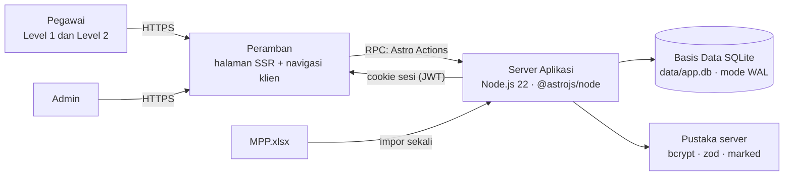
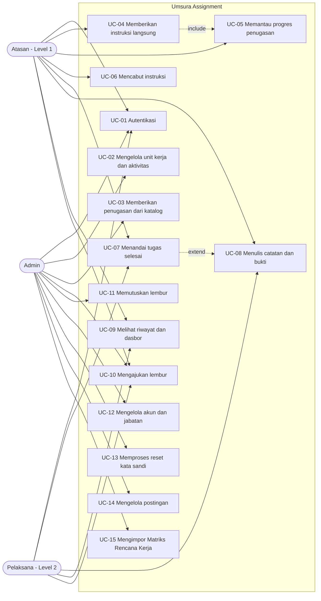
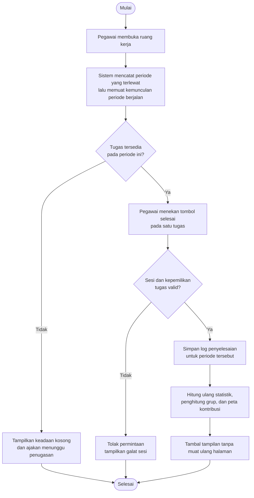
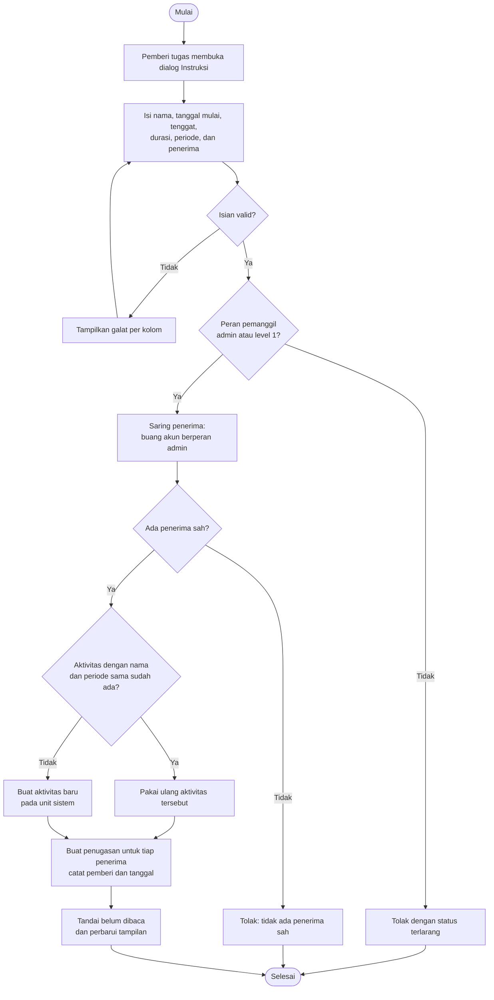
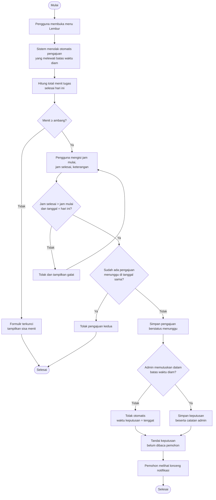
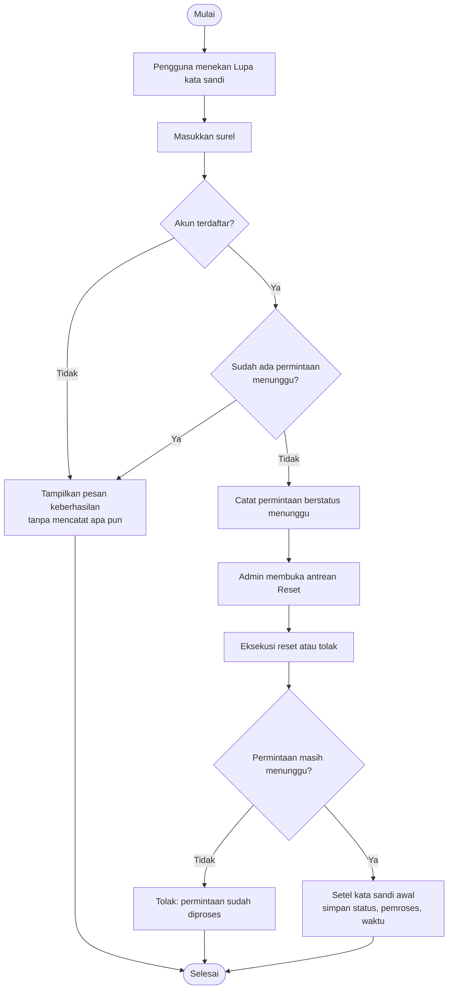
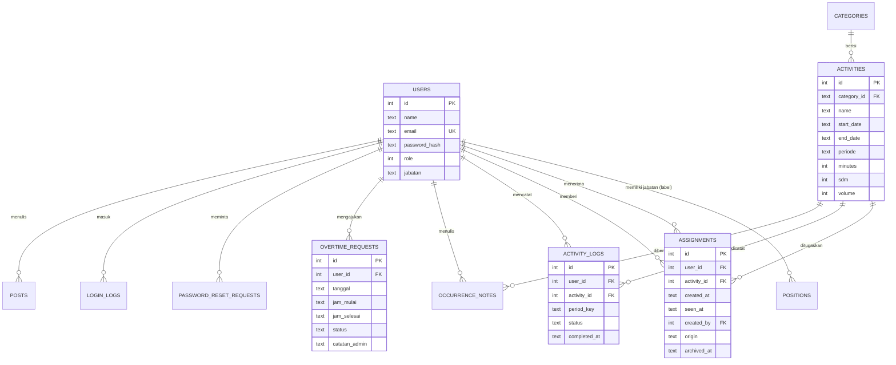
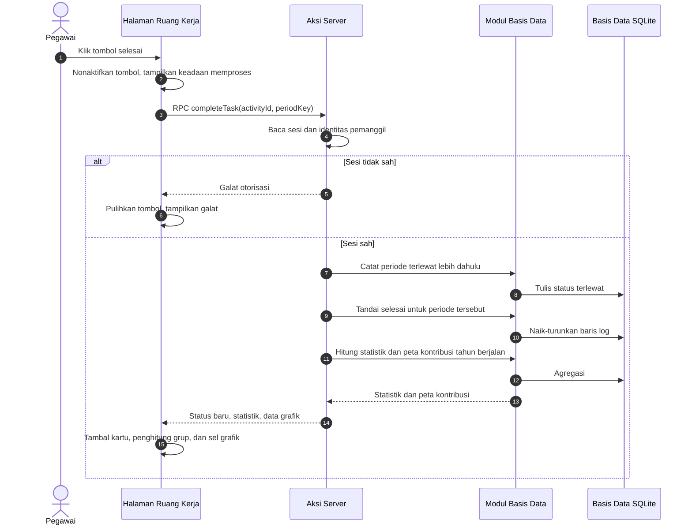
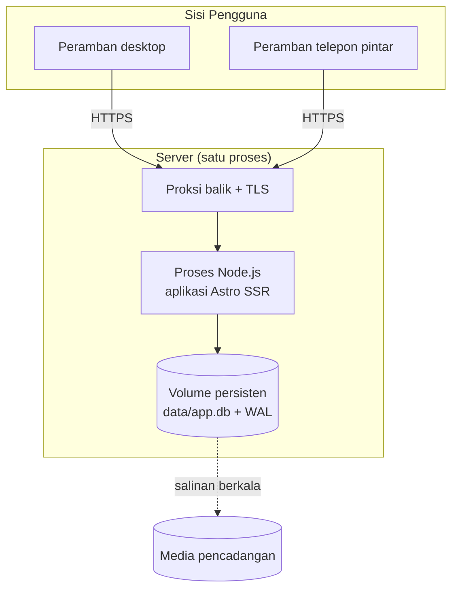

# C200 — Spesifikasi Produk "Umsura Assignment"

> Dokumen kerja (draft C200). Disusun mengikuti template **C200 Spesifikasi** dari
> *Buku Pedoman Pelaksanaan Capstone, Departemen Teknik Komputer Undip (2025)*,
> lampiran halaman 46–71. Angka bertanda `[UKUR]` wajib diisi dari hasil pengukuran
> aplikasi yang berjalan, bukan perkiraan.

---

## Halaman Identitas

| Field | Isi |
|---|---|
| Topik Capstone | Sistem Informasi Manajemen Penugasan dan Kinerja Unit Kerja |
| Siklus / Tahun | `[Gasal/Genap] / [tahun]` |
| Judul Capstone | Rancang Bangun Umsura Assignment: Sistem Penugasan, Pelaporan Kinerja, dan Pengajuan Lembur Berbasis Periode untuk Unit Kerja |
| Jenis Dokumen | **SPESIFIKASI** |
| Nomor Dokumen | `C200.[NoRev]TA[tahun].[1/2].[KodeKelompok]` |
| Nama File | `[KodeKelompok].pdf` |

Susunan halaman depan mengikuti template: sampul → **Data Pengusul** (3 anggota: nama,
jabatan, NIM, tanggal, tanda tangan) → **Pembimbing 1 (Utama)** dan **Pembimbing 2** →
**Riwayat Revisi** (kolom: Versi, Tanggal, Oleh, Perbaikan) → Daftar Isi → Daftar Gambar →
Daftar Tabel → Daftar Singkatan.

---

# 1. Pendahuluan

## 1.1 Ringkasan Isi Dokumen

Dokumen ini disusun untuk mendefinisikan secara rinci spesifikasi produk perangkat lunak
**"Umsura Assignment"**, sebuah sistem informasi yang dirancang untuk mendigitalkan proses
penugasan, pelaporan penyelesaian pekerjaan, penelusuran bukti kinerja, dan pengajuan kerja
lembur pada unit kerja pemerintahan bergaya satuan kerja (*satuan kerja*). Sistem ini
menggantikan pengelolaan Matriks Rencana Kerja (MPP) yang saat ini berupa lembar kerja
tersebar, penugasan yang disampaikan secara lisan maupun melalui aplikasi pesan, serta rekap
kinerja yang dihitung manual pada akhir periode.

Tujuan spesifik dokumen ini adalah:

- Mendefinisikan ruang lingkup sistem beserta batasannya secara eksplisit, sehingga fitur
  yang tidak termasuk dalam lingkup tidak menimbulkan ekspektasi yang keliru pada pemangku
  kepentingan.
- Mendokumentasikan kebutuhan fungsional dan non-fungsional secara terukur dan dapat diuji,
  agar setiap kebutuhan dapat diverifikasi pada tahap implementasi (C400) dan pengujian
  (C500).
- Memodelkan alur proses bisnis utama beserta alur negatifnya sebagai dasar perancangan pada
  dokumen C300.
- Menetapkan karakteristik pengguna dan hak akses tiap peran sebagai acuan tunggal bagi
  perancangan mekanisme otorisasi.

Dokumen ini tidak membahas pemilihan teknologi secara rinci, rancangan basis data fisik,
maupun rencana pengujian; ketiga hal tersebut dibahas pada dokumen C300 dan C400.

## 1.2 Aplikasi Dokumen

Dokumen ini berlaku sebagai *technical specification design* yang berfungsi untuk menjelaskan:

1. Gambaran proses rekayasa atau proses bisnis yang diakomodasi oleh sistem, termasuk ruang
   lingkup sistem.
2. Target efisiensi/efektivitas yang ingin dicapai beserta metrik yang digunakan untuk
   mengukurnya.
3. Dokumentasi spesifikasi sistem yang dibangun, sebagai dasar perancangan produk pada
   dokumen C300 dan verifikasi hasil pada C400.

## 1.3 Referensi

> Format IEEE. Ganti dan tambahkan sesuai sumber yang benar-benar kamu baca — daftar di bawah
> adalah kandidat yang relevan dengan isi dokumen, bukan sitasi yang sudah diverifikasi.

[1] IEA Constituent Agreements, *Graduate Attributes and Professional Competences*, 2021.
[Daring]. Tersedia: https://www.ieagreements.org/

[2] International Organization for Standardization, *ISO/IEC 25010:2023 – Systems and software
Quality Requirements and Evaluation (SQuaRE) – Product quality model*, 2023.

[3] The Astro Technology Company, "Astro Documentation – On-demand Rendering & Actions," 2026.
[Daring]. Tersedia: https://docs.astro.build/

[4] SQLite Consortium, "Write-Ahead Logging," *SQLite Documentation*, 2026. [Daring].
Tersedia: https://www.sqlite.org/wal.html

[5] Auth.js, "Auth.js Documentation – Session Strategies," 2026. [Daring].
Tersedia: https://authjs.dev/

[6] `[Tambahkan jurnal tentang e-government / manajemen kinerja / sistem penugasan, 2022–2026]`

## 1.4 Daftar Singkatan

| Akronim | Pengertian |
|---|---|
| MPP | Matriks Rencana Kerja |
| SKP | Sasaran Kinerja Pegawai |
| RBAC | *Role-Based Access Control* |
| CRUD | *Create, Read, Update, Delete* |
| SSR | *Server-Side Rendering* |
| RPC | *Remote Procedure Call* |
| SPA | *Single Page Application* |
| JWT | *JSON Web Token* |
| WAL | *Write-Ahead Logging* |
| ERD | *Entity Relationship Diagram* |
| BPMN | *Business Process Model and Notation* |
| RPO | *Recovery Point Objective* |
| RTO | *Recovery Time Objective* |
| TLS | *Transport Layer Security* |

---

# 2. Spesifikasi Sistem dan Pengguna

## 2.1 Gambaran Sistem

Umsura Assignment dirancang untuk menyelesaikan satu masalah pokok pada unit kerja:
**pekerjaan sudah tercatat di atas kertas, tetapi tidak dapat dibuktikan, ditelusuri, maupun
direkap secara otomatis.** Matriks Rencana Kerja mendefinisikan apa yang seharusnya dikerjakan
tiap unit, namun tidak memiliki mekanisme untuk mencatat siapa mengerjakan apa, kapan
diselesaikan, dan dengan bukti apa. Akibatnya, penyusunan laporan kinerja bergantung pada
ingatan pelaksana dan rekap manual, sementara atasan tidak memiliki cara memantau progres
tanpa bertanya langsung.

Sistem ini menjawab masalah tersebut melalui empat mekanisme utama. **Pertama, katalog
aktivitas terpusat.** Seluruh baris Matriks Rencana Kerja dari sebelas unit kerja diimpor ke
dalam basis data sebagai definisi aktivitas, masing-masing dengan periode pengulangan (Harian,
Mingguan, Bulanan, Triwulan, Semesteran, Tahunan, atau Kegiatan), durasi standar dalam menit,
kebutuhan SDM, dan volume kerja. **Kedua, penugasan.** Aktivitas dari katalog diberikan kepada
pegawai, baik secara perorangan, secara massal (banyak aktivitas ke banyak pegawai sekaligus),
maupun melalui mekanisme **Instruksi** — penugasan langsung yang diberikan atasan di luar
katalog, lengkap dengan pencatatan siapa pemberi tugas. **Ketiga, pelaksanaan dan pembuktian.**
Setiap penugasan direifikasi menjadi kemunculan (*occurrence*) per periode. Pegawai menandai
penyelesaian, melampirkan catatan dan tautan bukti, dan sistem secara otomatis mencatat periode
yang terlewat apabila tenggat terlampaui tanpa penyelesaian. **Keempat, pemantauan.** Atasan
melihat progres tiap penugasan yang ia berikan per periode, sementara dasbor pegawai
menampilkan beban kerja hari ini, ritme penyelesaian empat belas hari terakhir, dan peta
kontribusi setahun dalam bentuk *heatmap*.

Di samping alur utama tersebut, sistem menyediakan modul **pengajuan lembur** yang mengikat
pengajuan pada bukti kerja: formulir pengajuan hanya terbuka apabila total menit tugas yang
telah diselesaikan pada hari tersebut mencapai ambang tertentu, sehingga lembur tidak dapat
diajukan tanpa dasar pekerjaan yang tercatat. Pengajuan diputuskan oleh admin dalam satu
tingkat persetujuan, dengan batas waktu diam yang menyebabkan penolakan otomatis.

Keunggulan yang diharapkan dari sistem ini adalah: (a) **ketertelusuran** — setiap tugas
memiliki pemberi, penerima, periode, status, dan bukti; (b) **keotomatisan rekap** — angka
capaian dihitung dari data transaksi, bukan dari perhitungan ulang manual; (c) **kesetaraan
proses antar unit** — seluruh unit kerja memakai kosakata periode dan status yang sama sehingga
capaian antar unit dapat dibandingkan; dan (d) **ketertiban administrasi** — permintaan reset
kata sandi, pengelolaan jabatan, dan pengumuman terpusat pada satu aplikasi.

**Gambar 2.1 Arsitektur Logis Sistem**



Sistem berjalan sebagai satu proses Node.js yang melayani seluruh permintaan. Setiap perubahan
data dikirim sebagai RPC ke *server actions*; setiap aksi memeriksa ulang sesi dan peran
pemanggilnya di sisi server sebelum menyentuh basis data. Halaman tidak pernah dimuat ulang
penuh: hasil aksi dipakai untuk menambal DOM yang sudah dirender server, sehingga status,
penghitung, dan grafik berubah tanpa kehilangan posisi gulir.

## 2.2 Batasan Sistem

Batasan berikut bersifat mengikat dan disengaja, bukan kekurangan yang belum disadari.
Masing-masing disertai alasan agar dapat dipertanggungjawabkan pada sidang.

1. **Penyelesaian tugas tidak melalui persetujuan atasan.** Tugas dinyatakan selesai pada saat
   pegawai menandainya selesai. Tidak ada langkah verifikasi atau persetujuan bukti oleh
   atasan. Batasan ini dipilih karena alur persetujuan berlapis menambah beban administrasi
   pada volume tugas harian yang tinggi; mekanisme ini direncanakan sebagai pengembangan
   lanjutan.
2. **Pengajuan lembur hanya untuk hari berjalan.** Formulir pengajuan hanya menerima tanggal
   hari ini dan tidak menerima rentang lintas tengah malam. Lembur yang dikerjakan sebelum
   tengah malam dan baru diajukan setelah tengah malam akan ditolak karena masuk ke basis hari
   sebelumnya.
3. **Persetujuan lembur satu tingkat.** Hanya admin yang memutuskan pengajuan; tidak ada
   persetujuan berjenjang atasan–admin. Konsekuensinya, modul ini tidak memodelkan hierarki
   organisasi.
4. **Tidak ada hierarki atasan–bawahan.** Sistem membedakan tiga peran (admin, level 1, level
   2), tetapi tidak menyimpan relasi struktural siapa atasan siapa. Sebagai akibatnya, seorang
   pengguna level 1 dapat memberikan instruksi kepada pengguna level 1 lain. Pembatasan ini
   menunggu tersedianya data struktur organisasi.
5. **Pemulihan kata sandi tanpa token dan tanpa surel.** Halaman "Lupa kata sandi" hanya
   mencatat permintaan; admin mengeksekusi reset menjadi kata sandi awal yang seragam. Tidak ada
   tautan reset sekali pakai maupun verifikasi kepemilikan surel, sehingga sistem tidak dapat
   digunakan sebagai kanal pemulihan mandiri.
6. **Notifikasi bersifat tarik, bukan dorong.** Tidak ada surel, SMS, maupun *push
   notification*. Notifikasi tugas masuk dan keputusan lembur ditampilkan sebagai lonceng di
   kepala halaman dan baru terlihat ketika pengguna membuka aplikasi.
7. **Basis data berupa satu berkas SQLite dengan satu penulis.** Sistem diskalakan secara
   vertikal (menambah sumber daya satu proses), bukan horizontal. Menjalankan dua instans
   aplikasi terhadap berkas yang sama tidak didukung.
8. **Belum ada rekap atau ekspor lembur**, dan belum ada penanda khusus (misalnya "Red Notice")
   untuk pekerjaan yang terlambat.
9. **Sistem tidak menangani berkas dokumen.** Bukti pekerjaan dilampirkan sebagai **tautan** ke
   berkas yang disimpan di luar sistem, bukan sebagai unggahan berkas. Batasan ini menghindari
   kebutuhan penyimpanan objek dan pemindaian berkas.
10. **Antarmuka hanya tersedia dalam Bahasa Indonesia** dan dirancang untuk peramban modern
    dengan JavaScript aktif pada area administratif.

## 2.3 Kebutuhan Fungsional

Subbab ini menjelaskan apa yang harus dilakukan sistem untuk memenuhi kebutuhan pada Gambar
2.1, tanpa membahas cara teknis implementasinya.

**Tabel 2.1 Daftar Kebutuhan Fungsional**

| ID | Kebutuhan Fungsional | Aktor | Fitur | Prioritas |
|---|---|---|---|---|
| F-01 | Sistem mengautentikasi pengguna dengan surel dan kata sandi, serta mencatat waktu, alamat IP, dan peramban setiap login | Semua | Autentikasi | Wajib |
| F-02 | Sistem mengarahkan pengguna ke ruang kerja sesuai perannya setelah login | Semua | Autentikasi | Wajib |
| F-03 | Sistem menampilkan, menambah, mengubah, dan menghapus unit kerja beserta ikon dan urutannya | Admin | Master unit kerja | Wajib |
| F-04 | Sistem menampilkan, menambah, mengubah, dan menghapus jenis aktivitas per unit kerja, mencakup nama, tanggal mulai, tenggat, durasi, periode, klasifikasi, frekuensi, SDM, dan volume | Admin | Master aktivitas | Wajib |
| F-05 | Pengguna dapat mengajukan permintaan reset kata sandi dari halaman login tanpa mengungkap keberadaan akun | Semua | Pemulihan akun | Wajib |
| F-06 | Admin memproses antrean permintaan reset: mengeksekusi reset atau menolak permintaan | Admin | Pemulihan akun | Wajib |
| F-07 | Sistem menampilkan indikator jumlah permintaan reset yang menunggu pada seluruh halaman admin | Admin | Pemulihan akun | Wajib |
| F-08 | Admin memberikan aktivitas dari katalog kepada satu pengguna | Admin | Penugasan | Wajib |
| F-09 | Admin memberikan banyak aktivitas kepada banyak pengguna sekaligus, dengan pasangan yang sudah ada dilewati | Admin | Penugasan massal | Wajib |
| F-10 | Sistem menampilkan notifikasi jumlah penugasan yang belum dibaca penerimanya | Level 1, 2 | Notifikasi | Wajib |
| F-11 | Pengguna level 1 dan admin memberikan instruksi langsung kepada pengguna non-admin, beserta tenggat, durasi, periode, dan daftar penerima | Admin, Level 1 | Instruksi | Wajib |
| F-12 | Sistem mencatat pemberi tugas dan menampilkannya pada sisi penerima | Semua | Ketertelusuran | Wajib |
| F-13 | Sistem menampilkan progres tiap penugasan yang diberikan per periode: selesai, terlewat, berjalan, atau belum mulai | Admin, Level 1 | Ketertelusuran | Wajib |
| F-14 | Pemberi tugas dapat mencabut instruksi yang ia berikan sendiri | Admin, Level 1 | Instruksi | Wajib |
| F-15 | Admin mengarsipkan penugasan tanpa menghapus riwayat, serta memulihkan atau menghapusnya secara permanen | Admin | Siklus penugasan | Wajib |
| F-16 | Sistem menampilkan daftar tugas pengguna untuk periode berjalan, dikelompokkan dan diurutkan menurut keterlambatan | Level 1, 2 | Ruang kerja | Wajib |
| F-17 | Pengguna menandai kemunculan tugas sebagai selesai dan membatalkannya | Level 1, 2 | Ruang kerja | Wajib |
| F-18 | Pengguna menyimpan catatan dan tautan bukti per kemunculan tugas, terpisah dari status penyelesaian | Level 1, 2 | Bukti pekerjaan | Wajib |
| F-19 | Sistem mencatat periode yang terlewat secara otomatis ketika tenggat terlampaui tanpa penyelesaian | Sistem | Ruang kerja | Wajib |
| F-20 | Pengguna melihat riwayat penyelesaian dan periode terlewat lintas periode | Level 1, 2 | Riwayat | Wajib |
| F-21 | Sistem menampilkan peta kontribusi tahunan dan tren penyelesaian empat belas hari terakhir | Level 1, 2 | Dasbor | Wajib |
| F-22 | Sistem menampilkan beban kerja hari ini: jumlah tugas terbuka dan estimasi sisa menit | Level 1, 2 | Dasbor | Wajib |
| F-23 | Sistem menolak pengajuan lembur bila total menit tugas selesai hari itu belum mencapai ambang | Level 1, 2 | Lembur | Wajib |
| F-24 | Pengguna mengajukan lembur untuk hari berjalan dengan jam mulai, jam selesai, dan keterangan, maksimal satu pengajuan menunggu per tanggal | Level 1, 2 | Lembur | Wajib |
| F-25 | Pengguna membatalkan pengajuan lembur miliknya yang masih menunggu | Level 1, 2 | Lembur | Wajib |
| F-26 | Admin menyetujui atau menolak pengajuan lembur disertai catatan | Admin | Lembur | Wajib |
| F-27 | Sistem menolak otomatis pengajuan yang tidak diputuskan dalam batas waktu diam yang ditetapkan | Sistem | Lembur | Wajib |
| F-28 | Admin mengubah ambang menit dan batas waktu diam lembur | Admin | Lembur | Wajib |
| F-29 | Sistem memberi tahu pemohon atas keputusan lembur melalui lonceng notifikasi | Level 1, 2 | Notifikasi | Wajib |
| F-30 | Admin mengelola akun pengguna: menambah, mengubah, menghapus, dan menetapkan jabatan | Admin | Pengguna | Wajib |
| F-31 | Admin mengelola daftar Posisi/Jabatan yang menjadi pilihan pada formulir pengguna | Admin | Pengguna | Wajib |
| F-32 | Admin mengelola postingan pengumuman | Admin | Postingan | Wajib |
| F-33 | Sistem menampilkan ringkasan admin: pekerjaan yang perlu perhatian, cakupan penugasan per unit, tren login tujuh hari, dan log terbaru | Admin | Dasbor admin | Wajib |
| F-34 | Sistem menyediakan impor Matriks Rencana Kerja dari berkas lembar kerja secara idempoten | Admin | Master aktivitas | Opsional |
| F-35 | Sistem menampilkan ringkasan aktivitas pengguna pada tabel pengguna (jumlah tugas, capaian) | Admin | Pengguna | Opsional |

### 2.3.1 Deskripsi Fitur Utama

Sistem Umsura Assignment memiliki enam fitur inti sebagai berikut.

**1. Master Unit Kerja dan Jenis Aktivitas**

*Deskripsi:* Sistem menyimpan daftar unit kerja (kategori) dan, di bawah setiap unit, daftar
jenis aktivitas beserta seluruh atributnya. Atribut yang disimpan mencakup nama aktivitas,
rentang tanggal berlaku (mulai dan tenggat), penanda klasifikasi (utama, periodik, bukan tugas
pokok), periode pengulangan, frekuensi, durasi standar dalam menit, kebutuhan SDM, dan volume
kerja. Periode pengulangan yang didukung adalah Harian, Mingguan, Bulanan, Triwulan,
Semesteran, Tahunan, dan Kegiatan. Rentang tanggal berfungsi ganda: tanggal mulai menentukan
kapan tugas pertama kali muncul, sedangkan tanggal tenggat **menghentikan pengulangan**, bukan
menandai keterlambatan.

*Manfaat:* Menjadi satu-satunya sumber kebenaran mengenai "apa yang seharusnya dikerjakan"
tiap unit, sehingga penugasan tidak lagi dibuat ulang per pegawai dan kosakata periode seragam
antarsatuan kerja. Kemampuan impor dari Matriks Rencana Kerja memungkinkan migrasi ratusan baris
aktivitas tanpa pengetikan ulang.

**2. Penugasan dan Instruksi**

*Deskripsi:* Aktivitas dari katalog dapat diberikan kepada pegawai secara perorangan maupun
massal — banyak aktivitas ke banyak pegawai dalam satu tindakan, dengan pasangan yang sudah ada
dilewati agar tidak terjadi duplikasi. Di luar katalog, atasan (level 1) dan admin dapat
memberikan **instruksi langsung**: aktivitas baru yang lahir dari dialog, ditempatkan pada unit
sistem khusus, dan dicatat pemberinya. Instruksi juga mendukung penerima ganda. Penugasan yang
tidak lagi relevan dapat diarsipkan; pengarsipan menyembunyikan tugas dari dasbor dan lonceng
penerima tanpa menghapus baris, riwayat penyelesaian, maupun catatan.

*Manfaat:* Distribusi pekerjaan berpindah dari lisan dan pesan singkat ke satu kanal yang
tercatat, sehingga beban kerja tiap pegawai dapat dihitung dan penugasan ganda dapat dihindari.
Pengarsipan memungkinkan penataan tanpa kehilangan bukti historis.

**3. Ruang Kerja Periodik dan Bukti Pekerjaan**

*Deskripsi:* Setiap penugasan direifikasi menjadi kemunculan per periode. Ruang kerja pegawai
menampilkan kemunculan periode berjalan, dikelompokkan dan diurutkan sehingga pekerjaan yang
terlambat naik ke atas. Pegawai menandai selesai atau membatalkan tanda selesai; keduanya tidak
memuat ulang halaman. Catatan dan tautan bukti disimpan **terpisah** dari status penyelesaian
sehingga tetap ada ketika tanda selesai dibatalkan, dan dapat ditulis sebelum tugas selesai.
Periode yang lewat tanpa penyelesaian dicatat sistem sebagai "terlewat" pada tanggal jatuh
temponya, bukan pada tanggal sistem menyadarinya.

*Manfaat:* Menghasilkan jejak kronologis yang tidak dapat direkonstruksi belakangan, sekaligus
menyediakan bukti yang melekat pada periode kerja — bukan pada berkas terpisah yang mudah hilang.

**4. Pengajuan dan Persetujuan Lembur**

*Deskripsi:* Pengajuan lembur hanya dapat dibuat untuk hari berjalan, dan formulirnya baru
terbuka setelah total menit tugas yang diselesaikan hari itu mencapai ambang yang ditetapkan
admin (bawaan: 60 menit). Durasi lembur dihitung dari selisih jam mulai dan jam selesai saat
ditampilkan, bukan disimpan. Satu pengguna hanya boleh memiliki satu pengajuan menunggu per
tanggal. Admin memutuskan dalam satu tingkat persetujuan disertai catatan; pengajuan yang tidak
diputuskan dalam batas waktu diam (bawaan: 180 menit) ditolak otomatis. Keputusan diberitahukan
melalui lonceng notifikasi.

*Manfaat:* Mengikat klaim lembur pada bukti kerja yang sudah tercatat, sehingga lembur tidak
lagi diajukan berdasarkan perkiraan, dan memastikan setiap pengajuan memperoleh keputusan dalam
batas waktu yang pasti.

**5. Ketertelusuran dan Dasbor Kinerja**

*Deskripsi:* Pemberi tugas melihat panel progres yang menghitung status tiap penugasan per
periode — selesai, terlewat, berjalan, atau belum mulai — dengan logika periode yang sama persis
dengan yang dipakai dasbor penerima, sehingga status tidak bergantung pada apakah penerima
pernah membuka aplikasi. Riwayat periode disajikan sebagai rangkaian node terbatas dua belas
periode terakhir. Pada sisi pegawai, dasbor menampilkan beban kerja hari ini, tren penyelesaian
empat belas hari, dan peta kontribusi setahun bergaya *heatmap* yang membedakan hari produktif
dari periode terlewat. Pada sisi admin, dasbor menampilkan pekerjaan yang perlu perhatian,
cakupan penugasan per unit kerja, tren login tujuh hari, serta log dan pengumuman terbaru.

*Manfaat:* Atasan memperoleh jawaban atas dua pertanyaan inti — "siapa yang memberi tugas ini"
dan "apakah tugas ini dikerjakan" — tanpa perlu bertanya langsung, dan tanpa bergantung pada
keaktifan pegawai dalam membuka aplikasi.

**6. Administrasi Akun dan Pengumuman**

*Deskripsi:* Admin mengelola akun pengguna (menambah, mengubah, menghapus, menetapkan jabatan)
serta daftar Posisi/Jabatan yang menjadi pilihan pada formulir tersebut. Permintaan reset kata
sandi masuk sebagai antrean dengan indikator jumlah pada seluruh halaman admin; hanya permintaan
yang masih menunggu dapat diproses, sehingga formulir lama tidak dapat mereset akun dua kali.
Pengumuman dikelola sebagai postingan. Sistem juga menyediakan impor Matriks Rencana Kerja yang
dapat dijalankan berulang setelah berkas sumber diperbaiki.

*Manfaat:* Menghilangkan ketergantungan pada satu orang untuk pemulihan akun dan penyebaran
informasi, sekaligus menjaga konsistensi data kepegawaian melalui daftar jabatan terpusat.

### 2.3.2 Alur Proses Utama

Bagian ini memaparkan alur bisnis sistem, dilengkapi diagram use case, skenario use case, dan
diagram aktivitas untuk setiap proses utama, termasuk alur negatifnya.

#### A. Use Case Diagram

Sistem memiliki tiga aktor: **Admin**, **Atasan (Level 1)**, dan **Pelaksana (Level 2)**. Admin
dan level 1 sama-sama dapat memberikan instruksi, tetapi cakupan objeknya berbeda: admin
mengelola seluruh katalog, sedangkan level 1 terbatas pada instruksi yang ia berikan sendiri.

**Gambar 2.2 Use Case Diagram Sistem**



Catatan: Mermaid tidak menyediakan tipe diagram use case UML. Diagram di atas menggunakan
`flowchart` dengan subgraph sebagai batas sistem dan node berujung bulat sebagai aktor; notasi
`include`/`extend` digambarkan sebagai garis putus-putus berlabel.

#### B. Use Case Scenario

**Tabel 2.2 Use Case Scenario UC-01: Autentikasi**

| Atribut | Isi |
|---|---|
| Use Case ID Number | UC-01 |
| Use Case Name | Autentikasi |
| Use Case Description | Menggambarkan proses masuk ke sistem dan pengarahan ke ruang kerja sesuai peran. |
| Primary Actor | Admin, Atasan, Pelaksana |
| Secondary Actor | — |
| Pre-Condition | Pengguna telah memiliki akun yang aktif. |
| Post Condition | Pengguna berada pada ruang kerja sesuai perannya dan sesi tercatat. |

**Primary Flow of Events**

| User Action | System Response |
|---|---|
| 1. Pengguna membuka alamat sistem. | 2. Sistem memeriksa sesi; jika tidak ada, menampilkan formulir masuk. |
| 3. Pengguna memasukkan surel dan kata sandi. | 4. Sistem memverifikasi kata sandi terhadap *hash* tersimpan. |
| | 5. Sistem mencatat waktu, alamat IP, dan peramban ke log login. |
| | 6. Sistem menerbitkan sesi dan mengarahkan pengguna: admin ke dasbor admin, level 1 dan 2 ke ruang kerja. |

**Error Flow of Events**

| Langkah | Kondisi |
|---|---|
| 4a | Surel tidak ditemukan atau kata sandi tidak sesuai — sistem menampilkan pesan galat yang tidak membedakan keduanya dan tidak mencatat log login. |
| 2a | Pengguna membuka halaman terbatas tanpa sesi — sistem mengalihkan ke formulir masuk disertai penanda sesi berakhir. |
| 6a | Sesi tidak memuat identitas pengguna yang sah — sistem mengalihkan kembali ke formulir masuk. |

---

**Tabel 2.3 Use Case Scenario UC-03: Memberikan Penugasan dari Katalog**

| Atribut | Isi |
|---|---|
| Use Case ID Number | UC-03 |
| Use Case Name | Memberikan penugasan dari katalog |
| Use Case Description | Menggambarkan pemberian satu atau banyak aktivitas katalog kepada satu atau banyak pegawai. |
| Primary Actor | Admin |
| Secondary Actor | Atasan, Pelaksana |
| Pre-Condition | Admin telah masuk; unit kerja dan jenis aktivitas telah tersedia. |
| Post Condition | Penugasan tercatat, penerima menerima notifikasi tugas masuk. |

**Primary Flow of Events**

| User Action | System Response |
|---|---|
| 1. Admin membuka menu Penugasan dan memilih pegawai. | 2. Sistem menampilkan katalog aktivitas beserta penanda aktivitas yang sudah ditugaskan. |
| 3. Admin memilih satu atau beberapa aktivitas. | 4. Sistem menampilkan pratinjau jumlah pasangan baru. |
| 5. Admin menekan tombol tugaskan. | 6. Sistem memvalidasi sesi dan peran admin. |
| | 7. Sistem menyimpan pasangan penugasan yang belum ada, melewati yang sudah ada. |
| | 8. Sistem menandai penugasan baru sebagai belum dibaca dan memperbarui tampilan. |

**Error Flow of Events**

| Langkah | Kondisi |
|---|---|
| 3a | Admin tidak memilih aktivitas apa pun — sistem menonaktifkan tombol dan menampilkan pesan bahwa pilihan masih kosong. |
| 6a | Sesi berakhir atau peran bukan admin — sistem menolak permintaan dan menampilkan pesan bahwa tindakan tidak diizinkan. |
| 7a | Seluruh pasangan yang dipilih sudah ada — sistem tidak menulis apa pun dan memberi tahu bahwa tidak ada penugasan baru. |

---

**Tabel 2.4 Use Case Scenario UC-04: Memberikan Instruksi Langsung**

| Atribut | Isi |
|---|---|
| Use Case ID Number | UC-04 |
| Use Case Name | Memberikan instruksi langsung |
| Use Case Description | Menggambarkan pemberian tugas baru di luar katalog kepada satu atau beberapa pegawai non-admin. |
| Primary Actor | Admin, Atasan |
| Secondary Actor | Pelaksana |
| Pre-Condition | Pemberi tugas telah masuk dan berperan sebagai admin atau level 1. |
| Post Condition | Instruksi tercatat atas nama pemberi, penerima menerima notifikasi tugas masuk. |

**Primary Flow of Events**

| User Action | System Response |
|---|---|
| 1. Pemberi tugas membuka menu Instruksi dan menekan "Beri Instruksi". | 2. Sistem menampilkan formulir: nama, tanggal mulai, tenggat, durasi, periode, klasifikasi, frekuensi, SDM, serta daftar penerima yang dapat dicari. |
| 3. Pemberi tugas mengisi formulir dan memilih satu atau beberapa penerima. | 4. Sistem memvalidasi isian dan menghitung volume secara otomatis. |
| 5. Pemberi tugas menekan tombol kirim. | 6. Sistem memeriksa ulang sesi, peran, dan menyaring penerima agar hanya berperan non-admin. |
| | 7. Sistem membuat aktivitas pada unit sistem dan penugasan dalam satu transaksi. |
| | 8. Sistem mencatat pemberi tugas dan menandai penugasan sebagai belum dibaca. |

**Error Flow of Events**

| Langkah | Kondisi |
|---|---|
| 4a | Tanggal tenggat lebih awal daripada tanggal mulai, atau durasi/volume bukan bilangan positif — sistem menolak penyimpanan dan menampilkan galat pada kolom terkait. |
| 6a | Sesi berakhir atau peran tidak sah — sistem menolak permintaan. |
| 6b | Seluruh penerima yang dipilih berperan admin — sistem menolak karena tidak ada penerima sah. |
| 7a | Aktivitas dengan nama dan periode yang sama sudah ada pada unit sistem — sistem memakai ulang aktivitas tersebut alih-alih membuat duplikat. |

---

**Tabel 2.5 Use Case Scenario UC-05: Memantau Progres Penugasan**

| Atribut | Isi |
|---|---|
| Use Case ID Number | UC-05 |
| Use Case Name | Memantau progres penugasan |
| Use Case Description | Menggambarkan penelusuran status tiap penugasan yang diberikan, per periode. |
| Primary Actor | Admin, Atasan |
| Secondary Actor | Pelaksana |
| Pre-Condition | Pemberi tugas telah masuk dan pernah memberikan penugasan. |
| Post Condition | Pemberi tugas mengetahui status terkini setiap penugasan. |

**Primary Flow of Events**

| User Action | System Response |
|---|---|
| 1. Pemberi tugas membuka menu Instruksi atau Penugasan. | 2. Sistem menghitung periode yang telah berjalan untuk setiap penugasan sejak tanggal penugasan dibuat. |
| | 3. Sistem menampilkan ringkasan jumlah selesai, terlewat, dan berjalan. |
| | 4. Sistem menampilkan kartu per penugasan berisi status, pemberi, penerima, dan rangkaian periode terakhir. |
| 5. Pemberi tugas menyaring daftar dengan filter "belum selesai". | 6. Sistem menampilkan hanya penugasan yang belum tuntas dan menandai filter aktif pada alamat halaman. |

**Error Flow of Events**

| Langkah | Kondisi |
|---|---|
| 4a | Penugasan memiliki tanggal mulai di masa depan — sistem menampilkan status "Belum mulai" dan tidak menghitung periode apa pun. |
| 4b | Penugasan tidak memiliki catatan pemberi karena merupakan data lama — sistem tidak menampilkan baris pemberi sama sekali, bukan mengisinya dengan sebutan umum. |
| 4c | Penugasan memiliki lebih dari dua belas periode berjalan — sistem menampilkan dua belas periode terakhir dan jumlah periode yang tidak ditampilkan. |

---

**Tabel 2.6 Use Case Scenario UC-10: Mengajukan Lembur**

| Atribut | Isi |
|---|---|
| Use Case ID Number | UC-10 |
| Use Case Name | Mengajukan lembur |
| Use Case Description | Menggambarkan pengajuan lembur untuk hari berjalan setelah ambang menit terpenuhi. |
| Primary Actor | Pelaksana, Atasan |
| Secondary Actor | Admin |
| Pre-Condition | Pengguna telah masuk; pengguna telah menyelesaikan tugas pada hari berjalan. |
| Post Condition | Pengajuan tercatat berstatus menunggu dan menunggu keputusan admin. |

**Primary Flow of Events**

| User Action | System Response |
|---|---|
| 1. Pengguna membuka menu Lembur. | 2. Sistem menjalankan penyaringan pengajuan kedaluwarsa, lalu menghitung total menit tugas yang selesai hari ini. |
| | 3. Jika total menit ≥ ambang, sistem menampilkan formulir pengajuan. |
| 4. Pengguna mengisi jam mulai, jam selesai, dan keterangan, lalu mengirim. | 5. Sistem memeriksa ulang ambang menit, memastikan tanggal adalah hari ini, dan jam selesai lebih lambat daripada jam mulai. |
| | 6. Sistem menyimpan pengajuan berstatus menunggu dan menampilkannya pada riwayat pengguna. |

**Error Flow of Events**

| Langkah | Kondisi |
|---|---|
| 3a | Total menit belum mencapai ambang — sistem tidak membuka formulir dan menampilkan sisa menit yang diperlukan. |
| 5a | Ambang tidak lagi terpenuhi karena permintaan dikirim ulang setelah data berubah — sistem menolak dan menampilkan galat. |
| 5b | Jam selesai tidak lebih lambat daripada jam mulai — sistem menolak dan menampilkan galat pada kolom terkait. |
| 5c | Pengguna sudah memiliki pengajuan menunggu pada tanggal yang sama — sistem menolak pengajuan kedua. |

---

**Tabel 2.7 Use Case Scenario UC-11: Memutuskan Lembur**

| Atribut | Isi |
|---|---|
| Use Case ID Number | UC-11 |
| Use Case Name | Memutuskan lembur |
| Use Case Description | Menggambarkan persetujuan atau penolakan pengajuan lembur oleh admin. |
| Primary Actor | Admin |
| Secondary Actor | Pelaksana, Atasan |
| Pre-Condition | Admin telah masuk; terdapat pengajuan berstatus menunggu yang belum kedaluwarsa. |
| Post Condition | Pengajuan berstatus disetujui atau ditolak; pemohon menerima notifikasi keputusan. |

**Primary Flow of Events**

| User Action | System Response |
|---|---|
| 1. Admin membuka menu Lembur. | 2. Sistem menyaring pengajuan yang melewati batas waktu diam menjadi ditolak, lalu menampilkan antrean pengajuan menunggu. |
| 3. Admin membuka satu pengajuan dan meninjau jam, durasi, dan keterangan. | 4. Sistem menampilkan rincian pengajuan. |
| 5. Admin memilih setujui atau tolak, mengisi catatan, lalu mengirim. | 6. Sistem memvalidasi sesi dan peran admin, memastikan pengajuan masih berstatus menunggu. |
| | 7. Sistem menyimpan keputusan, waktu keputusan, dan catatan admin, lalu menandai keputusan sebagai belum dibaca pemohon. |

**Error Flow of Events**

| Langkah | Kondisi |
|---|---|
| 6a | Pengajuan telah diputuskan atau kedaluwarsa lebih dahulu — sistem menolak dan menyegarkan antrean. |
| 6b | Sesi berakhir atau peran bukan admin — sistem menolak permintaan. |
| 6c | Catatan penolakan kosong — sistem tetap mengizinkan penolakan, namun menampilkan catatan kosong pada sisi pemohon sebagai konsekuensi yang telah diketahui. |

---

**Tabel 2.8 Use Case Scenario UC-13: Memproses Reset Kata Sandi**

| Atribut | Isi |
|---|---|
| Use Case ID Number | UC-13 |
| Use Case Name | Memproses reset kata sandi |
| Use Case Description | Menggambarkan penanganan permintaan reset kata sandi oleh admin. |
| Primary Actor | Admin |
| Secondary Actor | Pengguna yang mengajukan |
| Pre-Condition | Admin telah masuk; terdapat permintaan berstatus menunggu. |
| Post Condition | Kata sandi akun menjadi kata sandi awal, atau permintaan ditolak. |

**Primary Flow of Events**

| User Action | System Response |
|---|---|
| 1. Pengguna menekan "Lupa kata sandi" pada halaman masuk dan mengisi surel. | 2. Sistem mencatat permintaan bila akun ada, dan tetap menampilkan pesan keberhasilan yang sama bila akun tidak ada. |
| 3. Admin membuka menu Reset. | 4. Sistem menampilkan antrean permintaan menunggu beserta indikator jumlahnya. |
| 5. Admin memilih eksekusi reset atau tolak. | 6. Sistem memastikan permintaan masih berstatus menunggu, lalu menyimpan status, pemroses, dan waktu pemrosesan. |

**Error Flow of Events**

| Langkah | Kondisi |
|---|---|
| 2a | Surel tidak terdaftar — sistem tidak mencatat apa pun dan menampilkan pesan keberhasilan yang identik, sehingga keberadaan akun tidak dapat disimpulkan. |
| 2b | Akun telah memiliki satu permintaan menunggu — sistem menolak membuat permintaan kedua. |
| 6a | Permintaan telah diproses sebelumnya — sistem menolak, sehingga formulir lama tidak dapat mereset akun dua kali. |

#### C. Activity Diagram

Diagram aktivitas berikut memodelkan proses-proses utama beserta cabang negatifnya.

**Gambar 2.3 Activity Diagram: Menandai Penyelesaian Tugas**



**Gambar 2.4 Activity Diagram: Memberikan Instruksi Langsung**



**Gambar 2.5 Activity Diagram: Mengajukan dan Memutuskan Lembur**



**Gambar 2.6 Activity Diagram: Pemulihan Kata Sandi**



## 2.4 Kebutuhan Data

**1. Jenis Data.** Sistem mengelola dua belas tabel yang dapat dikelompokkan menjadi empat
ranah: (a) **kepegawaian dan akses** — `users` (akun, peran, jabatan), `positions` (daftar
jabatan), `login_logs` (riwayat masuk), `password_reset_requests` (antrean reset); (b) **kerja
dan penugasan** — `categories` (unit kerja), `activities` (jenis aktivitas), `assignments`
(penugasan), `activity_logs` (status penyelesaian per periode), `occurrence_notes` (catatan dan
tautan bukti per periode); (c) **lembur** — `overtime_requests` (pengajuan), `overtime_settings`
(ambang menit dan batas waktu diam); (d) **informasi** — `posts` (pengumuman). Atribut kunci
tiap entitas dirinci pada Tabel 2.9.

**2. Sumber Data.** Lima sumber: masukan admin melalui formulir master (unit kerja, aktivitas,
pengguna, jabatan, pengumuman, setelan lembur); tindakan pegawai melalui ruang kerja
(penyelesaian, catatan, pengajuan lembur); perhitungan sistem (periode terlewat, penolakan
lembur otomatis, agregasi statistik); berkas **Matriks Rencana Kerja** yang diimpor sekali pada
tahap penyiapan; dan metadata permintaan HTTP untuk log login (alamat IP dari header *forwarded*
dan *user-agent* peramban).

**3. Format Data.** Seluruh tanggal disimpan sebagai teks ISO `YYYY-MM-DD` pada zona waktu
Jakarta; tanggal sipil sengaja dipisahkan dari waktu agar bebas dari pergeseran zona waktu.
Kunci periode mengikuti pola per jenis periode: `YYYY-MM-DD` (Harian), `YYYY-Wnn` (Mingguan,
pekan ISO), `YYYY-MM` (Bulanan dan Kegiatan), `YYYY-Qn` (Triwulan), `YYYY-Sn` (Semesteran),
`YYYY` (Tahunan). Enumerasi yang dibatasi *constraint*: peran `0|1|2`; status penyelesaian
`selesai|terlewat`; status lembur `pending|disetujui|ditolak`; status permintaan reset
`pending|reset|rejected`; periode `Harian|Mingguan|Bulanan|Triwulan|Semesteran|Tahunan|Kegiatan`.
Rentang tanggal aktivitas menggunakan string kosong sebagai penanda "tanpa batas". Durasi lembur
tidak disimpan, melainkan dihitung dari jam mulai dan jam selesai.

**4. Volume Data.** Jumlah baris `activity_logs` dan `occurrence_notes` sebanding dengan jumlah
kemunculan, yang dihitung dari jenis periode:

| Periode | Kemunculan per tahun | Contoh: 30 aktivitas per pegawai |
|---|---|---|
| Harian | 365 | 10.950 baris/tahun |
| Mingguan | 52 | 1.560 baris/tahun |
| Bulanan / Kegiatan | 12 | 360 baris/tahun |
| Triwulan | 4 | 120 baris/tahun |
| Semesteran | 2 | 60 baris/tahun |
| Tahunan | 1 | 30 baris/tahun |

Dengan asumsi 200 pegawai dan komposisi tugas yang didominasi periode bulanan serta harian,
kebutuhan penyimpanan tahap awal diperkirakan pada orde puluhan megabita per tahun. Sistem
membatasi akumulasi periode per penugasan pada 400 periode untuk mencegah perhitungan tak
terbatas. `[UKUR ukuran data/app.db aktual dan jumlah baris per tabel pada data uji]`

**5. Frekuensi Pengumpulan Data.** Data tidak dialirkan secara berkelanjutan. Penulisan terjadi
per kejadian: satu baris log per login, satu baris per penandaan selesai, satu baris per catatan
yang disimpan, satu baris per pengajuan lembur. Pembacaan agregat (statistik, tren, peta
kontribusi) dilakukan saat halaman dibuka.

**6. Penyimpanan Data.** Data disimpan pada satu berkas SQLite dengan mode *Write-Ahead
Logging*, sehingga operasi baca tidak terblokir oleh penulisan. Retensi bersifat permanen:
penghapusan penugasan oleh pengguna diimplementasikan sebagai pengarsipan (menyembunyikan tanpa
menghapus), sedangkan penghapusan permanen hanya tersedia pada tab arsip dan tetap dimaksudkan
untuk membersihkan data yang salah masuk. `[UKUR estimasi laju pertumbuhan berkas per bulan pada
data uji]`

**7. Keamanan Data.** Kata sandi disimpan sebagai *hash* bcrypt, tidak pernah sebagai teks
biasa. Sesi disimpan pada cookie bertanda tangan dan diverifikasi ulang terhadap baris pengguna
pada setiap pembacaan, sehingga perubahan nama, surel, atau peran langsung berlaku tanpa
menunggu sesi berakhir. Seluruh kueri basis data menggunakan parameter terikat untuk mencegah
injeksi. Tautan bukti divalidasi dua kali — di peramban dan di server — dan hanya menerima URL
absolut berskema `http` atau `https`. Permintaan reset tidak menyimpan token maupun membocorkan
keberadaan akun.

**8. Kebutuhan Pemrosesan Data.** Tiga proses turunan yang penting: (a) **materialisasi
keterlambatan** — saat dasbor pegawai dibuka, sistem menelusuri periode yang telah lewat tanpa
penyelesaian dan mencatatnya sebagai terlewat pada tanggal jatuh tempo periode tersebut; (b)
**penolakan lembur otomatis** — setiap pembacaan data lembur terlebih dahulu menandai pengajuan
yang melewati batas waktu diam, dengan waktu keputusan dihitung deterministik dari waktu
pengajuan ditambah batas tersebut; (c) **agregasi dasbor** — total menit selesai hari ini, tren
penyelesaian empat belas hari, peta kontribusi tahunan, dan cakupan penugasan per unit dihitung
dari tabel transaksi, bukan dari tabel ringkasan tersendiri.

**Tabel 2.9 Ringkasan Entitas dan Atribut Kunci**

| Entitas | Atribut Kunci | Keterangan |
|---|---|---|
| `users` | id, name, email (unik), password_hash, role, jabatan | `jabatan` menyimpan label teks, bukan kunci asing |
| `positions` | id, label (unik, tanpa beda huruf besar/kecil) | Pilihan jabatan pada formulir pengguna |
| `categories` | id (teks), label, icon, position | Termasuk satu unit sistem untuk instruksi |
| `activities` | id, category_id, name, start_date, end_date, periode, frequency, minutes, sdm, volume | Tiga penanda klasifikasi terpisah |
| `assignments` | id, user_id, activity_id, created_at, seen_at, created_by, origin, archived_at | Unik per pasangan pengguna–aktivitas |
| `activity_logs` | user_id, activity_id, period_key, status, completed_at | Unik per pengguna–aktivitas–periode |
| `occurrence_notes` | user_id, activity_id, period_key, note, link | Kunci primer gabungan; berdiri sendiri dari status |
| `overtime_requests` | id, user_id, tanggal, jam_mulai, jam_selesai, status, catatan_admin, seen_at, handled_by | Maksimal satu status menunggu per pengguna per tanggal |
| `overtime_settings` | id (selalu 1), min_minutes, expire_minutes | Satu baris tunggal |
| `password_reset_requests` | id, user_id, status, handled_by, handled_at | Maksimal satu status menunggu per akun |
| `login_logs` | id, user_id, ip, user_agent, created_at | Riwayat masuk untuk dasbor admin |
| `posts` | id, title, body, author_id, position | Pengumuman |

**Gambar 2.7 Entity Relationship Diagram**



Catatan: Mermaid `erDiagram` tidak dapat menggambarkan kunci primer gabungan secara tepat.
Tabel `occurrence_notes` memakai kunci primer gabungan `(user_id, activity_id, period_key)`, dan
`activity_logs` memakai batasan unik atas tiga kolom yang sama; kedua hal tersebut dijelaskan
pada teks, bukan pada diagram.

## 2.5 Kebutuhan Non Fungsional

**Tabel 2.10 Daftar Kebutuhan Non Fungsional**

| ID | Kategori | Kebutuhan | Kriteria Terukur |
|---|---|---|---|
| NF-01 | Kinerja | Waktu muat halaman dasbor pegawai dengan 50 kemunculan tugas | ≤ `[UKUR]` ms pada koneksi lokal |
| NF-02 | Kinerja | Waktu respons aksi penandaan selesai hingga tampilan berubah | ≤ `[UKUR]` ms tanpa muat ulang halaman |
| NF-03 | Keamanan | Setiap aksi mutasi memeriksa sesi dan peran di sisi server | 100% aksi; tidak ada otorisasi yang hanya bergantung pada antarmuka |
| NF-04 | Keamanan | Kata sandi tidak pernah disimpan atau dicatat dalam bentuk teks biasa | Verifikasi pada basis data |
| NF-05 | Keamanan | Tidak ada akun yang dapat dienumerasi melalui halaman pemulihan kata sandi | Respons identik untuk surel terdaftar dan tidak terdaftar |
| NF-06 | Keandalan | Data tidak hilang pada penulisan serentak | Mode WAL aktif; penulisan master dalam satu transaksi |
| NF-07 | Keandalan | Pemulihan dari kegagalan berkas basis data | RPO `[UKUR]`; RTO `[UKUR]` |
| NF-08 | Skalabilitas | Sistem melayani `[UKUR]` pengguna aktif bersamaan | Uji beban pada C400 |
| NF-09 | Portabilitas | Sistem berjalan pada lingkungan Node.js 22 tanpa ketergantungan layanan awan berbayar | Berjalan pada satu server dengan volume persisten |
| NF-10 | Aksesibilitas | Setiap kontrol dapat dioperasikan dengan papan ketik, dan status tidak disampaikan hanya melalui warna | Uji dengan pembaca layar dan navigasi Tab |
| NF-11 | Usabilitas | Antarmuka responsif hingga lebar 390 px tanpa luapan horizontal | Uji pada lebar 390 px |
| NF-12 | Pemeliharaan | Setiap mutasi terpusat pada satu modul aksi dengan validasi masukan seragam | Tinjauan kode; tidak ada kueri tulis di luar modul tersebut |

### 2.5.1 Kinerja Sistem

Kinerja sistem diukur pada tiga jalur yang paling sering dilalui pengguna. **Waktu muat halaman
ruang kerja** menjadi tolok ukur terpenting karena halaman ini dihitung dari data transaksi
setiap kali dibuka, mencakup materialisasi periode terlewat, pemuatan kemunculan periode
berjalan, statistik, tren empat belas hari, dan peta kontribusi tahunan. Target yang ditetapkan
adalah `[UKUR]` ms untuk 50 kemunculan aktif pada perangkat kelas menengah; angka ini ditetapkan
setelah pengukuran awal pada tahap C300. **Waktu respons aksi** penandaan selesai diukur dari
klik hingga tampilan berubah, dengan target `[UKUR]` ms; karena aksi tidak memuat ulang halaman,
angka ini praktis setara waktu perjalanan RPC ditambah pemrosesan basis data. **Throughput
penulisan** diperkirakan rendah — puluhan penulisan per menit pada jam sibuk pagi — sehingga
kebutuhan *bandwidth* dan CPU server bersifat modest. Kebutuhan sumber daya minimum yang
diajukan adalah 2 vCPU, memori 2 GB, dan penyimpanan 20 GB dengan volume persisten.

### 2.5.2 Keamanan Sistem

Keamanan sistem bertumpu pada prinsip bahwa **setiap aksi adalah batas kepercayaan tersendiri**.
Aksi tidak mewarisi otorisasi dari halaman yang memanggilnya: setiap aksi membaca sesi,
mengambil identitas pemanggil dari basis data, dan memeriksa peran sebelum menyentuh data.
Target yang ditetapkan adalah cakupan 100% aksi mutasi yang memeriksa sesi dan peran di sisi
server, termasuk pemisahan hak antara pengguna biasa dan admin, serta pembatasan bahwa pencabutan
instruksi hanya dapat dilakukan oleh pemberinya sendiri atau admin. Selain itu: kata sandi
disimpan sebagai *hash* bcrypt dengan biaya komputasi yang ditetapkan; sesi disimpan pada cookie
bertanda tangan; seluruh masukan divalidasi dengan skema tipe di server, bukan hanya di peramban;
tautan bukti hanya menerima URL absolut berskema `http`/`https`; dan halaman pemulihan kata sandi
tidak dapat dipakai untuk menyimpulkan keberadaan akun. Pengendalian akses berbasis peran (RBAC)
diimplementasikan dengan tiga peran tetap; matriks rinci ada pada subbab 2.7.

`[Jika pengukuran menunjukkan, tambahkan temuan bahwa cookie sesi tidak ditandai Secure ketika
aplikasi berjalan di belakang proksi yang mengakhiri TLS — nyatakan sebagai batasan yang
diketahui beserta mitigasinya.]`

### 2.5.3 Keandalan Sistem

Sistem menargetkan ketersediaan `[UKUR]`% pada jam kerja, dengan toleransi kegagalan satu kali
proses. Karena basis data berupa satu berkas, strategi keandalan bertumpu pada empat hal: mode
WAL agar kegagalan penulisan tidak merusak berkas utama; transaksi untuk setiap operasi yang
menyentuh lebih dari satu tabel; penulisan yang idempoten untuk operasi yang dapat terkirim ulang
(klik ganda tidak menghasilkan baris ganda, karena dibatasi indeks unik parsial); dan pencadangan
berkas basis data secara berkala. RPO yang ditetapkan adalah `[UKUR]` (maksimal kehilangan data
sejak pencadangan terakhir) dan RTO `[UKUR]` (waktu pemulihan). Sistem belum menyediakan
replikasi maupun *failover* otomatis; hal ini dinyatakan sebagai batasan pada subbab 2.2.

### 2.5.4 Kebutuhan Skalabilitas

Skalabilitas sistem bersifat **vertikal**: penambahan kapasitas dilakukan dengan menambah sumber
daya proses tunggal, bukan dengan menjalankan beberapa instans. Batas ini merupakan konsekuensi
langsung dari pemilihan basis data tertanam dengan satu penulis; dua proses yang menulis berkas
yang sama tidak didukung. Skalabilitas fungsional dijaga melalui dua rancangan: penambahan unit
kerja dan jenis aktivitas tidak memerlukan perubahan kode, dan penambahan jenis periode baru
hanya memerlukan penambahan pemetaan kunci periode. Jalur keluar yang direncanakan apabila beban
melampaui kapasitas satu proses adalah migrasi basis data ke sistem manajemen basis data
relasional multi-pengguna; lapisan akses data sengaja dipusatkan pada satu modul agar migrasi
tersebut tidak menyentuh lapisan tampilan. Perkiraan batas praktis satu proses: `[UKUR]` pengguna
aktif bersamaan.

### 2.5.5 Kebutuhan Teknologi dalam Lingkungan Operasional

**A. Perangkat Lunak**

*Sistem operasi:* Linux (Ubuntu Server 22.04 LTS atau lebih baru) untuk lingkungan produksi; macOS
atau Linux untuk pengembangan.
*Runtime:* Node.js versi 22 atau lebih baru.
*Kerangka kerja aplikasi:* Astro versi 7 dengan adaptor Node dalam mode *server-side rendering*;
Tailwind CSS versi 4 untuk tata letak; pustaka animasi Motion untuk transisi antarmuka.
*Basis data:* SQLite melalui pustaka *native* better-sqlite3, dengan mode WAL.
*Keamanan:* bcryptjs untuk *hashing* kata sandi; Auth.js melalui integrasi auth-astro untuk sesi
berbasis JWT; zod untuk validasi skema masukan.
*Pustaka pendukung:* marked untuk perenderan markdown pada pengumuman; Lucide untuk ikon
antarmuka.
*Perkakas pengembangan:* TypeScript, pemeriksa tipe Astro, dan pengelola paket.
*Perkakas uji:* skrip uji otomatis berbasis peramban untuk alur kritis.
*Perkakas operasional:* pengelola proses (systemd atau setara), proksi balik dengan TLS (Caddy
atau nginx), dan alat pencadangan berkas.

**B. Perangkat Keras**

*Server aplikasi:* 2 vCPU, memori 2 GB, penyimpanan 20 GB SSD dengan volume persisten untuk
direktori data, dan koneksi jaringan stabil. Tanpa GPU dan tanpa akselerator khusus.
*Klien:* komputer atau telepon pintar dengan peramban modern yang mendukung JavaScript dan CSS
modern; layar minimum selebar 390 px untuk tampilan pegawai.
*Perangkat jaringan:* sakelar dan penjalur standar; tidak diperlukan perangkat khusus.
*Perangkat pencadangan:* media penyimpanan terpisah untuk salinan berkas basis data berkala.

## 2.6 Kebutuhan Arsitektur Sistem

Sistem diusulkan sebagai aplikasi web monolitik dengan pemisahan lapisan yang tegas: **lapisan
tampilan** (halaman yang dirender server), **lapisan aksi** (satu modul yang menampung seluruh
mutasi), **lapisan domain** (aturan periode, validasi, perhitungan lembur, pemformatan), dan
**lapisan data** (satu modul yang memiliki skema dan seluruh kueri). Pemisahan ini dipilih agar
otorisasi tidak tersebar dan agar penggantian basis data pada masa depan terbatas pada satu
modul.

**Tabel 2.11 Interaksi Antar Komponen**

| Kode | Komponen | Pengirim | Komponen Penerima | Muatan |
|---|---|---|---|---|
| K1 | Peramban | Peramban | Server aplikasi | Permintaan halaman (GET) |
| K2 | Halaman SSR | Server aplikasi | Peramban | HTML yang telah dirender |
| K3 | Aksi mutasi | Peramban | Modul aksi | RPC berisi masukan tervalidasi |
| K4 | Hasil aksi | Modul aksi | Peramban | Status, statistik terbaru, data grafik |
| K5 | Kueri data | Modul aksi / halaman | Modul basis data | Kueri berparameter |
| K6 | Hasil kueri | Modul basis data | Modul aksi / halaman | Baris data |
| K7 | Sesi | Peramban | Server aplikasi | Cookie sesi bertanda tangan |
| K8 | Impor MPP | Skrip server | Modul basis data | Baris aktivitas tervalidasi |

**Gambar 2.8 Sequence Diagram: Satu Aksi Penandaan Selesai**



**Gambar 2.9 Deployment Diagram**



## 2.7 Karakteristik Pengguna / Role & Permission

Sistem mendefinisikan tiga peran tetap. Peran disimpan pada baris pengguna dan ikut dibawa di
dalam sesi, namun diverifikasi ulang terhadap basis data pada setiap pembacaan, sehingga
perubahan peran berlaku tanpa menunggu pengguna masuk kembali.

**1. Description of User:** Pengelola sistem
**Role:** Admin (peran 0)
**Prerequisite:** Memiliki akun berperan admin dan telah masuk ke sistem
**Task description:** Mengelola unit kerja dan jenis aktivitas, memberikan penugasan dari katalog
secara perorangan maupun massal, memberikan instruksi langsung, mengarsipkan serta menghapus
penugasan, mengelola akun pengguna dan daftar jabatan, memproses permintaan reset kata sandi,
memutuskan pengajuan lembur, mengubah setelan lembur, mengelola pengumuman, dan menjalankan impor
Matriks Rencana Kerja

**2. Description of User:** Atasan langsung
**Role:** Level 1
**Prerequisite:** Memiliki akun berperan level 1 dan telah masuk ke sistem
**Task description:** Menerima dan menyelesaikan penugasan, menulis catatan dan bukti, mengajukan
lembur, memberikan instruksi langsung kepada pengguna non-admin, memantau progres instruksi yang
ia berikan sendiri, serta mencabut instruksi miliknya

**3. Description of User:** Pelaksana
**Role:** Level 2
**Prerequisite:** Memiliki akun berperan level 2 dan telah masuk ke sistem
**Task description:** Menerima dan menyelesaikan penugasan, menulis catatan dan bukti, melihat
riwayat dan dasbor kinerja pribadi, serta mengajukan lembur. Peran ini tidak dapat memberikan
instruksi maupun mengakses area administratif.

**Tabel 2.12 Matriks Hak Akses**

| Fitur / Halaman | Admin (0) | Level 1 | Level 2 |
|---|:---:|:---:|:---:|
| Dasbor admin | ✓ | — | — |
| Master unit kerja dan aktivitas | ✓ | — | — |
| Penugasan dari katalog (perorangan dan massal) | ✓ | — | — |
| Instruksi langsung | ✓ (semua) | ✓ (miliknya) | — |
| Pemantauan progres instruksi | ✓ (semua) | ✓ (miliknya) | — |
| Pencabutan instruksi | ✓ | ✓ (miliknya) | — |
| Arsip dan hapus permanen penugasan | ✓ | — | — |
| Ruang kerja tugas pribadi | — | ✓ | ✓ |
| Menandai selesai dan membatalkan | — | ✓ | ✓ |
| Catatan dan tautan bukti | — | ✓ | ✓ |
| Riwayat dan dasbor kinerja | — | ✓ | ✓ |
| Pengajuan dan pembatalan lembur | — | ✓ | ✓ |
| Keputusan lembur dan setelan lembur | ✓ | — | — |
| Pengelolaan akun, jabatan, reset sandi, pengumuman | ✓ | — | — |
| Impor Matriks Rencana Kerja | ✓ | — | — |

## 2.8 Target Sistem

**Kondisi existing.** Perencanaan kerja sudah terdokumentasi dalam Matriks Rencana Kerja, tetapi
pelaksanaannya tidak. Penugasan disampaikan secara lisan atau melalui aplikasi pesan sehingga
tidak ada catatan tunggal mengenai siapa mengerjakan apa. Bukti pekerjaan tersebar pada surel,
grup pesan, dan berkas lokal. Rekap capaian disusun manual pada akhir bulan atau akhir tahun
dengan mengandalkan ingatan pelaksana, sehingga rawan keliru dan memakan waktu. Klaim lembur
diajukan tanpa dasar pekerjaan yang tercatat dan diputuskan tanpa jejak. Atasan tidak memiliki
cara memantau progres tanpa bertanya langsung, dan tidak ada mekanisme yang konsisten untuk
menandai pekerjaan yang terlewat.

**Tabel 2.13 Target Sistem dan Metrik**

| No | Aspek | Kondisi Existing | Target | Metrik |
|---|---|---|---|---|
| 1 | Distribusi tugas | Lisan/pesan, tidak tercatat | Tercatat dengan pemberi, penerima, dan periode | Waktu menyiapkan penugasan untuk satu unit kerja: dari `[UKUR]` menjadi ≤ `[UKUR]` |
| 2 | Ketertelusuran bukti | Tersebar, mudah hilang | Melekat pada kemunculan tugas | Persentase kemunculan selesai yang memiliki catatan atau tautan bukti ≥ `[UKUR]`% |
| 3 | Rekap capaian | Manual, akhir periode | Otomatis dari data transaksi | Waktu menyusun rekap bulanan: dari `[UKUR]` menjadi ≤ `[UKUR]` |
| 4 | Pemantauan progres | Bertanya langsung | Panel progres per periode dengan status seragam | Ketersediaan status untuk 100% penugasan aktif |
| 5 | Penanda keterlambatan | Tidak ada | Status terlewat dicatat pada tanggal jatuh tempo | Keterlambatan terdeteksi tanpa tindakan penerima |
| 6 | Pengajuan lembur | Tanpa dasar, tanpa jejak | Terikat ambang menit kerja selesai, satu tingkat persetujuan | Jam pengajuan hingga keputusan ≤ batas waktu diam (bawaan 180 menit) |
| 7 | Pemulihan akun | Bergantung pada satu orang | Antrean permintaan dengan indikator pada tiap halaman admin | Waktu tanggap permintaan reset ≤ `[UKUR]` jam kerja |
| 8 | Konsistensi kosakata periode | Beragam antar unit | Tujuh periode baku untuk seluruh unit | 100% aktivitas memakai periode dari daftar baku |

---

# 3. Kebutuhan Antarmuka Sistem

## 3.1 Antarmuka Perangkat Keras

Sistem diakses sepenuhnya melalui peramban, sehingga antarmuka perangkat keras yang diperlukan
bersifat umum. Tidak ada perangkat keras khusus, sensor, maupun aktuator.

**Tabel 3.1 Antarmuka Perangkat Keras**

| No | Antarmuka | Fungsi |
|---|---|---|
| 1 | Papan ketik | Memasukkan data pada formulir, menavigasi kontrol, dan mengoperasikan dialog tanpa tetikus |
| 2 | Tetikus / layar sentuh | Memilih menu, menandai penyelesaian tugas, dan menggeser daftar |
| 3 | Monitor / layar | Menampilkan dasbor, tabel, dan grafik; tata letak menyesuaikan hingga lebar 390 px |
| 4 | Jaringan komputer | Menghubungkan peramban ke server aplikasi melalui HTTPS |

## 3.2 Antarmuka Perangkat Lunak

1. **Antarmuka halaman–aksi.** Halaman memanggil aksi melalui RPC dengan muatan JSON; aksi
   mengembalikan status serta data terbaru yang dipakai untuk menambal tampilan. Tidak ada
   endpoint REST publik pada tahap ini selain satu endpoint baca untuk keperluan integrasi
   konten.
2. **Antarmuka aplikasi–basis data.** Akses basis data dilakukan secara sinkron dalam proses
   melalui pustaka *native* SQLite, dengan kueri berparameter dan skema yang dibuat serta
   dimigrasikan otomatis saat aplikasi mulai.
3. **Antarmuka aplikasi–pustaka kriptografi.** *Hashing* kata sandi melalui bcryptjs;
   penandatanganan sesi melalui Auth.js.
4. **Antarmuka aplikasi–peramban.** Cookie sesi bertanda tangan, penyimpanan lokal untuk
   preferensi tema dan keadaan menu, serta API peramban untuk dialog modal dan transisi
   antarhalaman.
5. **Antarmuka aplikasi–berkas lembar kerja.** Pembacaan Matriks Rencana Kerja dilakukan di luar
   jam layanan melalui skrip yang membaca berkas hasil ekstraksi, memvalidasi setiap baris dengan
   aturan yang sama seperti formulir admin, lalu menuliskannya dalam satu transaksi.
6. **Format pertukaran data.** JSON untuk RPC; teks ISO untuk tanggal; UTF-8 untuk seluruh teks.

## 3.3 Antarmuka Komunikasi

1. **Protokol.** HTTPS dengan HTTP/1.1 atau HTTP/2 untuk seluruh lalu lintas aplikasi. Tidak
   digunakan WebSocket; pembaruan keadaan terjadi sebagai respons terhadap aksi atau navigasi.
2. **Keamanan komunikasi.** TLS diakhiri pada proksi balik. Cookie sesi bersifat *HttpOnly* dan
   *SameSite*, dan ditandai *Secure* apabila aplikasi melayani HTTPS secara langsung.
3. **Kebutuhan bandwidth.** Rendah: halaman berupa HTML dan CSS dengan JavaScript dalam jumlah
   terbatas; tidak ada unggahan berkas. Diperkirakan `[UKUR]` KB per pemuatan halaman.
4. **Konektivitas.** Jaringan lokal unit kerja atau internet, dengan satu titik masuk melalui
   proksi balik.
5. **Ketahanan.** Navigasi antarhalaman tidak memuat ulang dokumen penuh, sehingga koneksi dengan
   latensi tinggi tetap terasa responsif; kegagalan satu aksi ditampilkan sebagai pemberitahuan
   tanpa kehilangan keadaan halaman.

## 3.4 Kebutuhan Integrasi dengan Sistem Lain (Opsional)

Pada tahap ini sistem **tidak terintegrasi** dengan sistem eksternal; seluruh data dikelola di
dalam aplikasi. Kebutuhan integrasi berikut dicatat sebagai arah pengembangan, bukan bagian dari
lingkup C200:

1. **Integrasi autentikasi tunggal (SSO) kampus/instansi**, agar akun pegawai tidak dikelola
   ganda.
2. **Integrasi kanal pemberitahuan** (surel, gateway pesan instan) untuk mengubah notifikasi dari
   tarik menjadi dorong.
3. **Integrasi pelaporan kepegawaian** untuk memasok capaian ke sistem Sasaran Kinerja Pegawai.
4. **Ekspor lembar kerja** (XLSX/CSV) untuk keperluan rekap dan audit di luar sistem.
5. **Integrasi penyimpanan dokumen** apabila bukti pekerjaan perlu diunggah sebagai berkas, bukan
   tautan.
6. **Impor data kepegawaian** dari basis data sumber daya manusia untuk menghilangkan entri akun
   manual.

---

# 4. Kesimpulan

Dokumen ini menetapkan spesifikasi produk Umsura Assignment sebagai sistem penugasan, pelaporan
kinerja, dan pengajuan lembur berbasis periode untuk unit kerja. Kesimpulan yang dapat diambil:

a. Sistem menjawab empat masalah pokok: penugasan yang tidak tercatat, bukti pekerjaan yang
tersebar, rekap kinerja yang manual, dan klaim lembur tanpa dasar kerja yang tercatat.

b. Lingkup sistem mencakup enam fitur inti — master unit kerja dan aktivitas, penugasan dan
instruksi, ruang kerja periodik beserta bukti, pengajuan dan persetujuan lembur, ketertelusuran
dan dasbor kinerja, serta administrasi akun dan pengumuman — dengan tiga peran pengguna tetap.

c. Batasan sistem dinyatakan secara eksplisit, mencakup penyelesaian tugas tanpa persetujuan
atasan, lembur hanya untuk hari berjalan dengan satu tingkat persetujuan, ketiadaan hierarki
atasan–bawahan, pemulihan kata sandi tanpa token, notifikasi bersifat tarik, skalabilitas
vertikal, serta bukti pekerjaan berupa tautan alih-alih unggahan berkas.

d. Kebutuhan fungsional berjumlah tiga puluh lima butir (F-01 sampai F-35) dan kebutuhan
non-fungsional dua belas butir (NF-01 sampai NF-12), seluruhnya dirumuskan agar dapat
diverifikasi pada tahap implementasi dan pengujian.

e. Target sistem dinyatakan dalam metrik yang dapat diukur, khususnya waktu distribusi tugas,
waktu penyusunan rekap, persentase kemunculan tugas ber-bukti, dan waktu tanggap keputusan
lembur.

f. Spesifikasi ini menjadi dasar perancangan produk pada dokumen C300, khususnya pemodelan data,
pemilihan pola arsitektur, dan rencana pengujian.

---

## Lampiran A — Inventaris Diagram

| No | Diagram | Tipe Mermaid | Bagian |
|---|---|---|---|
| 1 | Arsitektur logis | `flowchart LR` | 2.1 |
| 2 | Use case | `flowchart LR` + subgraph | 2.3.2 A |
| 3 | Activity: menandai selesai | `flowchart TD` | 2.3.2 C |
| 4 | Activity: instruksi langsung | `flowchart TD` | 2.3.2 C |
| 5 | Activity: lembur | `flowchart TD` | 2.3.2 C |
| 6 | Activity: pemulihan sandi | `flowchart TD` | 2.3.2 C |
| 7 | ERD | `erDiagram` | 2.4 |
| 8 | Sequence: aksi selesai | `sequenceDiagram` | 2.6 |
| 9 | Deployment | `flowchart TB` | 2.6 |

Perintah render (SVG untuk disisipkan ke Word):

```sh
npx -y @mermaid-js/mermaid-cli -i diagram.mmd -o diagram.svg
```

## Lampiran B — Catatan Pemakaian

**Yang harus diisi sendiri** — semua tanda `[UKUR]`: waktu muat, waktu respons aksi, ukuran basis
data, jumlah baris nyata, target uptime, RPO/RTO, batas pengguna bersamaan, KB per halaman, waktu
tanggap reset, dan persentase kemunculan ber-bukti. Ambil dari aplikasi yang berjalan (`curl -w`,
DevTools Network, `sqlite3 data/app.db "SELECT count(*)…"`), jangan tulis angka bulat asal.

**Yang perlu diverifikasi**: referensi [1]–[6] (kandidat, belum diverifikasi isinya) dan
kesesuaian urutan subbab dengan pedoman kampus masing-masing.

**Yang belum ada di draft ini**: gambar 2.1–2.9 masih berupa blok Mermaid, belum dirender ke SVG;
daftar gambar/tabel belum dibuat; tiga subbab bisa diperluas bila penguji menuntut — 2.4 (contoh
isi tiap tabel), 2.5.5 (justifikasi pemilihan pustaka), dan 2.7 (skenario penggunaan per peran).
